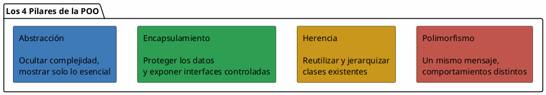
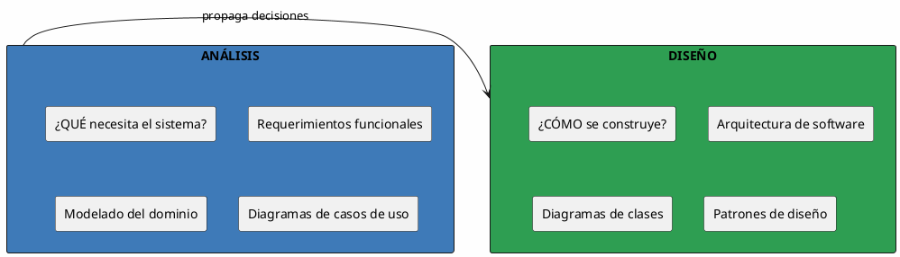
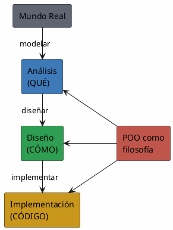

# 01 — Introducción al Paradigma Orientado a Objetos

> *"La orientación a objetos es más que una técnica de programación; es una forma de pensar sobre el mundo."* — Grady Booch

---

## ¿Qué es un paradigma de programación?

Un **paradigma** es un estilo o filosofía de programación. Define **cómo se estructura** el código, **cómo se organiza** la lógica y **cómo se resuelven** problemas. Históricamente han coexistido varios:

| Paradigma | Enfoque | Ejemplo de lenguaje |
| --- | --- | --- |
| **Imperativo** | Secuencia de instrucciones que modifican el estado | C, Pascal |
| **Estructurado** | Uso de bloques, ciclos y subrutinas | C, Ada |
| **Funcional** | Funciones puras, sin efectos secundarios | Haskell, Lisp, Elixir |
| **Orientado a Objetos** | Organización en objetos que encapsulan datos y comportamiento | Java, C#, Python, C++ |

> [!important] No son excluyentes
> La mayoría de lenguajes modernos son **multiparadigma**. Python es OO pero también funcional. Java es OO pero soporta programación funcional desde Java 8.

---

## Evolución: de lo procedural a lo orientado a objetos

### El problema del paradigma procedural

En un enfoque procedural, el código se organiza en **funciones** que operan sobre **datos** separados:

```
// Estructura procedural
struct Cuenta {
    float saldo;
    char titular[100];
};

void depositar(struct Cuenta *c, float monto) {
    c->saldo += monto;
}

void retirar(struct Cuenta *c, float monto) {
    if (c->saldo >= monto)
        c->saldo -= monto;
}
```

**Problemas:**
- Los datos están "desnudos" — cualquier función puede modificarlos.
- No hay protección ni validación automática.
- A medida que el sistema crece, las funciones se vuelven interdependientes y difíciles de mantener.

### La solución: encapsular datos + comportamiento

En POO, los datos y las operaciones que trabajan sobre ellos **viven juntos** dentro de un objeto:

```
// Estructura orientada a objetos
class Cuenta {
    private float saldo;
    private String titular;

    public void depositar(float monto) {
        if (monto > 0) saldo += monto;
    }

    public boolean retirar(float monto) {
        if (saldo >= monto) {
            saldo -= monto;
            return true;
        }
        return false;
    }
}
```

**Ventajas:**
- El saldo es **privado** — no se puede modificar desde fuera directamente.
- La validación vive **dentro** del objeto.
- El objeto es **autocontenido** y **reutilizable**.

---

## Los 4 pilares de la POO

La programación orientada a objetos se sustenta en **cuatro principios fundamentales**:



| Pilar | Pregunta que resuelve | Concepto clave |
| --- | --- | --- |
| **Abstracción** | ¿Qué necesito mostrar al usuario? | Modelo simplificado del mundo real |
| **Encapsulamiento** | ¿Cómo protejo los datos internos? | Modificadores de acceso, interfaces |
| **Herencia** | ¿Cómo reutilizo código entre clases? | Jerarquías de clases, superclase/subclase |
| **Polimorfismo** | ¿Cómo hago que se comporten distinto con la misma interfaz? | Sobrecarga, sobreescritura, ligadura dinámica |

> [!tip] Los veremos uno a uno en detalle
> Cada pilar tiene su propia nota de apuntes con ejemplos y diagramas PlantUML.

---

## Análisis vs. Diseño

Una distinción crucial en esta materia:



| Fase | Pregunta | Herramientas |
| --- | --- | --- |
| **Análisis** | ¿Qué debe hacer el sistema? | Casos de uso, historias de usuario, modelo de dominio |
| **Diseño** | ¿Cómo lo haremos? | Diagramas de clases, patrones, arquitectura, UML |

> [!warning] Error común
> Muchos saltan directamente al diseño (o a la codificación) sin haber completado el análisis. Esto lleva a sistemas que "funcionan" pero no resuelven bien el problema real.

---

## ¿Por qué UML?

**UML** (*Unified Modeling Language*) es el lenguaje estándar para diagramar sistemas orientados a objetos. No es un lenguaje de programación; es un **lenguaje visual** para comunicar diseño.

**UML no es opcional en el desarrollo profesional.** Permite que un equipo de 10 personas entienda el mismo diseño sin leer líneas de código.

> [!note] Ver también
> - [[Diagramas UML]] — tipología completa de los 14 diagramas
> - [[Diagrama de Casos de Uso]] — el primer diagrama que aprenderemos

---

## Resumen Visual



---

## Para reflexionar

> Pregunta para la siguiente clase: Si tuvieras que modelar un **sistema de estacionamiento**, ¿cuáles serían los objetos principales? ¿Qué datos tendría cada uno? ¿Qué acciones podrían realizar?

---

## Referencias

- Booch, G. — *Object-Oriented Analysis and Design with Applications*
- Fowler, M. — *UML Distilled*
- Gamma, E. et al. — *Design Patterns*
