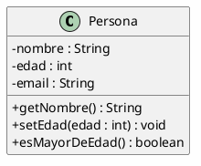
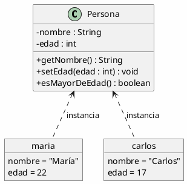
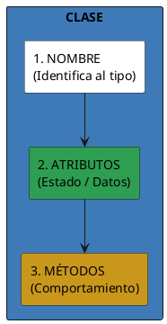
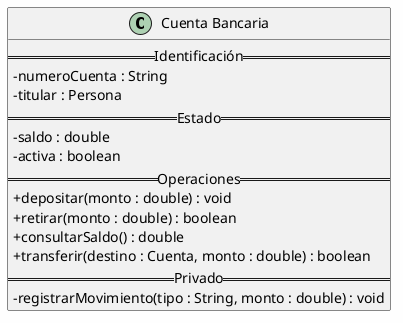
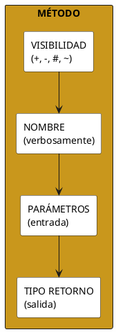
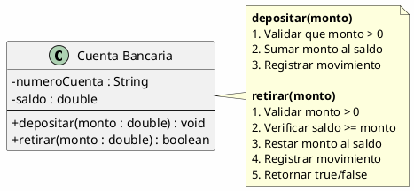
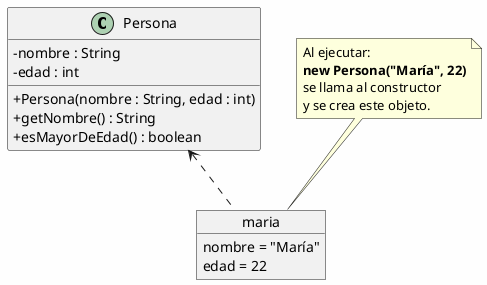
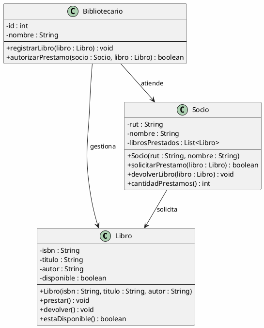
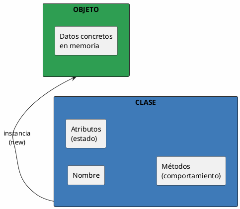

# 02 — Clases y Objetos

> *"Una clase es el plano; un objeto es la casa construida a partir de ese plano."*

---

## ¿Qué es una clase?

Una **clase** es la definición abstracta de un tipo de entidad. Es un **molde** o **plano** que describe:

- **Atributos** — qué datos almacena (estado)
- **Métodos** — qué comportamiento tiene (acciones)



| Sección | Visor UML | Significado |
| --- | --- | --- |
| `Persona` | Nombre arriba | El nombre de la clase |
| `- nombre : String` | `−` = privado | Atributo privado de tipo String |
| `+ getNombre()` | `+` = público | Método público que retorna un String |

---

## ¿Qué es un objeto?

Un **objeto** es una **instancia concreta** de una clase. Si la clase es el plano, el objeto es la casa:



> [!key] Distinción fundamental
> - **Clase** = tipo abstracto (existe una sola definición)
> - **Objeto** = instancia concreta (pueden existir miles)

---

## Anatomía de una clase

### Los tres componentes



### Ejemplo completo: Cuenta Bancaria



| Sección | Propósito |
| --- | --- |
| **Identificación** | Datos que identifican de forma única a la cuenta |
| **Estado** | Datos que cambian a lo largo de la vida del objeto |
| **Operaciones públicas** | Acciones que otros objetos pueden solicitar |
| **Privado** | Métodos internos que solo la propia clase usa |

---

## Atributos: el estado del objeto

### Tipos de atributos

| Tipo | Descripción | Ejemplo |
| --- | --- | --- |
| **Primitivos** | Valores simples | `int`, `double`, `boolean`, `char` |
| **Compuestos** | Objetos de otras clases | `Direccion`, `Fecha`, `Persona` |
| **Colectivos** | Colecciones de objetos | `List<Cuenta>`, `Map<String, Integer>` |

### Convenciones de nombre

```
- nombreCompleto : String      // camelCase, empieza con minúscula
- fechaNacimiento : Date       // descriptivo
- MAXIntentos : int            // CONSTANTES en MAYÚSCULAS
```

---

## Métodos: el comportamiento del objeto

### Estructura



### Ejemplo: crear cuenta



---

## Constructor: nacimiento del objeto

Un **constructor** es un método especial que se ejecuta al crear un objeto. Inicializa su estado.



---

## Diferencia: Clase vs. Objeto vs. Interfaz

| Concepto | ¿Qué es? | Ejemplo |
| --- | --- | --- |
| **Clase** | Definición / plano | `class Persona { String nombre; }` |
| **Objeto** | Instancia concreta en memoria | `Persona p = new Persona("Ana");` |
| **Interfaz** | Contrato de comportamiento (sin implementación) | `interface Serializable { }` |

---

## Ejemplo Integrador: Modelando una Biblioteca



---

## Resumen



> [!tip] Para la siguiente clase
> Piensa en 3 objetos del mundo real (una Mascota, un Vehículo, un Producto). ¿Cuáles serían sus atributos y métodos? ¿Qué restricciones de acceso tienen?
