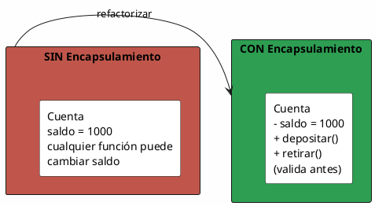
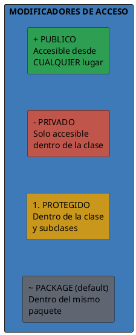
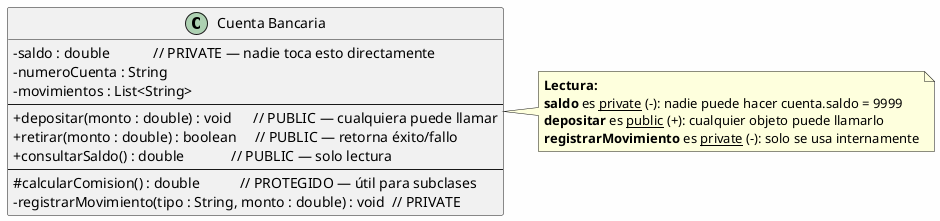
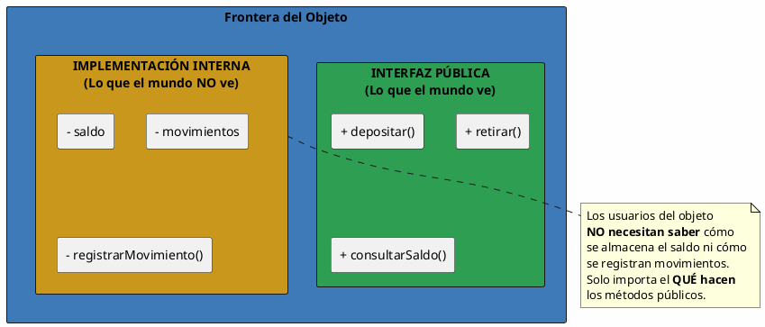
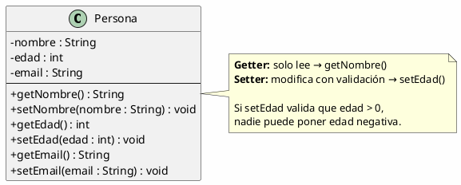
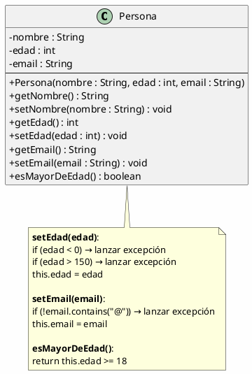

# 03 — Encapsulamiento y Modificadores de Acceso

> *"Encapsular es ponerle una cáscara a un objeto para que nadie vea su jugo interno."* — analogía

---

## ¿Qué es el encapsulamiento?

El **encapsulamiento** es el pilar de la POO que consiste en **ocultar los detalles internos** de un objeto y **exponer solo lo necesario** a través de una interfaz controlada.



### ¿Por qué es importante?

| Sin encapsulamiento | Con encapsulamiento |
| --- | --- |
| Cualquier parte del código puede modificar `saldo` directamente | Solo `depositar()` y `retirar()` pueden modificar `saldo` |
| No hay validación — se puede poner saldo negativo | Cada operación valida antes de actuar |
| Si cambia la lógica, hay que buscar en todo el código | Solo se cambia dentro de la clase |
| El objeto es frágil y dependiente de todo el sistema | El objeto es robusto y autocontenido |

---

## Los 4 modificadores de acceso



| Modificador | Palabra clave | Símbolo UML | Desde la clase | Subclase | Mismo paquete | Cualquier lugar |
| --- | --- | --- | --- | --- | --- | --- |
| **Público** | `public` | `+` | ✅ | ✅ | ✅ | ✅ |
| **Protegido** | `protected` | `#` | ✅ | ✅ | ✅ | ❌ |
| **Package** | *(sin palabra)* | `~` | ✅ | ❌ | ✅ | ❌ |
| **Privado** | `private` | `-` | ✅ | ❌ | ❌ | ❌ |

---

## Ejemplo: Cuenta Bancaria encapsulada



### Código de ejemplo (pseudocódigo Java)

```java
public class CuentaBancaria {
    // Atributos privados — ocultos al mundo exterior
    private double saldo;
    private String numeroCuenta;
    private List<String> movimientos;

    // Constructor
    public CuentaBancaria(String numero, double saldoInicial) {
        this.numeroCuenta = numero;
        this.saldo = saldoInicial;
        this.movimientos = new ArrayList<>();
    }

    // Método público — interfaz controlada
    public void depositar(double monto) {
        if (monto <= 0) {
            throw new IllegalArgumentException("El monto debe ser positivo");
        }
        saldo += monto;
        registrarMovimiento("DEPOSITO", monto);
    }

    // Método público — con lógica de validación
    public boolean retirar(double monto) {
        if (monto <= 0 || monto > saldo) {
            return false;
        }
        saldo -= monto;
        registrarMovimiento("RETIRO", monto);
        return true;
    }

    // Método público — solo lectura
    public double consultarSaldo() {
        return saldo;
    }

    // Método privado — solo la clase lo usa internamente
    private void registrarMovimiento(String tipo, double monto) {
        movimientos.add(tipo + ": $" + monto);
    }
}
```

---

## El principio de información oculta

> *"Todo objeto tiene una frontera. Lo que está adentro es su responsabilidad; lo que está afuera es el contrato con el resto del mundo."*



---

## Getters y Setters: acceso controlado

Los **getters** y **setters** permiten acceder y modificar atributos privados de forma controlada:



### ¿Cuándo usar cada uno?

| Escujo | Acceso | Ejemplo |
| --- | --- | --- |
| Solo lectura | Solo getter | `consultarSaldo()` — nadie puede modificar el saldo directamente |
| Lectura + escritura | Getter + Setter | `setNombre()` — con validación interna |
| Solo escritura | Setter sin getter | `registrarAcceso()` — se registra pero no se consulta externamente |

---

## Ejemplo Integrador: Persona con validación



---

## Errores comunes

| Error | Ejemplo incorrecto | Por qué está mal |
| --- | --- | --- |
| Atributo público directo | `public double saldo;` | Cualquiera puede hacer `cuenta.saldo = -1000` |
| Setter sin validación | `public void setEdad(int e) { this.edad = e; }` | Permite edad = -5 |
| Todo público | Todos los atributos y métodos son `public` | No hay encapsulamiento, el objeto es frágil |
| Getter + Setter de todo | Siempre `getX()` + `setX()` para cada atributo | Muchos atributos solo necesitan lectura (ej: `numeroCuenta`) |

> [!tip] Regla práctica
> Por defecto, los atributos siempre son **privados**. Solo se hace público algo si es estrictamente necesario. Los métodos se hacen públicos según el **contrato** que el objeto ofrece al mundo exterior.
