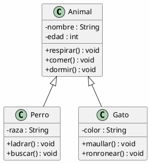
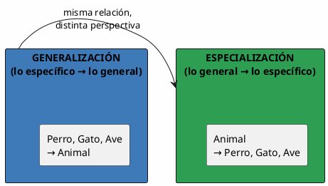
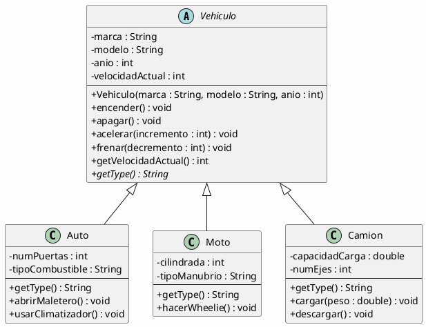
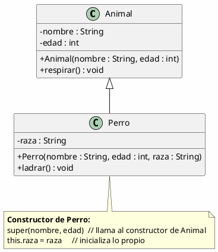
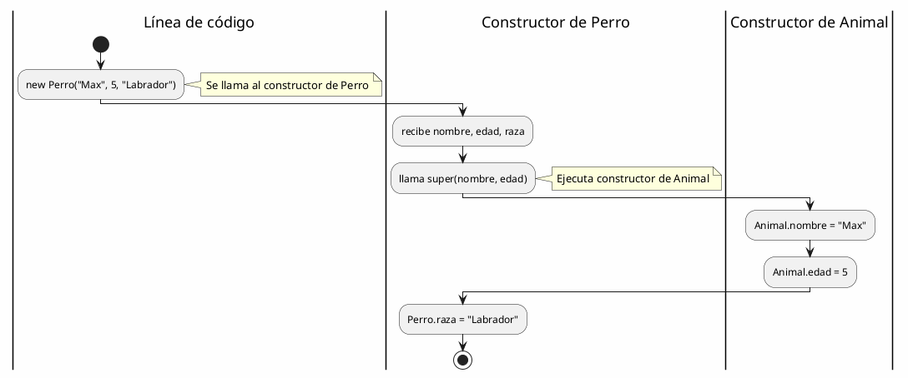
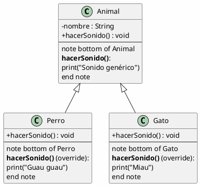
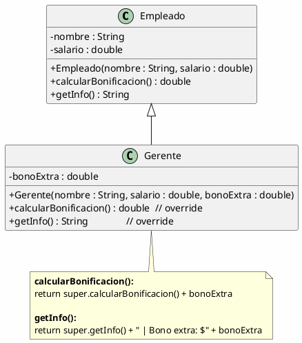
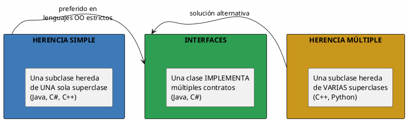
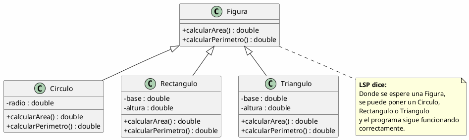
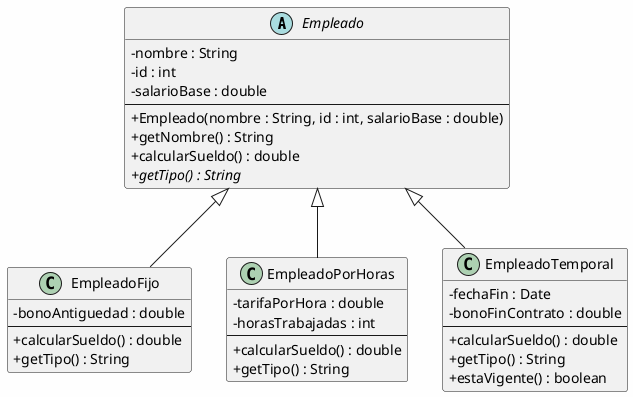

# 04 — Herencia y Generalización

> *"La herencia permite construir nuevas clases a partir de las existentes, reutilizando código y estableciendo jerarquías naturales."*

---

## ¿Qué es la herencia?

La **herencia** es un mecanismo que permite crear una **nueva clase** (subclase) basándose en una **clase existente** (superclase). La subclase **hereda** atributos y métodos de la superclase, y puede **agregar** o **modificar** comportamiento.



> [!note] Notación UML
> La **flecha con triángulo vacío** (`▷`) apunta de la subclase a la superclase. Se lee: "Perro **es un** Animal".

---

## Generalización vs. Especialización

| Concepto | Dirección | Ejemplo |
| --- | --- | --- |
| **Generalización** | De lo específico a lo general | Perro, Gato, Ave → Animal |
| **Especialización** | De lo general a lo específico | Animal → Perro, Gato, Ave |



---

## Ejemplo Completo: Vehículos



### ¿Qué hereda cada subclase?

| Hereda de Vehiculo | Auto añade | Moto añade | Camion añade |
| --- | --- | --- | --- |
| `marca`, `modelo`, `anio`, `velocidadActual` | `numPuertas`, `tipoCombustible` | `cilindrada`, `tipoManubrio` | `capacidadCarga`, `numEjes` |
| `encender()`, `apagar()`, `acelerar()`, `frenar()` | `abrirMaletero()`, `usarClimatizador()` | `hacerWheelie()` | `cargar()`, `descargar()` |

---

## El constructor en la herencia



### Flujo de construcción



---

## Sobrescritura de métodos (Override)

Una subclase puede **reescribir** un método de la superclase para cambiar su comportamiento:



```java
// Superclase
public class Animal {
    public void hacerSonido() {
        System.out.println("Sonido genérico");
    }
}

// Subclase
public class Perro extends Animal {
    @Override  // anotación que indica override
    public void hacerSonido() {
        System.out.println("Guau guau");
    }
}
```

---

## super: acceder a la superclase

La palabra clave `super` permite invocar **métodos o constructores** de la superclase:



---

## Tipos de herencia



| Tipo | Lenguaje | Ejemplo |
| --- | --- | --- |
| **Simple** | Java, C#, C++ | `class Perro extends Animal` |
| **Múltiple** | C++, Python | `class A(B, C, D)` |
| **Interfaces** | Java, C# | `class A implements X, Y, Z` |

---

## Principio de sustitución de Liskov (LSP)

> *"Si S es un subtipo de T, entonces los objetos de tipo T pueden ser reemplazados por objetos de tipo S sin alterar las propiedades correctas del programa."*



---

## Ejemplo Integrador: Sistema de Empleados



### Flujo de ejecución

```plantuml
@startuml
skinparam backgroundColor #FEFEFE

start
:Crear lista de empleados;
:Empleado e1 = new EmpleadoFijo("Ana", 1, 500000);
:Empleado e2 = new EmpleadoPorHoras("Luis", 2, 5000);
:Empleado e3 = new EmpleadoTemporal("Pedro", 3, 600000);

:Calcular sueldo de cada uno;
:e1.calcularSueldo();  // → EmpleadoFijo: 500000 + bonoAntiguedad
:e2.calcularSueldo();  // → EmpleadoPorHoras: tarifa * horas
:e3.calcularSueldo();  // → EmpleadoTemporal: salarioBase + bonoFin

stop
@enduml
```

---

## Resumen

| Concepto | Descripción |
| --- | --- |
| **Superclase** | Clase de la que se hereda (padre) |
| **Subclase** | Clase que hereda (hijo) |
| **Herencia** | Mecanismo de reutilización y jerarquía |
| **Override** | Reescribir un método de la superclase |
| **super** | Acceder a miembros de la superclase |
| **abstract** | Clase/método que no se puede instanciar directamente |
| **LSP** | Los subtipos deben ser sustituibles por sus supertipos |

> [!tip] Para la siguiente clase
> Diseña una jerarquía de **Formas Geométricas** (Círculo, Rectángulo, Triángulo) que hereden de una clase abstracta `Forma`. Cada una debe implementar `calcularArea()` y `calcularPerimetro()`. ¿Qué otros métodos comunes podrían compartir?
