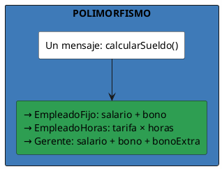
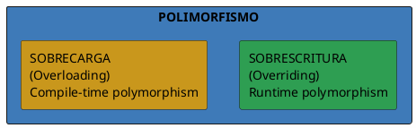
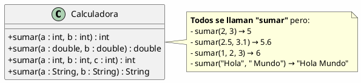
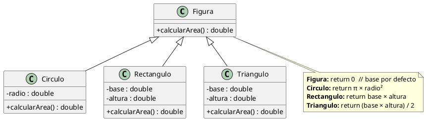
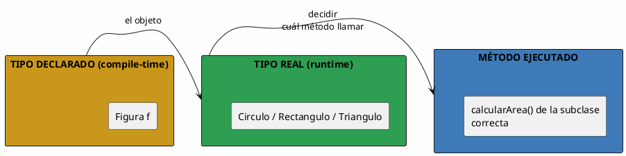
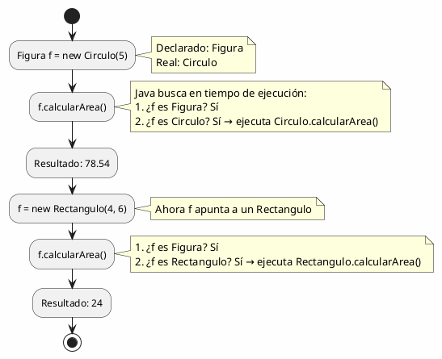
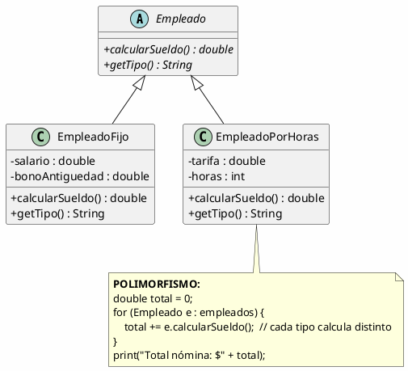
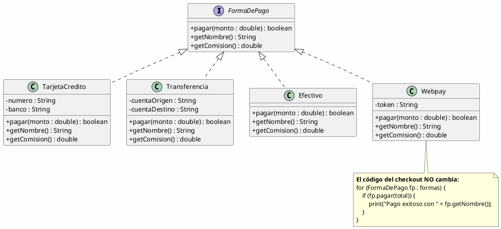
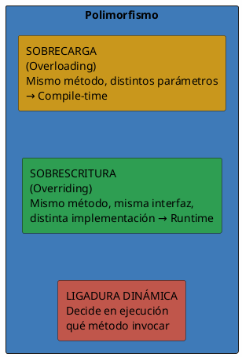

# 05 — Polimorfismo

> *"Polimorfismo significa 'muchas formas'. Un mismo mensaje puede producir comportamientos distintos según el objeto que lo reciba."*

---

## ¿Qué es el polimorfismo?

El **polimorfismo** es la capacidad de un mismo método de tener **comportamientos diferentes** dependiendo del tipo de objeto que lo invoca. Es el pilar que permite escribir código **genérico** que funciona con muchos tipos.



---

## Los dos tipos de polimorfismo



### 1. Sobrecarga (Overloading)

**Mismo nombre, diferentes parámetros.** Se resuelve en tiempo de compilación.



| Llamada | Método invocado | Retorno |
| --- | --- | --- |
| `sumar(2, 3)` | `sumar(int, int)` | `5` |
| `sumar(2.5, 3.1)` | `sumar(double, double)` | `5.6` |
| `sumar(1, 2, 3)` | `sumar(int, int, int)` | `6` |

### 2. Sobreescritura (Overriding)

**Mismo nombre, mismos parámetros, diferente implementación.** Se resuelve en tiempo de ejecución.



---

## La magia del polimorfismo en acción

```plantuml
@startuml
skinparam backgroundColor #FEFEFE

start
:List<Figura> figuras = new ArrayList<>();
:figuras.add(new Circulo(5));
:figuras.add(new Rectangulo(4, 6));
:figuras.add(new Triangulo(3, 8));

:double total = 0;
:for (Figura f : figuras) {
    total += f.calcularArea();
}

note right
  En tiempo de ejecución, Java
  "sabe" que:
  - f1 es Circulo → llama Circulo.calcularArea()
  - f2 es Rectangulo → llama Rectangulo.calcularArea()
  - f3 es Triangulo → llama Triangulo.calcularArea()
end note

:total = 78.54 + 24 + 12 = 114.54;

stop
@enduml
```

> [!key] El punto clave
> El código que itera **no sabe** qué tipo concreto de Figura es cada una. Solo sabe que **todas son Figuras** y que todas tienen `calcularArea()`. El polimorfismo se encarga de elegir la implementación correcta.

---

## Ligadura dinámica (Dynamic Binding)

La **ligadura dinámica** es el mecanismo por el cual el lenguaje decide **en tiempo de ejecución** qué método invocar, basándose en el tipo real del objeto.



### Ejemplo de ligadura dinámica



---

## Polimorfismo con colecciones

El verdadero poder del polimorfismo se ve al trabajar con **colecciones de tipo base**:



---

## Sobrecarga vs. Sobreescritura

| Característica | Sobrecarga (Overloading) | Sobreescritura (Overriding) |
| --- | --- | --- |
| **Nombre** | Igual | Igual |
| **Parámetros** | Diferentes | Iguales |
| **Relación de clases** | Misma clase (o herencia) | Superclase ↔ Subclase |
| **Tipo de polimorfismo** | Compile-time (estático) | Runtime (dinámico) |
| **Palabra clave** | Ninguna | `@Override` |
| **Determinado por** | El compilador, según argumentos | El tipo real del objeto, en ejecución |

---

## Ejemplo Integrador: Sistema de Pagos



---

## Resumen



> [!tip] Para la siguiente clase
> Crea una jerarquía de `FormaDePago` con al menos 3 implementaciones. Escribe un programa que procese una lista de pagos usando polimorfismo, calculando el total de comisiones sin saber de antemano qué formas de pago habrá.
