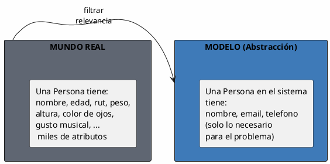
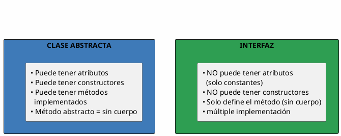
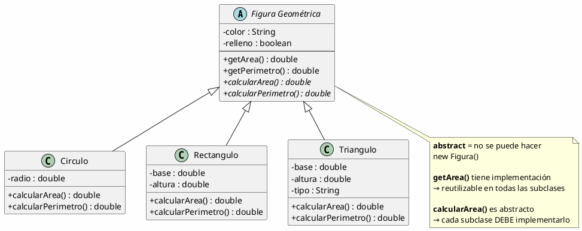
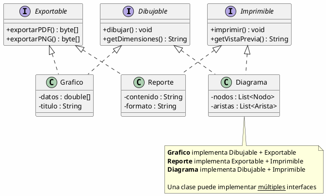
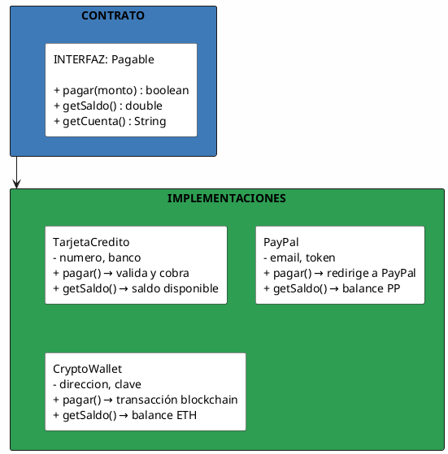
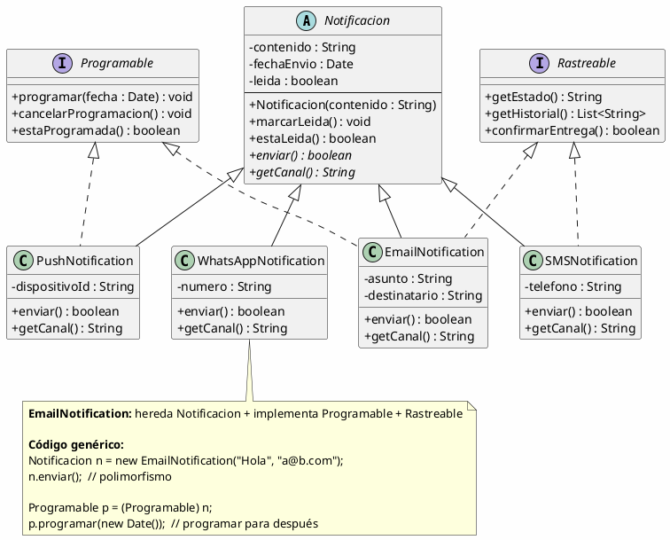
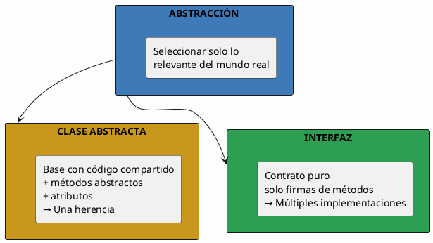

# 06 — Abstracción e Interfaces

> *"La abstracción es seleccionar solo lo relevante del mundo real y descartar lo irrelevante para el problema que estamos resolviendo."*

---

## ¿Qué es la abstracción?

La **abstracción** es el proceso de **modelar solo las características esenciales** de un objeto, ignorando los detalles que no son relevantes para el contexto.



### Ejemplo

| Objeto real | Abstracción en sistema de mensajería | Abstracción en sistema médico |
| --- | --- | --- |
| Persona | nombre, email, telefono | nombre, rut, edad, alergias, sangre |

> [!key] La misma entidad se abstrae de forma diferente según el **problema** que se resuelve.

---

## Clase Abstracta vs. Interfaz

Son los dos mecanismos de abstracción en POO:



---

## Clases Abstractas

Una **clase abstracta** es una clase que **no se puede instanciar** directamente. Sirve como base para sus subclases.

### Diagrama UML



### Código de ejemplo

```java
public abstract class Figura {
    protected String color;
    protected boolean relleno;

    public Figura(String color) {
        this.color = color;
    }

    // Método CON implementación → reutilizable
    public String getArea() {
        return "Área: " + calcularArea();
    }

    // Método abstracto → cada subclase DEBE implementarlo
    public abstract double calcularArea();
    public abstract double calcularPerimetro();
}

public class Circulo extends Figura {
    private double radio;

    public Circulo(String color, double radio) {
        super(color);
        this.radio = radio;
    }

    @Override
    public double calcularArea() {
        return Math.PI * radio * radio;
    }

    @Override
    public double calcularPerimetro() {
        return 2 * Math.PI * radio;
    }
}
```

---

## Interfaces

Una **interfaz** es un **contrato** que define qué métodos debe implementar una clase, sin decir cómo.



---

## Contrato: qué promete la interfaz



---

## Diferencia Clase Abstracta vs. Interfaz

| Característica | Clase Abstracta | Interfaz |
| --- | --- | --- |
| **Atributos** | Puede tener atributos con estado | Solo constantes (`static final`) |
| **Constructores** | Puede tener constructores | No puede tener constructores |
| **Métodos con implementación** | Puede tener métodos con cuerpo | No (solo definición) |
| **Métodos abstractos** | Puede tener (con `abstract`) | Todos son abstractos (por defecto) |
| **Herencia múltiple** | No (una sola superclase) | Sí (múltiples interfaces) |
| **¿Cuándo usar?** | Cuando las subclases comparten código y estado | Cuando defines un contrato que múltiples clases pueden cumplir |

---

## Ejemplo Integrador: Sistema de Notificaciones



---

## Resumen Visual



> [!tip] Para la siguiente clase
> Diseña un sistema de **compresión de archivos** con una interfaz `Compresor` y al menos 3 implementaciones (ZIP, RAR, GZIP). Incluye también una clase abstracta `ArchivoComprimido` que comparta lógica común. ¿Qué métodos irían en la interfaz y cuáles en la clase abstracta?
