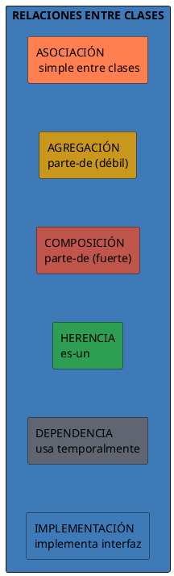
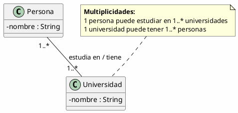
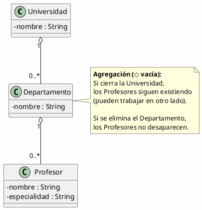
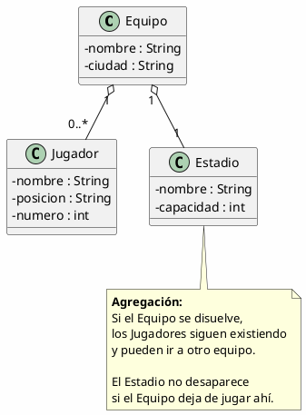
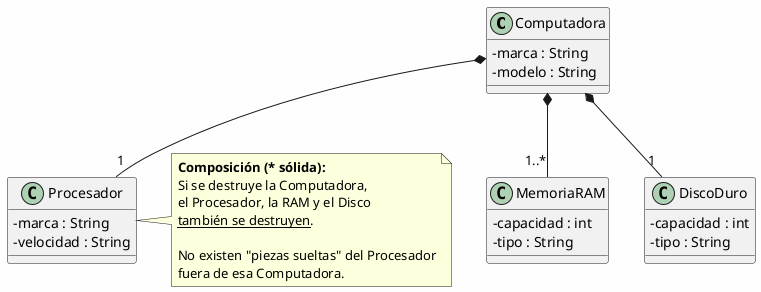
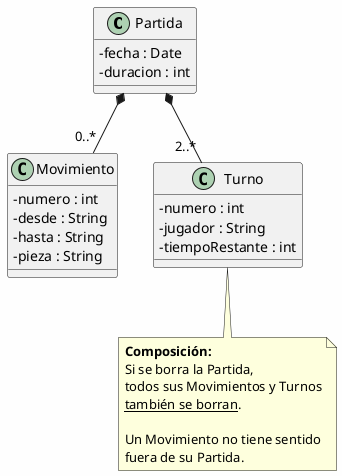
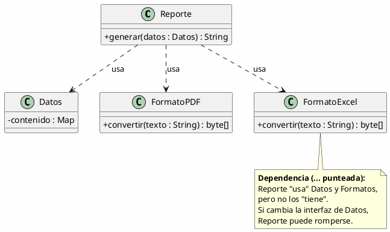
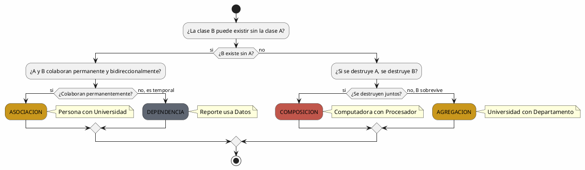
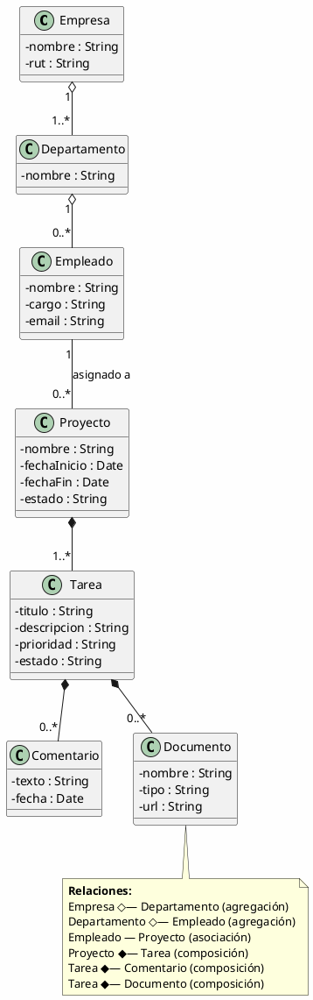

# 07 — Relaciones entre Clases

> *"Las clases no viven aisladas. Las relaciones entre ellas definen la arquitectura del sistema."*

---

## Tipos de relaciones

---

## 1. Asociación

Relación **general** entre dos clases que se conocen entre sí y **colaboran**.

### Notación UML

### Multiplicidades

| Multiplicidad | Significado |
| --- | --- |
| `1` | Exactamente uno |
| `0..1` | Cero o uno (opcional) |
| `*` | Muchos (cero o más) |
| `1..*` | Uno o más |
| `0..*` | Cero o más |
| `3..5` | Entre 3 y 5 |

---

## 2. Agregación (relación "parte-de" débil)

Una clase **contiene** a otra pero **ambas existen independientemente**. Si se destruye el todo, las partes **sobreviven**.

### Notación UML

### Ejemplo concreto

---

## 3. Composición (relación "parte-de" fuerte)

Una clase **contiene** a otra y **controla su ciclo de vida**. Si se destruye el todo, las partes **se destruyen** también.

### Notación UML

### Ejemplo concreto

---

## 4. Dependencia

Una clase **usa temporalmente** a otra (por ejemplo, como parámetro de un método). No hay relación permanente.

### Notación UML

---

## Comparación de relaciones

| Relación | Notación | Ciclo de vida | Ejemplo |
| --- | --- | --- | --- |
| **Asociación** | `—` sólida | Independientes | Persona ↔ Universidad |
| **Agregación** | `o—` diamante vacío | Independientes | Universidad ◇— Departamento |
| **Composición** | `*—` diamante sólido | Dependientes | Computadora ◆— Procesador |
| **Dependencia** | `...>` punteada | Temporal | Reporte usa Datos |
| **Herencia** | `▷` triángulo | Jerarquía | Perro ▷ Animal |

---

## Decidir la relación correcta

---

## Ejemplo Integrador: Sistema de Gestión de Proyectos

---

## Resumen

| Relación | Fuerza | Ciclo de vida | Notación |
| --- | --- | --- | --- |
| Asociación | Débil | Independiente | Línea sólida |
| Agregación | Media | Independiente | Diamante vacío `◇` |
| Composición | Fuerte | Dependiente | Diamante sólido `◆` |
| Herencia | Fuerte | Jerarquía | Triángulo `▷` |
| Dependencia | Muy débil | Temporal | Flecha punteada `...>` |

> [!tip] Para la siguiente clase
> Modela un **sistema de e-commerce** identificando las relaciones entre: Cliente, Pedido, Producto, Carrito, Pago y Factura. Para cada relación, indica si es asociación, agregación o composición y justifica tu decisión.
