# 08 — Principios SOLID

> *"SOLID son los 5 principios de diseño orientado a objetos que, cuando se aplican, producen sistemas fáciles de mantener, extender y reutilizar."* — Robert C. Martin (Uncle Bob)

---

## Visión General

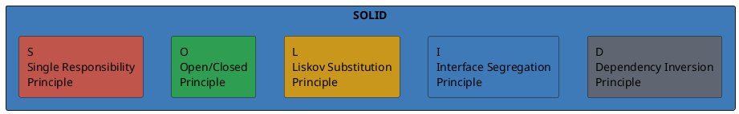

| Letra | Principio | En una frase |
| --- | --- | --- |
| **S** | Single Responsibility | Una clase = una sola razón para cambiar |
| **O** | Open/Closed | Abierto a extensión, cerrado a modificación |
| **L** | Liskov Substitution | Los subtipos deben ser sustituibles por sus supertipos |
| **I** | Interface Segregation | Mejor muchas interfaces específicas que una general |
| **D** | Dependency Inversion | Depender de abstracciones, no de implementaciones concretas |

---

## S — Single Responsibility (Responsabilidad Única)

> *"Una clase debería tener solo una razón para cambiar."*

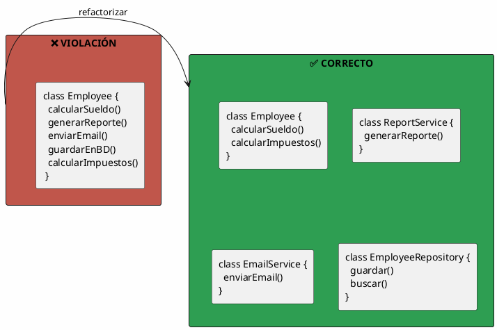

### Ejemplo

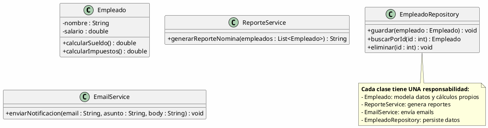

---

## O — Open/Closed (Abierto/Cerrado)

> *"Las entidades de software deben estar abiertas a la extensión pero cerradas a la modificación."*

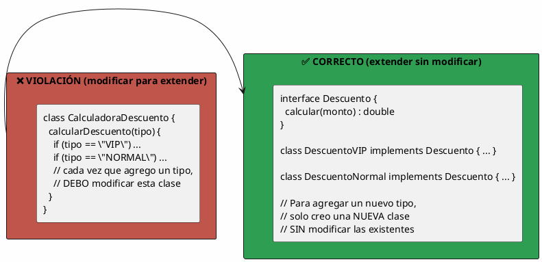

### Ejemplo

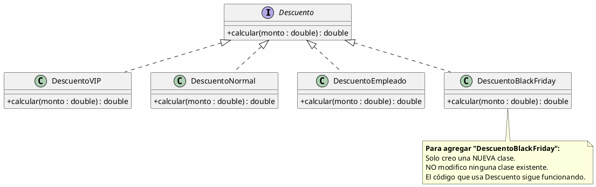

---

## L — Liskov Substitution (Sustitución de Liskov)

> *"Si S es un subtipo de T, entonces los objetos de tipo T pueden ser reemplazados por objetos de tipo S sin alterar las propiedades correctas del programa."*

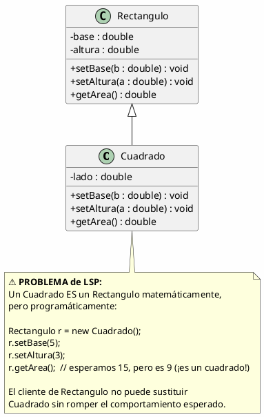

### Solución correcta

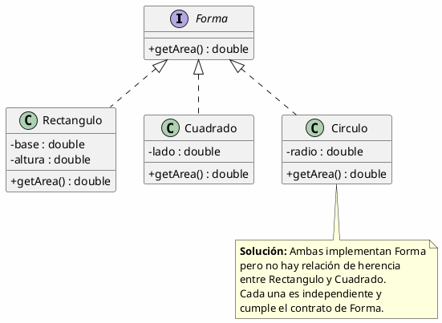

---

## I — Interface Segregation (Segregación de Interfaces)

> *"Ningún cliente debería ser forzado a depender de métodos que no usa."*

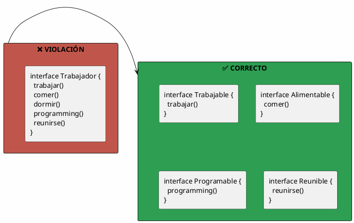

### Ejemplo

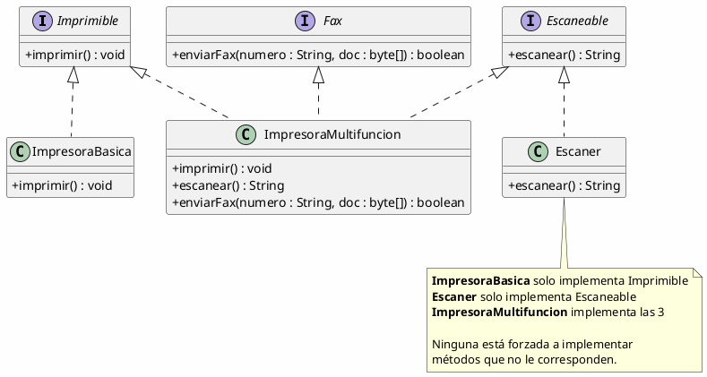

---

## D — Dependency Inversion (Inversión de Dependencias)

> *"Los módulos de alto nivel no deben depender de los de bajo nivel. Ambos deben depender de abstracciones."*

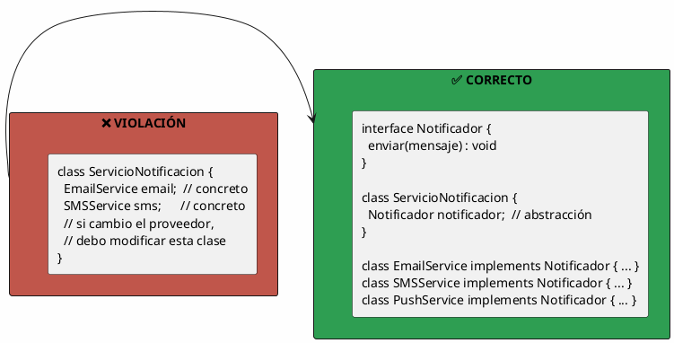

### Ejemplo

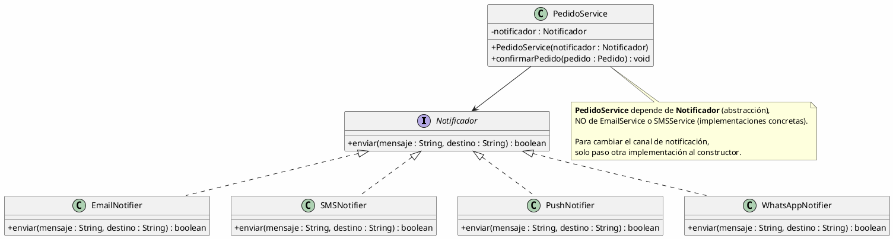

---

## Resumen Visual

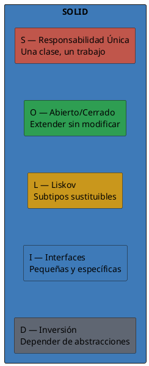

---

## ¿Por qué importan SOLID?

| Sin SOLID | Con SOLID |
| --- | ---|
| Clases grandes y difíciles de mantener | Clases pequeñas y enfocadas |
| Modificar una cosa rompe otras | Los cambios son locales |
| Difícil de testear | Fácil de mockear y testear |
| Acoplamiento alto entre componentes | Componentes independientes |
| Duplicación de código | Reutilización natural |

> [!tip] Para la siguiente clase
> Revisa el código de un proyecto existente (o inventa uno simple). Identifica al menos **una violación de cada principio SOLID** y propón cómo refactorearla aplicando el principio correspondiente.
