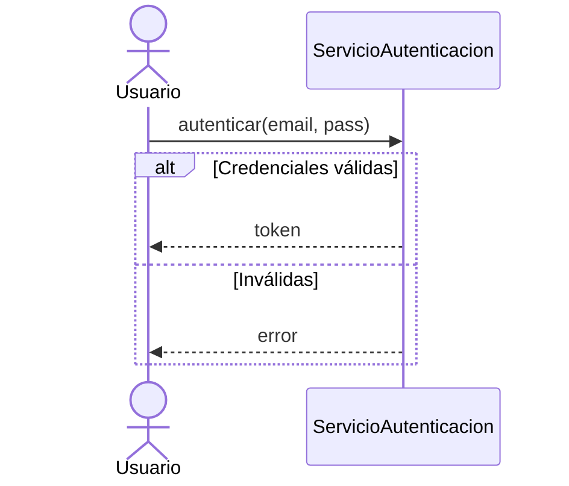
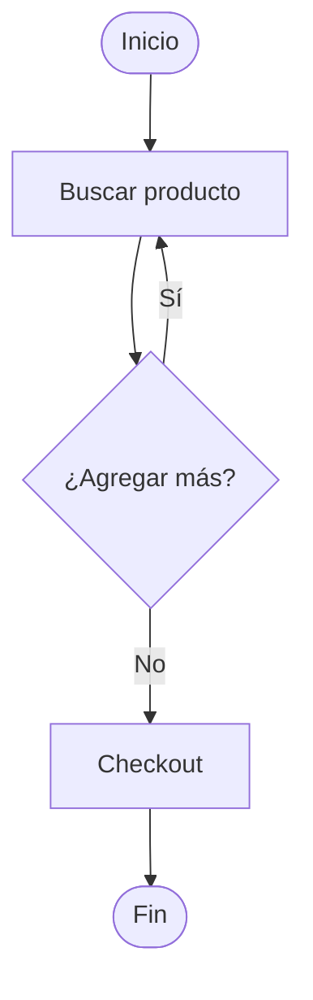

## 10. Principios SOLID

| Letra | Principio | En una frase |
| --- | --- | --- |
| S | Single Responsibility | Una clase = una sola razón para cambiar |
| O | Open/Closed | Abierta a extensión, cerrada a modificación |
| L | Liskov Substitution | Subtipos sustituibles por supertipos (Cuadrado ≠ heredar de Rectángulo → usar interfaz `Forma`) |
| I | Interface Segregation | Mejor muchas interfaces específicas que una general (Imprimible / Escaneable / Fax) |
| D | Dependency Inversion | Depender de abstracciones (interfaz `Notificador`), no de implementaciones concretas |

Beneficios: clases pequeñas, cambios locales, fácil de testear, componentes independientes, reutilización.

## 11. UML — Visión General

**UML** (*Unified Modeling Language*) = lenguaje de modelado visual estándar para sistemas OO. No es un método ni proceso: es un lenguaje gráfico para comunicar diseño.

**14 diagramas en 2 categorías:**

| Estructurales (estáticos) | Comportamentales (dinámicos) |
| --- | --- |
| Clases · Objetos · Componentes · Despliegue · Paquetes · Estructura compuesta · Perfiles | Casos de uso · Secuencia · Actividad · Máquina de estados · Comunicación · Temporal · Interacción general |

- **Relación entre diagramas:** casos de uso = qué hace; clases = con qué estructura; secuencia = cómo interactúan; actividad = flujo del proceso; estados = ciclo de vida.
- **Más usados en OO:** clases, casos de uso, secuencia, actividad.
- **Herramientas:** Draw.io/diagrams.net, Lucidchart, PlantUML, StarUML, Mermaid.

## 12. Diagrama de Casos de Uso

**Def:** funcionalidades del sistema desde la perspectiva de los usuarios; muestra **qué** hace, no cómo. Clave en análisis de requerimientos.

| Elemento | Símbolo | Descripción |
| --- | --- | --- |
| Actor | Hombre palo | Entidad externa (usuario, sistema, dispositivo) |
| Caso de uso | Óvalo | Funcionalidad que el sistema ofrece |
| Sistema | Rectángulo | Límite del sistema |
| Relaciones | Líneas/flechas | Conexiones |

**Relaciones:**
- **Asociación** — línea sólida actor ↔ caso de uso.
- **`<<include>>`** — el caso **siempre** invoca a otro (obligatorio).
- **`<<extend>>`** — agregado **opcional** bajo ciertas condiciones.
- **Generalización** — triángulo vacío (herencia entre actores o casos).

**Buenas prácticas:** nombrar verbo + sustantivo en infinitivo ("Retirar dinero"); unidad de funcionalidad completa con valor para el actor; sin detalles de implementación; distinguir actores principales y secundarios.

**Ejemplo conceptual:**

```
┌─────────── Sistema Banco ───────────┐
│ (Iniciar sesión)                    │
│ (Transferir) ──<<include>>── (Validar PIN)  │
│ (Retirar) ──<<extend>>── (Imprimir comprobante) │
└─────────────────────────────────────┘
        [Cliente]           [Admin]
```

**Ejemplos aplicados (resumen):**

| Sistema | Actores | `<<include>>` clave | `<<extend>>` |
| --- | --- | --- | --- |
| **Hospitalario** | Paciente, Médico, Enfermero, Administrador + Laboratorio y Farmacia (externos) | Agendar cita ← Registrarse + Gestionar agenda; Atender consulta ← Registrar diagnóstico; Aplicar medicación ← Despachar; Solicitar examen ← Procesar | Solicitar receta ← Emitir receta; Reportar incidencia ← Administrar tratamiento |
| **Bancario** | Cliente, Cajero, Asesor + Sistema Central (externo) | Transferir/Retirar/Pagar ← Verificar fondos + Registrar transacción; Solicitar préstamo ← Evaluar riesgo | Validar identidad ← Iniciar sesión |
| **E-commerce** | Cliente, Vendedor, Administrador + Pasarela de Pagos (externa) | Realizar compra ← Pagar + Iniciar sesión; Agregar al carrito ← Ver detalle | Cancelar pedido ← Realizar compra |
| **Biblioteca** | Socio, Bibliotecario + Sistema de Notificaciones (externo) | Reservar ← Ver detalle + Consultar préstamos; Devolver ← Registrar devolución; Registrar préstamo ← Buscar libro | Notificar vencimiento; Confirmar reserva |

## 13. Diagrama de Clases

**Def:** estructura **estática** del sistema (el "plano de la casa"): clases, atributos, métodos y relaciones. El más utilizado en diseño OO.

- **Anatomía:** rectángulo de 3 secciones (nombre / atributos / métodos). Visibilidad: ver sección 5.
- **Tipos de atributos:** `String`, `int`, `float`, `boolean`, `Date`. **Tipos de métodos:** constructor, getter, setter, acción.
- **Cardinalidad:** `Cliente 1 → 0..* Pedido` · `Pedido 1 → 1..* DetallePedido` · `Producto 1 → 0..* DetallePedido`.
- **Consejos:** empezar por las clases principales; solo atributos relevantes; métodos = comportamientos (no solo getters/setters); definir relaciones y cardinalidad; usar herencia para tipos especializados; **preferir composición sobre herencia**.

## 14. Diagrama de Secuencia

**Def:** interacción entre objetos **ordenada cronológicamente** (arriba → abajo); ideal para detallar un caso de uso concreto.

| Elemento | Símbolo | Descripción |
| --- | --- | --- |
| Actor | `actor` | Externo, inicia la interacción |
| Participante | Rectángulo | Objeto que participa |
| Línea de vida | Línea vertical punteada | Existencia en el tiempo |
| Barra de activación | Rectángulo sobre la línea | Período activo |
| Mensaje | Flecha | Comunicación |

**Tipos de mensajes:** síncrono `->` (espera respuesta) · asíncrono `-->` (no espera) · retorno `-->` (respuesta) · creación (`new`) · destrucción (X).

**Fragmentos (frames):** `alt` if/else · `opt` if simple · `loop` ciclo · `par` paralelo · `break` interrupción.

**Mini ejemplo (autenticación):**



Regla práctica: si el flujo se explica con "primero, después, si, mientras" → es de secuencia.

## 15. Diagrama de Actividad

**Def:** flujo de trabajo paso a paso (procesos de negocio, algoritmos) con decisiones, paralelismos y ciclos.

| Elemento | Símbolo | Descripción |
| --- | --- | --- |
| Inicio | Círculo negro ● | Punto de partida |
| Fin | Círculo con borde ◎ | Terminación |
| Actividad | Rectángulo redondeado | Acción/tarea |
| Decisión | Rombo | Bifurcación if/else |
| Barrido | Barra gruesa | Paralelismo |
| Flujo | Flecha | Dirección |

Notaciones avanzadas: **Swimlane** (carriles = quién hace cada actividad) y **Signal** (eventos externos que interrumpen).

**Mini ejemplo (compra):**



Regla práctica: >20 nodos → dividir en subprocesos.

## 16. Scrum

**Def:** marco de trabajo **ágil** (no es proceso rígido) que organiza el trabajo en **Sprints** de 1–4 semanas con entrega incremental. Vs. Waterfall: planificación continua, entrega cada 2–4 semanas, requisitos evolutivos, feedback constante.

| Pilar | Significado |
| --- | --- |
| Transparencia | Visibilidad total del proceso (tablero visible) |
| Inspección | Revisión periódica (Daily Scrum) |
| Adaptación | Ajustar el rumbo (retrospectiva) |

**Valores:** compromiso, enfoque, apertura, respeto, coraje.

**Roles:**

| Rol | Función |
| --- | --- |
| Product Owner | Maximiza valor; crea/prioriza Product Backlog; acepta o rechaza trabajo |
| Scrum Master | Facilita eventos, elimina bloqueos, coach (servidor líder, no jefe) |
| Development Team | 3–9 miembros, multifuncional, auto-organizado, sin sub-roles |

**Artefactos:**

| Artefacto | Descripción |
| --- | --- |
| Product Backlog | Lista ordenada por valor/riesgo; unidad = historia de usuario (**Como… quiero… para que…** + criterios de aceptación) |
| Sprint Backlog | Historias seleccionadas + tareas del Sprint |
| Incremento | Suma de historias completadas; potencialmente entregable (*shippable*) |

**Eventos:** Sprint (ciclo fijo) · Planning (máx 8 h: objetivo + backlog) · Daily (máx 15 min: ¿qué hice? ¿qué haré? ¿bloqueos?) · Review (máx 4 h: demo + feedback) · Retrospective (máx 3 h: qué salió bien / mejorar / acciones).

**Planning Poker:** estimación con cartas Fibonacci (0,1,2,3,5,8,13,21) reveladas en simultáneo → discutir diferencias → consenso.

**Definition of Done:** checklist de calidad por equipo (código revisado, pruebas, docs, staging, aceptación del PO); si no cumple todo, **no está terminado**.

## 17. Referencias

- Booch, G. — *Object-Oriented Analysis and Design with Applications*
- Fowler, M. — *UML Distilled*
- Larman, C. — *Applying UML and Patterns*
- Gamma, E. et al. — *Design Patterns*
- Schwaber & Sutherland — *The Scrum Guide*
- Cohn, M. — *User Stories Applied*