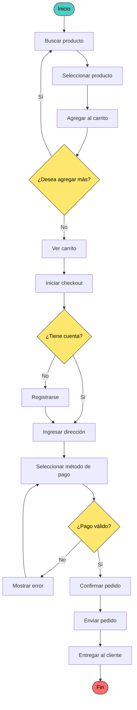
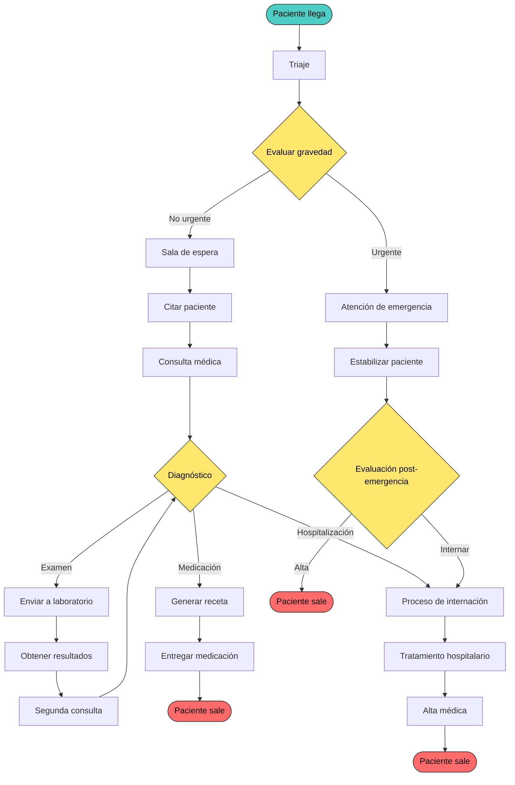
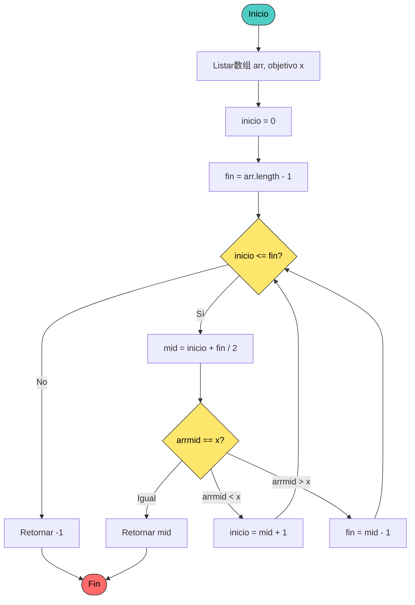
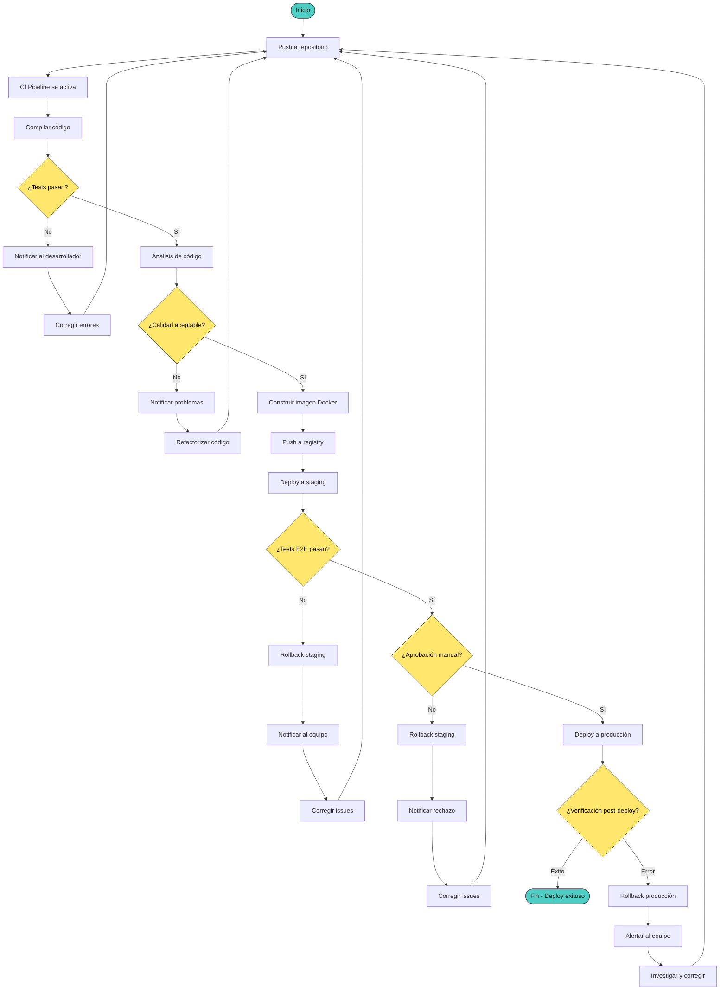
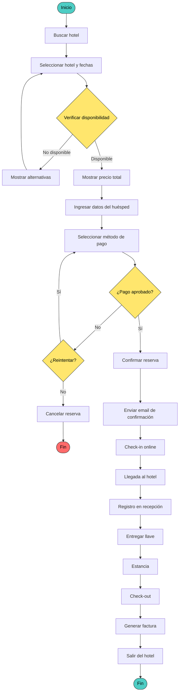
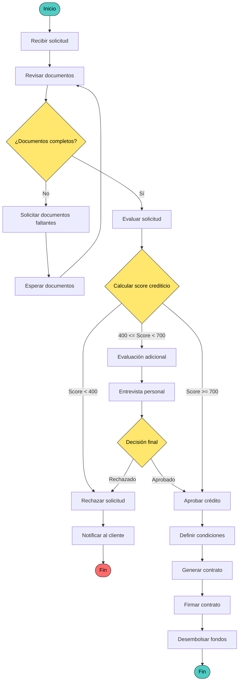
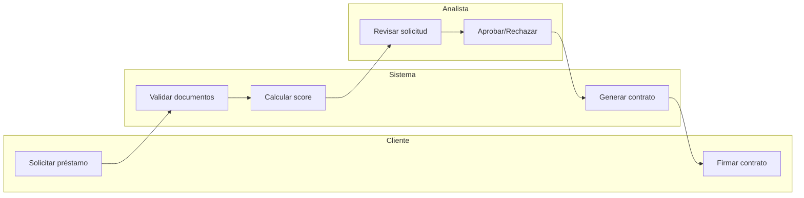
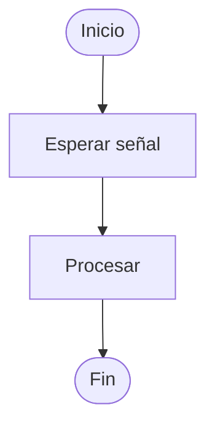

# Diagrama de Actividad

## ¿Qué es un Diagrama de Actividad?

Un **diagrama de actividad** muestra el **flujo de trabajo** o proceso paso a paso. Es ideal para modelar procesos de negocio, algoritmos y flujos de control con decisiones, paralelismos y ciclos.

> Piensa en un diagrama de actividad como un **mapa de carreteras**: te muestra el camino desde el inicio hasta el final, con bifurcaciones (decisiones), carriles paralelos (tareas simultáneas) y ciclos (vueltas al mismo punto).

## ¿Para qué sirve?

- **Modelar** procesos de negocio complejos
- **Documentar** algoritmos y flujos de trabajo
- **Analizar** caminos alternativos y excepciones
- **Comunicar** la lógica de un sistema a personas no técnicas
- **Validar** que el proceso cubre todos los escenarios

## Elementos Básicos

| Elemento | Símbolo | Descripción |
| --- | --- | --- |
| **Inicio** | Círculo negro | Punto de partida del flujo |
| **Fin** | Círculo negro con borde | Punto de terminación |
| **Actividad** | Rectángulo redondeado | Acción o tarea que se realiza |
| **Decisión** | Rombo | Punto donde se elige un camino (if/else) |
| **Fusión** | Rombo | Une caminos paralelos |
| **Barrido** | Barra gruesa | Inicia o termina paralelismo |
| **Flujo** | Flecha | Dirección del proceso |

## Ejemplo 1: Proceso de Compra en Tienda en Línea

### Diagrama

### Explicación Paso a Paso

1. **Inicio**: El cliente entra a la tienda en línea
2. **Buscar producto**: El cliente busca el producto que desea
3. **Seleccionar producto**: El cliente elige un producto específico
4. **Agregar al carrito**: El producto se añade al carrito de compras
5. **¿Desea agregar más?**: Decisión - si quiere seguir comprando o no
6. **Ver carrito**: El cliente revisa los productos en su carrito
7. **Iniciar checkout**: El cliente procede a pagar
8. **¿Tiene cuenta?**: Decisión - si tiene cuenta o necesita registrarse
9. **Ingresar dirección**: El cliente proporciona la dirección de entrega
10. **Seleccionar método de pago**: El cliente elige cómo pagar
11. **¿Pago válido?**: Decisión - si el pago es procesado correctamente
12. **Confirmar pedido**: Se confirma la orden
13. **Enviar pedido**: Se prepara y envía
14. **Entregar al cliente**: El producto llega al cliente
15. **Fin**: Proceso terminado

### Notas Clave

- Los **rombos** representan decisiones (if/else)
- Los **ciclos** se muestran cuando hay flechas que vuelven atrás
- El flujo puede tomar **múltiples caminos** según las decisiones

## Ejemplo 2: Proceso de Atención en Hospital

### Contexto
Un paciente llega al hospital y sigue un proceso de atención médica.

### Diagrama

### Explicación Paso a Paso

1. **Paciente llega**: Inicio del proceso
2. **Triaje**: Se evalúa la condición del paciente
3. **Evaluar gravedad**: Decisión crítica - ¿es urgente o no?
4. **Si es urgente**: Va directo a atención de emergencia
5. **Si no es urgente**: Espera en sala de espera
6. **Consulta médica**: El doctor evalúa al paciente
7. **Diagnóstico**: Tres caminos posibles
   - Medicación → Receta → Farmacia → Alta
   - Examen → Laboratorio → Segunda consulta → Re-evaluar
   - Hospitalización → Tratamiento → Alta
8. **Alta médica**: El paciente puede irse

### Notas Clave

- Hay **múltiples puntos de fin** (el paciente puede salir en diferentes momentos)
- El proceso tiene **ciclos** (laboratorio → segunda consulta → re-evaluar)
- Las **decisiones** determinan el camino del paciente

## Ejemplo 3: Algoritmo de Búsqueda Binaria

### Contexto
Implementar el algoritmo de búsqueda binaria para encontrar un elemento en una lista ordenada.

### Diagrama

### Explicación Paso a Paso

1. **Inicio**: Se define el array y el objetivo a buscar
2. **Se establecen los límites**: inicio = 0, fin = longitud - 1
3. **¿inicio <= fin?**: Condición del ciclo while
   - Si **No**: el elemento no existe, retornar -1
   - Si **Sí**: calcular la mitad
4. **Calcular mitad**: mid = (inicio + fin) / 2
5. **¿arrmid == x?**: Tres comparaciones
   - **Igual**: elemento encontrado, retornar mid
   - **Menor**: buscar en la mitad derecha (inicio = mid + 1)
   - **Mayor**: buscar en la mitad izquierda (fin = mid - 1)
6. **Repetir** desde el paso 3

### Notas Clave

- El **ciclo** se repite hasta encontrar el elemento o que inicio > fin
- Cada iteración **reduce a la mitad** el espacio de búsqueda
- La **complejidad** es O(log n) porque se divide el problema en cada paso

## Ejemplo 4: Proceso de Deploy (Despliegue)

### Contexto
El proceso de despliegue de una aplicación a producción.

### Diagrama

### Explicación Paso a Paso

1. **Push a repositorio**: El desarrollador sube código
2. **CI Pipeline se activa**: La integración continua comienza
3. **Compilar código**: Se construye la aplicación
4. **¿Tests pasan?**: Si fallan, se notifica y se corrige
5. **Análisis de código**: SonarQube verifica calidad
6. **¿Calidad aceptable?**: Si no cumple, se refactoriza
7. **Construir imagen Docker**: Se crea el contenedor
8. **Deploy a staging**: Se despliega en el ambiente de pruebas
9. **¿Tests E2E pasan?**: Pruebas de extremo a extremo
10. **¿Aprobación manual?**: Un humano aprueba el deploy
11. **Deploy a producción**: Se lleva a producción
12. **Verificación post-deploy**: Se confirma que todo funciona

### Notas Clave

- Hay **múltiples puntos de rollback** si algo falla
- El proceso es **iterativo** (vuelve al push si hay errores)
- La **aprobación manual** es una safeguard importante
- La **verificación post-deploy** detecta problemas en producción

## Ejemplo 5: Proceso de Reserva de Hotel

### Contexto
Un cliente reserva una habitación de hotel a través de una plataforma web.

### Diagrama

### Explicación Paso a Paso

1. **Buscar hotel**: El cliente busca disponibilidad
2. **Seleccionar hotel y fechas**: El cliente elige opciones
3. **Verificar disponibilidad**: ¿hay habitaciones?
   - Si **No disponible**: mostrar alternativas
   - Si **Disponible**: mostrar precio
4. **Ingresar datos del huésped**: Nombre, email, teléfono
5. **Seleccionar método de pago**: Tarjeta, PayPal, etc.
6. **¿Pago aprobado?**: Verificación con el procesador de pagos
   - Si **No**: reintentar o cancelar
   - Si **Sí**: confirmar reserva
7. **Enviar email de confirmación**: Comprobante al cliente
8. **Check-in online**: El cliente completa el check-in antes de llegar
9. **Llegada al hotel**: El cliente llega a la propiedad
10. **Registro en recepción**: Se verifica la reserva
11. **Entregar llave**: Se asigna la habitación
12. **Estancia**: El cliente se hospeda
13. **Check-out**: El cliente se retira
14. **Generar factura**: Se crea el comprobante fiscal

## Ejemplo 6: Proceso de Aprobación de Crédito

### Contexto
Un banco evalúa si aprueba o rechaza una solicitud de crédito.

### Diagrama

### Explicación Paso a Paso

1. **Recibir solicitud**: El cliente solicita un crédito
2. **Revisar documentos**: Se verifican los documentos presentados
3. **¿Documentos completos?**: Si faltan documentos, se solicitan
4. **Evaluar solicitud**: Se analiza la solicitud
5. **Calcular score crediticio**: Tres rangos posibles
   - **Score < 400**: Rechazo inmediato
   - **400 <= Score < 700**: Evaluación adicional (entrevista)
   - **Score >= 700**: Aprobación directa
6. **Entrevista personal**: Se evalúa al cliente en persona
7. **Decisión final**: Aprobado o rechazado
8. **Aprobar crédito**: Se definen las condiciones
9. **Generar contrato**: Se crea el documento legal
10. **Firmar contrato**: El cliente firma
11. **Desembolsar fondos**: Se entregan el dinero

## Notaciones Avanzadas

### Swinlane (Carril)

Los carriles muestran **quién** es responsable de cada actividad.

### Signal (Señal)

Las señales representan **eventos externos** que interrumpen el flujo.

## Diferencia entre Diagrama de Actividad y Diagrama de Secuencia

| Aspecto | Diagrama de Actividad | Diagrama de Secuencia |
| --- | --- | --- |
| **Qué muestra** | Flujo de trabajo paso a paso | Interacción entre objetos |
| **Cuándo se usa** | Procesos de negocio, algoritmos | Comunicación entre componentes |
| **Elementos** | Actividades, decisiones, paralelismo | Objetos, mensajes, líneas de vida |
| **Pregunta que responde** | ¿Qué pasos se siguen? | ¿Cómo hablan los objetos? |
| **Ejemplo** | "El cliente busca, selecciona y compra" | "La app le pide al servidor que verifique stock" |

> **Regla práctica:** Si el proceso se puede describir con verbos (buscar, seleccionar, pagar, enviar), usa un diagrama de actividad. Si se describe con interacciones (envía, recibe, responde), usa un diagrama de secuencia.

## Consejos para Dibujar Diagramas de Actividad

1. **Empieza por el inicio**: ¿dónde comienza el proceso?
2. **Define el fin**: ¿dónde termina el proceso?
3. **Identifica las decisiones**: ¿dónde el proceso se bifurca?
4. **Busca paralelismo**: ¿qué tareas pueden hacerse al mismo tiempo?
5. **No exageres**: no muestres cada pequeño paso, solo los importantes
6. **Un diagrama = un proceso**: no intentes meter todo en un solo diagrama
7. **Valída con el negocio**: ¿el flujo refleja la realidad?

> **Regla práctica:** Si el diagrama tiene más de 20 nodos, considera dividirlo en subprocesos más pequeños.

---

## Referencias

- [[Diagramas UML]] — Visión general de los diagramas UML
- [[Diagrama de Clases]] — Estructura estática del sistema
- [[Diagrama de Secuencia]] — Interacciones entre objetos
- [[Scrum]] — Metodología ágil para gestión de proyectos
- *UML Distilled* — Martin Fowler
- *Applying UML and Patterns* — Craig Larman
