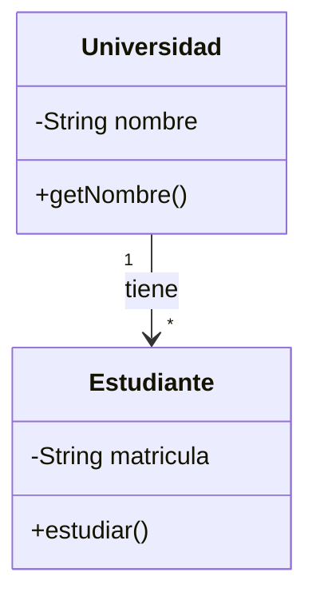
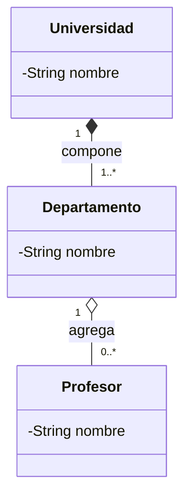
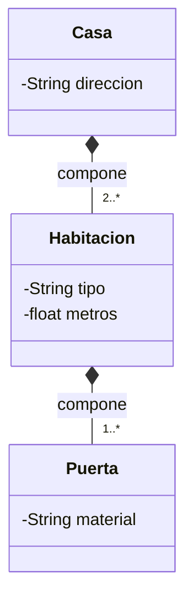
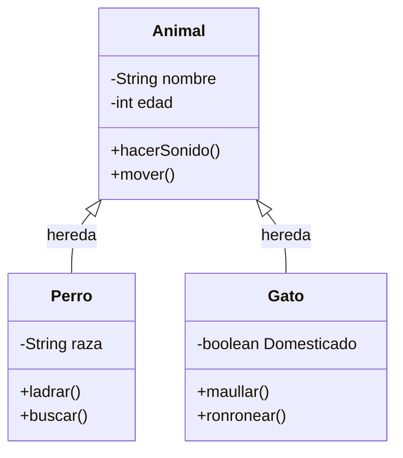
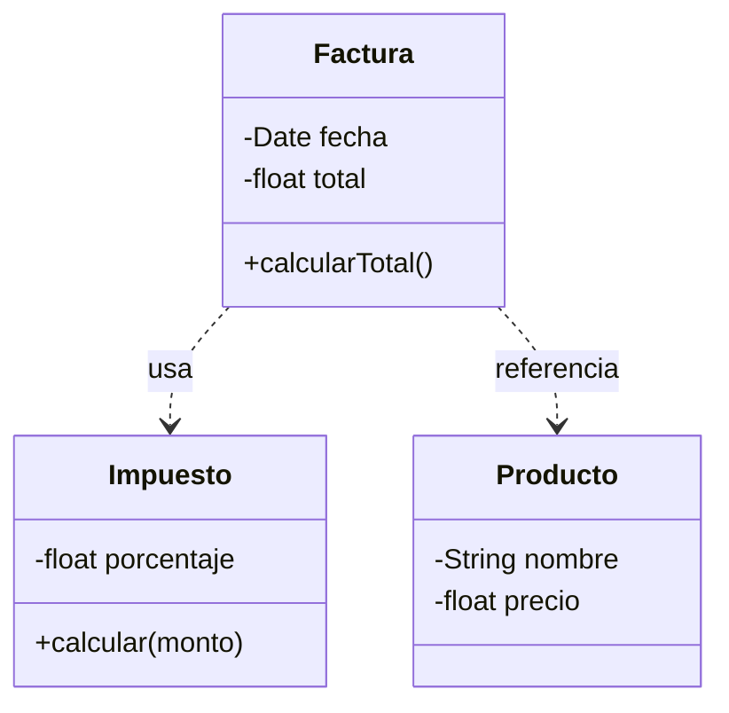
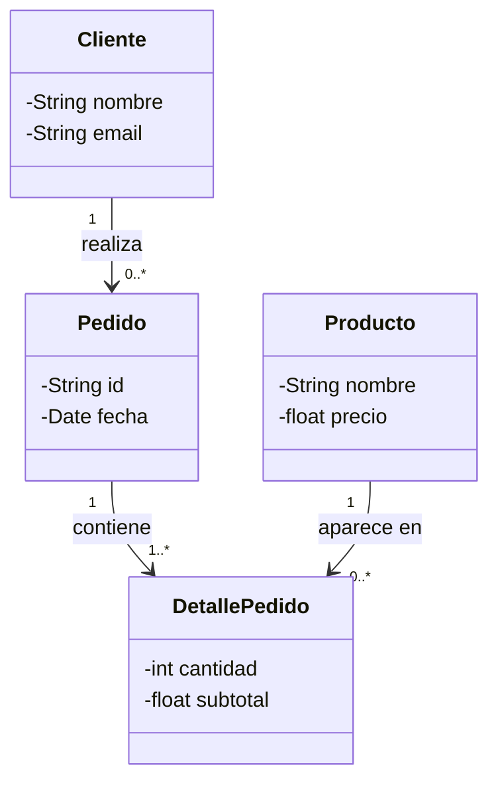
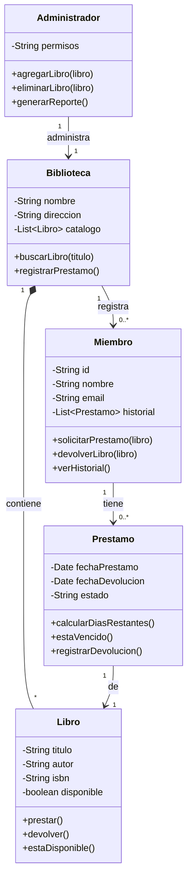
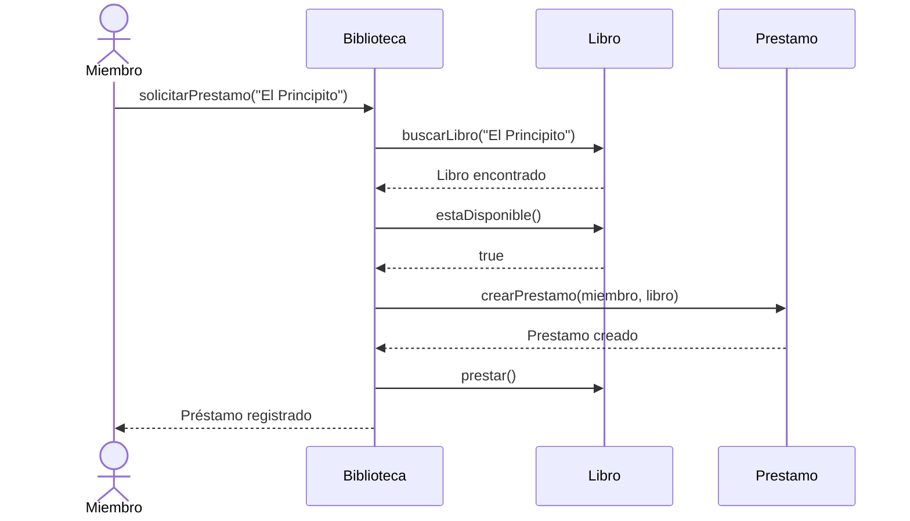
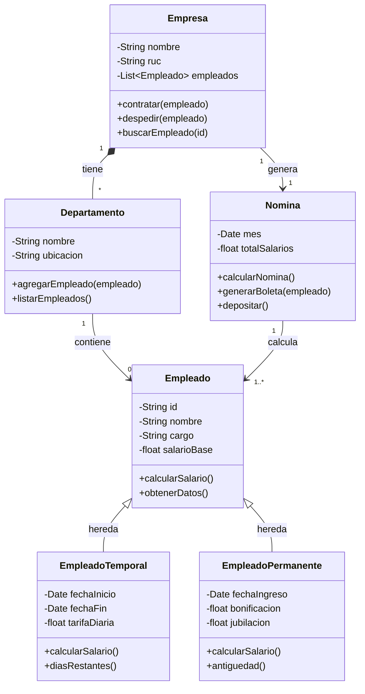

# Diagrama de Clases

## ¿Qué es un Diagrama de Clases?

Un **diagrama de clases** es el diagrama UML **más utilizado** en el diseño de software orientado a objetos. Representa la **estructura estática** del sistema: qué clases existen, qué atributos tienen, qué métodos pueden ejecutar y cómo se relacionan entre sí.

> Piensa en un diagrama de clases como el **plano de una casa**: te muestra qué habitaciones hay, qué muebles contienen y cómo se conectan entre sí. No te dice qué pasa dentro de la casa (eso sería un diagrama de secuencia), sino cómo está **organizada**.

## ¿Para qué sirve?

- **Analizar** el dominio del problema (qué entidades existen)
- **Diseñar** la arquitectura del software
- **Comunicar** el diseño entre miembros del equipo
- **Documentar** la estructura del sistema
- **Guía** la implementación del código

## Anatomía de una Clase

Una clase en UML se representa como un **rectángulo dividido en tres secciones**:

```
+-------------------+
|     NombreClase   |  ← Nombre de la clase
+-------------------+
| - atributo: tipo  |  ← Atributos (propiedades)
| + metodo(): tipo  |  ← Métodos (operaciones)
+-------------------+
```

### Visibilidad

| Símbolo | Significado | Ejemplo |
| --- | --- | --- |
| `+` | **Público** | Accesible desde cualquier lugar |
| `-` | **Privado** | Solo accesible dentro de la clase |
| `#` | **Protegido** | Accesible por la clase y sus subclases |
| `~` | **Paquete** | Accesible dentro del mismo paquete |

### Ejemplo: Clase Persona

```
+-------------------------+
|        Persona          |
+-------------------------+
| - nombre: String        |
| - edad: int             |
| - email: String         |
+-------------------------+
| + getNombre(): String   |
| + setEdad(edad: int)    |
| + esMayorDeEdad(): bool |
+-------------------------+
```

**Explicación:**
- `nombre`, `edad` y `email` son **privados** (`-`) porque no deben accederse directamente desde fuera
- `getNombre()`, `setEdad()` y `esMayorDeEdad()` son **públicos** (`+`) porque son la interfaz de la clase
- Esto cumple el principio de **encapsulamiento**: los datos están protegidos y se accede a ellos mediante métodos

## Tipos de Atributos

| Tipo | Ejemplo | Descripción |
| --- | --- | --- |
| `String` | `"Juan"` | Texto |
| `int` | `25` | Número entero |
| `float` | `1500.50` | Número decimal |
| `boolean` | `true` / `false` | Verdadero o falso |
| `Date` | `2026-09-07` | Fecha |

## Tipos de Métodos

| Tipo | Ejemplo | Descripción |
| --- | --- | --- |
| **Constructor** | `Persona(nombre, edad)` | Crea una instancia de la clase |
| **Getter** | `getNombre()` | Obtiene el valor de un atributo |
| **Setter** | `setNombre(nombre)` | Establece el valor de un atributo |
| **Acción** | `calcularEdad()` | Realiza una operación |

## Relaciones entre Clases

Las relaciones son un elemento **fundamental** de los diagramas de clases. Definen cómo interactúan las clases entre sí.

### 1. Asociación

Relación **"tiene un"** o **"conoce a"**. Es la relación más básica.



**Explicación:** Una Universidad **tiene** varios Estudiantes. La línea con flecha indica que la Universidad "conoce" a sus Estudiantes.

### 2. Agregación

Relación **"todo-parte"** pero donde las partes **pueden existir independientemente** del todo.



**Explicación:** La Universidad **agrega** Departamentos, y los Departamentos **agregan** Profesores. Si la Universidad cierra, los profesores siguen existiendo (pueden trabajar en otro lado).

### 3. Composición

Relación **"todo-parte"** pero donde las partes **NO pueden existir** sin el todo. Es más fuerte que la agregación.



**Explicación:** Una Casa **compone** Habitaciones, y las Habitaciones **componen** Puertas. Si destruyes la casa, las habitaciones y puertas dejan de existir como parte de esa casa.

**Diferencia clave:**
- **Agregación** (rombo vacío): las partes sobreviven al todo
- **Composición** (rombo lleno): las partes mueren con el todo

### 4. Herencia (Generalización)

Relación **"es un tipo de"**. Una clase hija hereda atributos y métodos de la clase padre.



**Explicación:**
- **Perro** hereda de **Animal**: tiene nombre, edad y puede hacerSonido() y mover()
- **Gato** herede de **Animal**: también tiene nombre, edad y puede hacerSonido() y mover()
- Cada clase hija **agrega** sus propios atributos y métodos (Perro tiene raza y ladrar(), Gato tiene Domesticado y maullar())

### 5. Dependencia

Relación **"usa temporalmente"**. Una clase necesita de otra para funcionar, pero no la guarda como atributo.



**Explicación:** La Factura **usa** el Impuesto para calcular el total y **referencia** Productos. Pero no guarda instancias de Impuesto ni Producto como atributos.

## Cardinalidad (Multiplicidad)

La cardinalidad indica **cuántas instancias** de una clase se relacionan con otra.

| Notación | Significado |
| --- | --- |
| `1` | Exactamente uno |
| `0..1` | Cero o uno (opcional) |
| `*` | Muchos (cero o más) |
| `1..*` | Uno o más |
| `0..*` | Cero o más |
| `3..5` | Entre 3 y 5 |

**Ejemplo con cardinalidad:**



**Explicación:**
- Un **Cliente** puede realizar **muchos Pedidos** (0..*)
- Un **Pedido** tiene **uno o más DetallePedido** (1..*)
- Un **Producto** puede aparecer en **muchos DetallePedido** (0..*)

## Ejemplo Didáctico Completo: Sistema de Biblioteca

### Contexto
Diseñar el sistema de una biblioteca donde los usuarios pueden:
- registrarse como miembros
- buscar libros
- solicitar préstamos
- devolver libros

### Diagrama de Clases



### Explicación de cada clase

**Biblioteca:**
- Atributos: nombre, dirección y catálogo de libros
- Método `buscarLibro(titulo)`: busca en el catálogo por título

**Libro:**
- Atributos: título, autor, ISBN y disponibilidad
- Método `prestar()`: marca el libro como no disponible
- Método `devolver()`: marca el libro como disponible

**Miembro:**
- Atributos: ID, nombre, email e historial de préstamos
- Método `solicitarPrestamo(libro)`: crea un nuevo préstamo si el libro está disponible

**Prestamo:**
- Atributos: fecha de préstamo, fecha de devolución y estado
- Método `estaVencido()`: verifica si la fecha de devolución ya pasó

### Flujo de Uso



## Ejemplo Didáctico 2: Sistema de Gestión de Empleados

### Diagrama de Clases



### Explicación de Herencia

**Empleado** es la clase padre con atributos comunes:
- `id`, `nombre`, `cargo`, `salarioBase`
- Método `calcularSalario()`: retorna el salario base

**EmpleadoTemporal** hereda de Empleado y agrega:
- `fechaInicio`, `fechaFin`, `tarifaDiaria`
- Sobreescribe `calcularSalario()`: multiplica tarifa diaria × días trabajados

**EmpleadoPermanente** herede de Empleado y agrega:
- `fechaIngreso`, `bonificacion`, `jubilacion`
- Sobreescribe `calcularSalario()`: suma base + bonificación - jubilación

### Polimorfismo en Acción

```java
// El mismo método calcularSalario() se comporta diferente según el tipo
Empleado e1 = new EmpleadoTemporal("Juan", 100);
Empleado e2 = new EmpleadoPermanente("María", 3000, 500, 200);

e1.calcularSalario(); // Retorna: tarifa × días
e2.calcularSalario(); // Retorna: 3000 + 500 - 200 = 3300
```

## Consejos para Dibujar Diagramas de Clases

1. **Empieza por las clases principales**: identifica las entidades clave del dominio
2. **Define atributos necesarios**: no pongas todos los atributos posibles, solo los relevantes para el diseño
3. **Define métodos que representen comportamientos**: no solo getters y setters
4. **Identifica relaciones**: ¿qué clases se conocen? ¿cuáles componen a otras?
5. **Define cardinalidad**: ¿cuántas instancias se relacionan?
6. **Usa herencia** cuando haya tipos especializados de una misma cosa
7. **Prefiere composición** sobre herencia cuando sea posible (principio de composición sobre herencia)

> **Regla práctica:** Si puedes decir "A tiene un B", es asociación o agregación. Si puedes decir "A es un tipo de B", es herencia.

---

## Referencias

- [[Diagramas UML]] — Visión general de los diagramas UML
- [[Scrum]] — Metodología ágil para gestión de proyectos
- *UML Distilled* — Martin Fowler
- *Applying UML and Patterns* — Craig Larman
