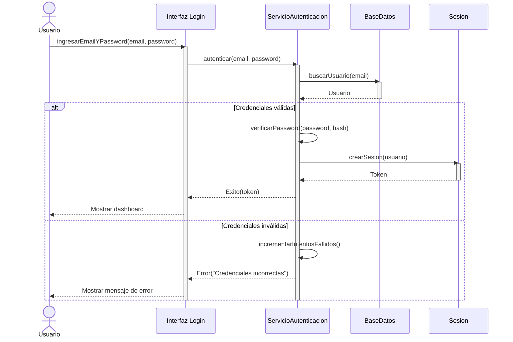
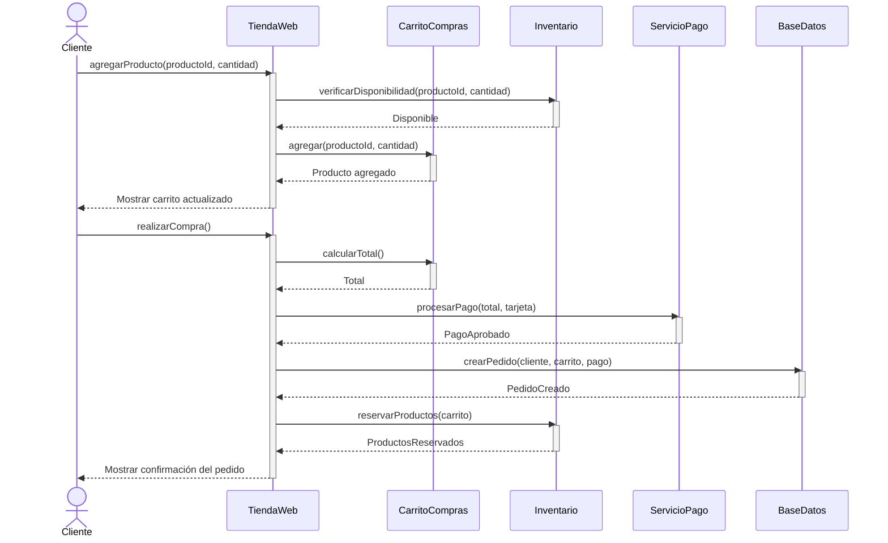
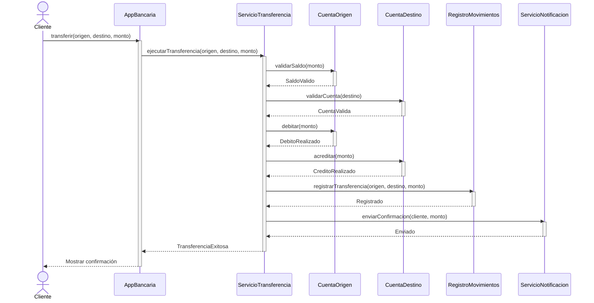
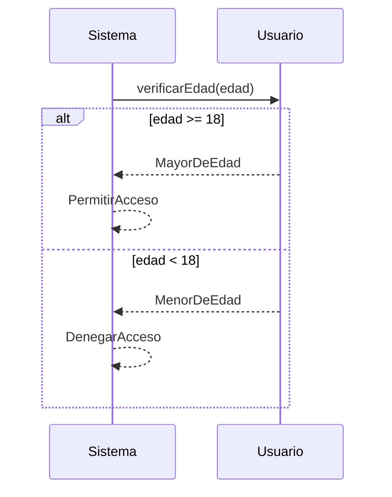
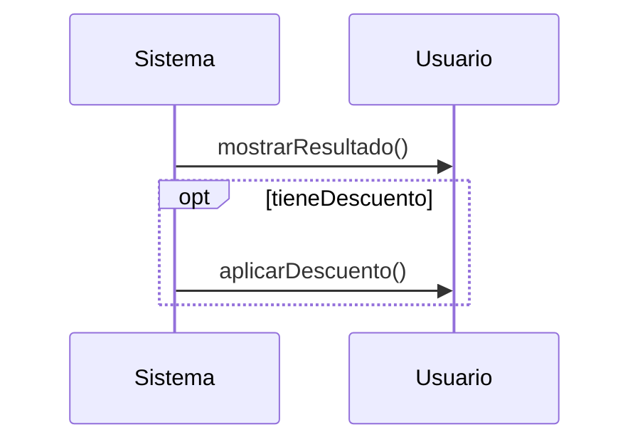
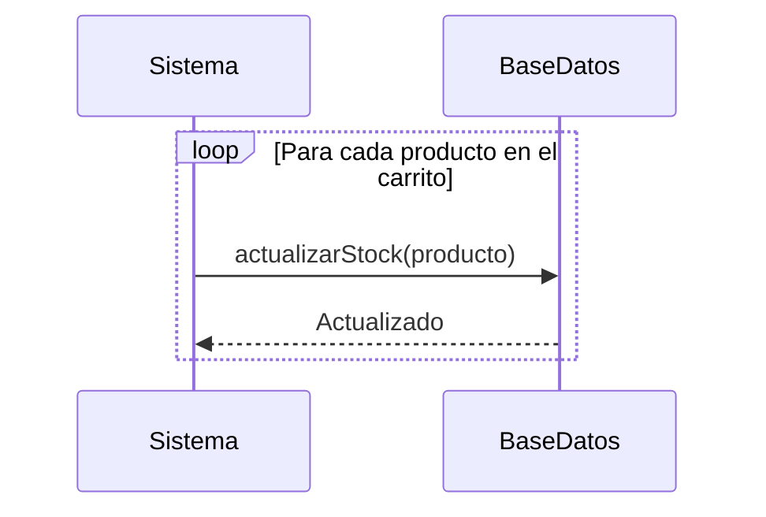
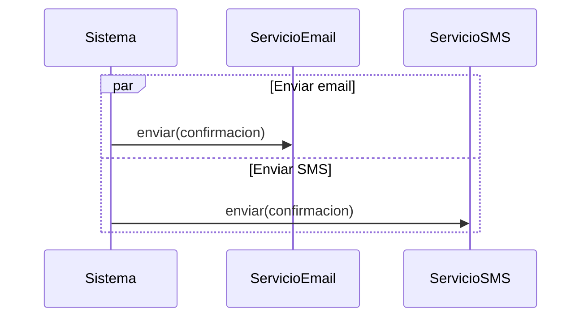
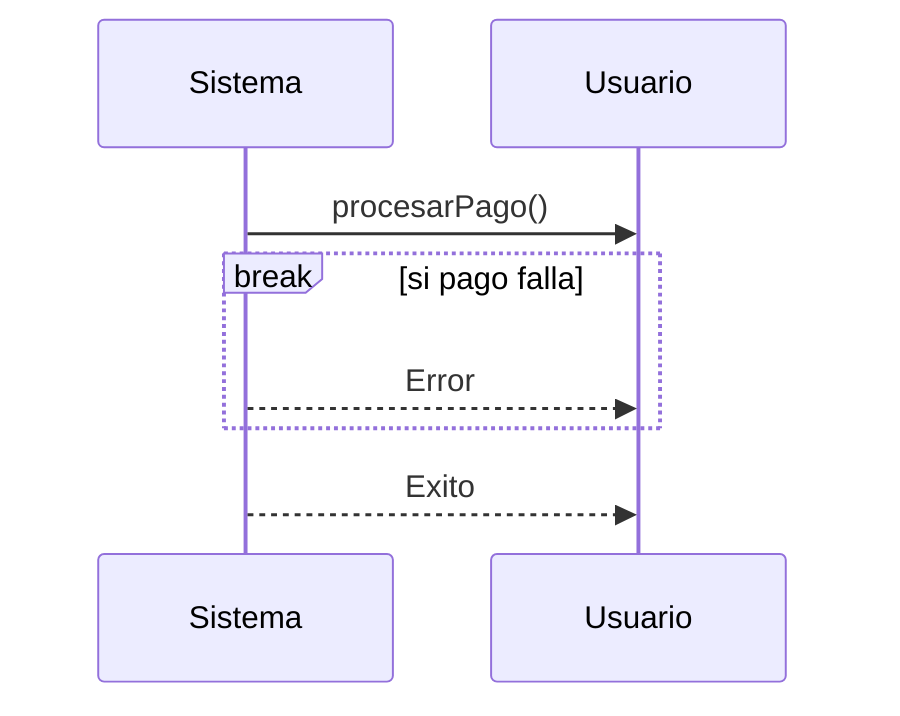
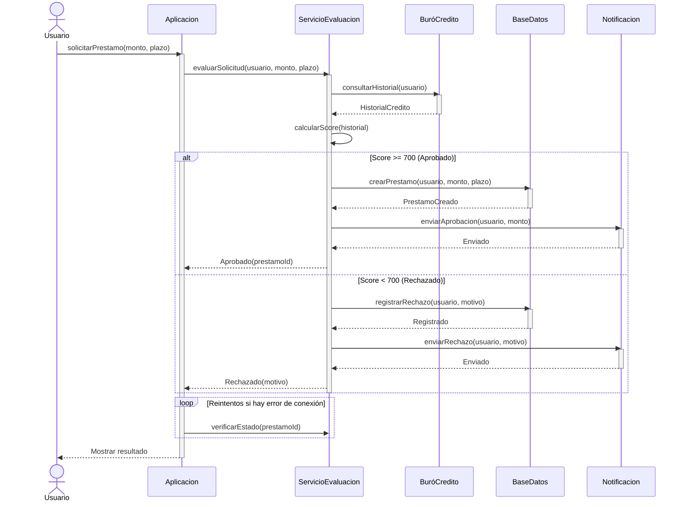
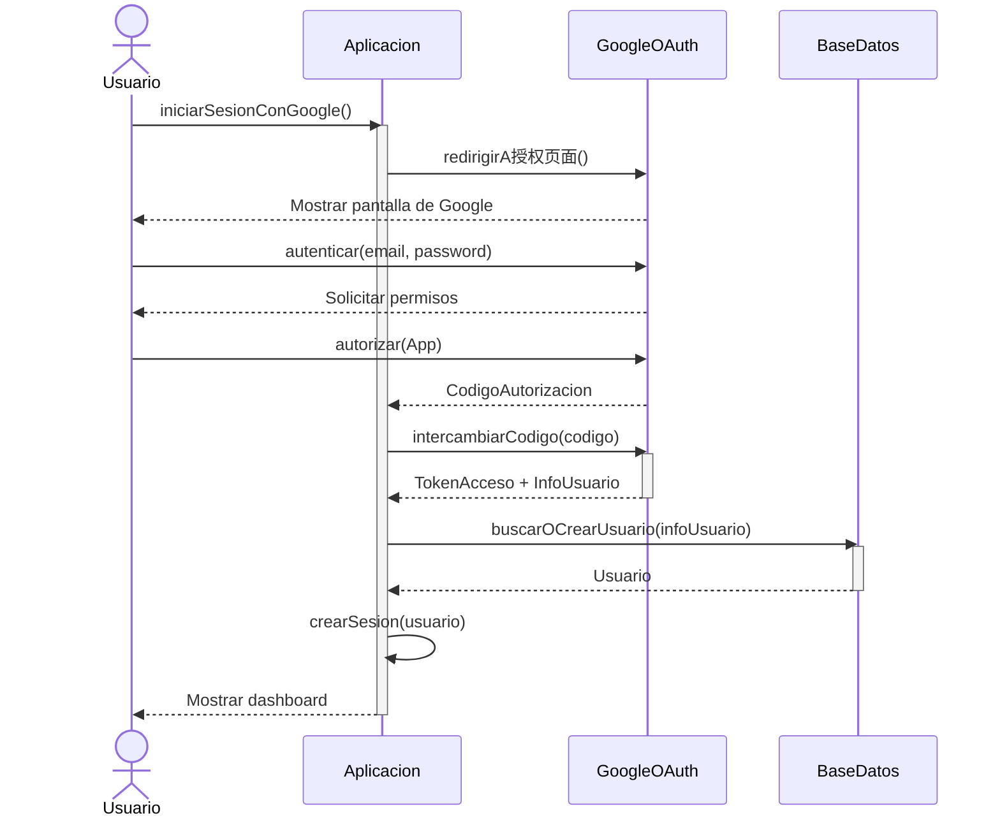

# Diagrama de Secuencia

## ¿Qué es un Diagrama de Secuencia?

Un **diagrama de secuencia** muestra cómo interactúan los objetos entre sí, **ordenados cronológicamente** (de arriba hacia abajo). Es el diagrama ideal para entender **cómo funciona un caso de uso específico** paso a paso.

> Piensa en un diagrama de secuencia como una **transcripción de una conversación**: te dice quién habla, a quién le habla, qué dice y en qué orden. No te dice qué propiedades tiene cada persona (eso sería un diagrama de clases), sino **cómo se comunican**.

## ¿Para qué sirve?

- **Detallar** cómo se ejecuta un caso de uso
- **Validar** que la interacción entre objetos es correcta
- **Detectar** problemas de diseño antes de programar
- **Documentar** flujos de trabajo complejos
- **Comunicar** la lógica de negocio al equipo

## Anatomía de un Diagrama de Secuencia

### Elementos Básicos

```
Actor        Objeto1        Objeto2        BaseDatos
  |              |              |              |
  |--mensaje---->|              |              |
  |              |--mensaje---->|              |
  |              |              |---consulta-->|
  |              |              |<--respuesta--|
  |              |<--respuesta--|              |
  |<--respuesta--|              |              |
  |              |              |              |
```

| Elemento | Símbolo | Descripción |
| --- | --- | --- |
| **Actor** | `actor` | Persona o sistema externo que inicia la interacción |
| **Objeto/Participante** | Rectángulo | Instancia de una clase que participa en la interacción |
| **Línea de vida** | Línea vertical punteada | Representa la existencia del objeto a lo largo del tiempo |
| **Barra de activación** | Rectángulo sobre la línea | Período en que el objeto está activo/procesando |
| **Mensaje** | Flecha | Comunicación entre objetos |

### Tipos de Mensajes

| Tipo | Símbolo | Descripción | Ejemplo |
| --- | --- | --- | --- |
| **Síncrono** | `->` (flecha llena) | El emisor espera respuesta | `autenticar(usuario)` |
| **Asíncrono** | `-->` (flecha abierta) | El emisor no espera | `enviarEmail()` |
| **Retorno** | `-->` (flecha punteada) | Respuesta a un mensaje | `true` |
| **Creación** | `->` (flecha a objeto) | Crea un nuevo objeto | `new Pedido()` |
| **Destrucción** | `X` | Elimina un objeto | `delete(usuario)` |

## Ejemplo 1: Autenticación de Usuario

### Contexto
Un usuario intenta iniciar sesión en un sistema con su email y contraseña.

### Diagrama



### Explicación Paso a Paso

1. **El Usuario** ingresa email y contraseña en la interfaz
2. **La Interfaz** envía las credenciales al **ServicioAutenticacion**
3. **El Servicio** consulta la **BaseDatos** para buscar el usuario
4. **La BaseDatos** retorna el usuario (o null si no existe)
5. **El Servicio** verifica si la contraseña coincide con el hash
6. **Si es válida**: crea una Sesión con un Token y retorna éxito
7. **Si es inválida**: incrementa los intentos fallidos y retorna error
8. **La Interfaz** muestra el resultado al Usuario

### Notas Clave

- Las **líneas verticales** muestran el tiempo (de arriba hacia abajo)
- Las **barras** muestran cuándo cada objeto está activo
- El bloque **alt** muestra alternativas (if/else)
- El bloque **else** muestra la alternativa cuando las credenciales fallan

## Ejemplo 2: Compra en Tienda en Línea

### Contexto
Un cliente agrega productos al carrito y realiza la compra.

### Diagrama



### Explicación Paso a Paso

1. **El Cliente** agrega un producto al carrito
2. **La TiendaWeb** verifica disponibilidad en el **Inventario**
3. **El Inventario** confirma que hay stock
4. **La TiendaWeb** agrega el producto al **CarritoCompras**
5. **El Cliente** decide comprar
6. **La TiendaWeb** calcula el total del carrito
7. **El ServicioPago** procesa el pago con la tarjeta
8. **La BaseDatos** crea el pedido
9. **El Inventario** reserva los productos
10. **El Cliente** recibe la confirmación

### Notas Clave

- Los **actores** están fuera del sistema (Cliente)
- Los **objetos** representan componentes internos del sistema
- Cada **mensaje** representa una llamada a un método
- Los **retornos** muestran qué responde cada objeto

## Ejemplo 3: Transferencia Bancaria

### Contexto
Un cliente transfiere dinero de su cuenta a otra cuenta.

### Diagrama



### Explicación Paso a Paso

1. **El Cliente** solicita una transferencia desde la app
2. **La App** delega al **ServicioTransferencia**
3. **El Servicio** valida que la cuenta origen tenga saldo suficiente
4. **El Servicio** valida que la cuenta destino exista y esté activa
5. **El Servicio** debita el monto de la cuenta origen
6. **El Servicio** acredita el monto en la cuenta destino
7. **El Servicio** registra los movimientos en ambas cuentas
8. **El Servicio** envía una notificación de confirmación
9. **El Cliente** recibe la confirmación

### Notas Clave

- La validación es **obligatoria** antes de ejecutar
- El **debito** y **crédito** deben ser **atómicos** (si uno falla, se revoca el otro)
- Los **registros de movimiento** son importantes para auditoría
- La **notificación** es independiente de la transferencia

## Fragmentos de Interrupción (Operator Frames)

UML define fragmentos para modelar lógica compleja:

### Alt (Alternativa - If/Else)



### Opt (Opcional - If Simple)



### Loop (Ciclo)



### Par (Paralelo)



### Break (Interrupción)



## Ejemplo 4: Flujo Completo con Múltiples Fragmentos

### Contexto
Un usuario solicita un préstamo y el sistema evalúa si es elegible.

### Diagrama



### Explicación Paso a Paso

1. **El Usuario** solicita un préstamo
2. **La Aplicación** delega la evaluación al **ServicioEvaluacion**
3. **El Servicio** consulta el **Buró de Crédito** para obtener el historial
4. **El Servicio** calcula el score crediticio
5. **Si el score es alto (>= 700)**:
   - Se crea el préstamo en la **BaseDatos**
   - Se envía una **notificación de aprobación**
   - Se retorna el ID del préstamo
6. **Si el score es bajo (< 700)**:
   - Se registra el rechazo en la **BaseDatos**
   - Se envía una **notificación de rechazo**
   - Se retorna el motivo
7. **La Aplicación** muestra el resultado al Usuario

### Notas Clave

- El fragmento **alt** modela la lógica de negocio (aprobación/rechazo)
- El fragmento **loop** muestra reintentos en caso de error
- Los **actores** son externos al sistema
- Los **objetos** son componentes internos

## Diferencia entre Diagrama de Secuencia y Diagrama de Clases

| Aspecto | Diagrama de Clases | Diagrama de Secuencia |
| --- | --- | --- |
| **Qué muestra** | Estructura estática | Comportamiento dinámico |
| **Cuándo se usa** | Diseño de la arquitectura | Detalle de interacciones |
| **Elementos** | Clases, atributos, métodos, relaciones | Objetos, mensajes, líneas de vida |
| **Pregunta que responde** | ¿Qué objetos existen? | ¿Cómo interactúan los objetos? |
| **Ejemplo** | "El sistema tiene una clase Pedido" | "El cliente envía un pedido y el sistema lo procesa" |

## Ejemplo 5: Login con OAuth (Google)

### Contexto
Un usuario se autentica usando su cuenta de Google.

### Diagrama



### Explicación

1. **El Usuario** elige autenticarse con Google
2. **La Aplicación** redirige a la página de autorización de Google
3. **El Usuario** ingresa sus credenciales en Google
4. **Google** solicita permisos a la aplicación
5. **El Usuario** autoriza a la aplicación
6. **Google** retorna un código de autorización
7. **La Aplicación** intercambia el código por un token de acceso
8. **La Aplicación** busca o crea el usuario en su **BaseDatos**
9. **La Aplicación** crea una sesión y muestra el dashboard

## Consejos para Dibujar Diagramas de Secuencia

1. **Empieza por el actor**: ¿quién inicia la interacción?
2. **Identifica los participantes**: ¿qué objetos necesitan hablar?
3. **Ordena los mensajes cronológicamente**: de arriba hacia abajo
4. **Usa fragmentos** para modelar lógica (alt, opt, loop)
5. **No exageres**: no muestres cada línea de código, solo las interacciones clave
6. **Un diagrama = un escenario**: no intentes meter todo en un solo diagrama
7. **Valída con el equipo**: ¿la secuencia tiene sentido lógico?

> **Regla práctica:** Si puedes explicar el diagrama con la palabra "primero", "después", "si", "mientras", entonces es un buen candidato para un diagrama de secuencia.

---

## Referencias

- [[Diagramas UML]] — Visión general de los diagramas UML
- [[Diagrama de Clases]] — Estructura estática del sistema
- [[Scrum]] — Metodología ágil para gestión de proyectos
- *UML Distilled* — Martin Fowler
- *Applying UML and Patterns* — Craig Larman
