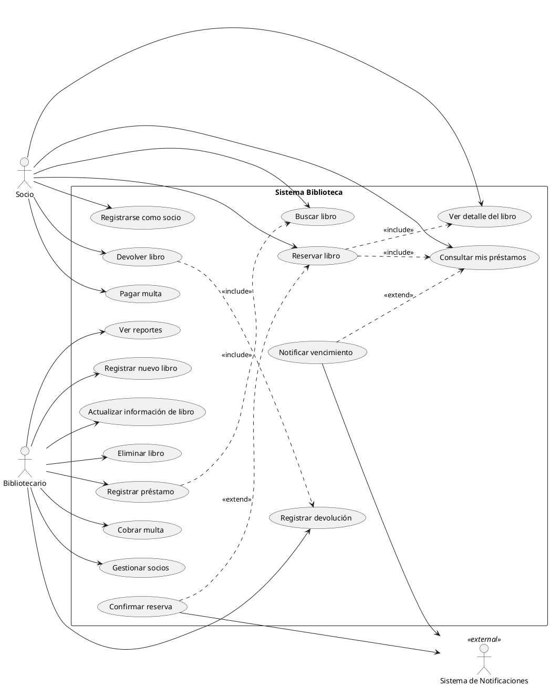

# Ejemplo: Diagrama de Casos de Uso — Biblioteca

## Contexto

Sistema de gestión de biblioteca donde los socios pueden buscar, reservar y devolver libros, los bibliotecarios gestionan el catálogo y el inventario, y el sistema notifica automáticamente vencimientos.

## Diagrama

## Desglose por Actor

### Socio
| Caso de Uso | Descripción |
| --- | --- |
| Buscar libro | Busca por título, autor, ISBN o categoría. |
| Ver detalle del libro | Consulta disponibilidad, sinopsis y ubicación en estantería. |
| Reservar libro | Aparta un libro que está prestado o en proceso de devolución. |
| Devolver libro | Devuelve un libro previamente prestado. |
| Consultar mis préstamos | Ve el estado de sus préstamos activos y fechas de vencimiento. |
| Pagar multa | Realiza el pago de multas por retraso en devoluciones. |
| Registrarse como socio | Crea su cuenta con datos personales y carné de biblioteca. |

### Bibliotecario
| Caso de Uso | Descripción |
| --- | --- |
| Registrar nuevo libro | Ingresa un título al catálogo con datos bibliográficos y ejemplares. |
| Actualizar información de libro | Modifica datos de un libro existente. |
| Eliminar libro | Retira un libro del catálogo (dado de baja). |
| Registrar préstamo | Registra la salida de un libro a un socio. |
| Registrar devolución | Registra la recepción de un libro devuelto. |
| Cobrar multa | Registra el cobro de una multa por retraso. |
| Gestionar socios | Alta, baja y modificación de cuentas de socios. |
| Ver reportes | Consulta estadísticas de préstamos, socios más activos, libros más prestados. |

### Actor Externo
| Caso de Uso | Descripción |
| --- | --- |
| Notificar vencimiento | Envía alertas automáticas por email o SMS cuando un préstamo está por vencer. |
| Confirmar reserva | Notifica al socio que su reserva está lista para retirar. |

## Relaciones Clave

- **`<<include>>`** — Reservar libro incluye Ver detalle y Consultar mis préstamos. Devolver libro incluye Registrar devolución.
- **`<<extend>>`** — Notificar vencimiento se activa **opcionalmente** cuando se detecta un préstamo próximo a vencer. Confirmar reserva se activa **opcionalmente** cuando un libro reservado está disponible.
