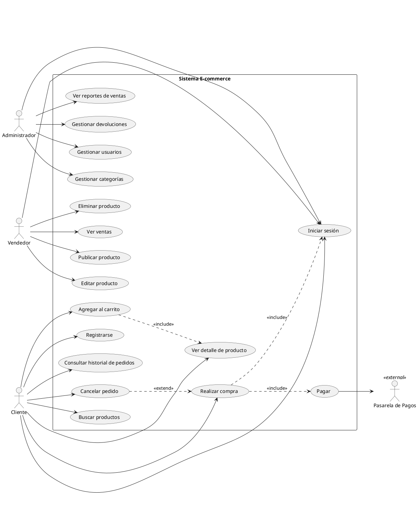

# Ejemplo: Diagrama de Casos de Uso — E-commerce

## Contexto

Sistema de tienda en línea donde los clientes pueden comprar productos, los vendedores gestionan su catálogo y un administrador supervisa el sistema.

## Diagrama

## Desglose por Actor

### Cliente
| Caso de Uso | Descripción |
| --- | --- |
| Buscar productos | El cliente busca productos por nombre, categoría o filtros. |
| Ver detalle de producto | Consulta información completa: precio, descripción, imágenes, stock. |
| Agregar al carrito | Añade un producto a su carrito de compras. |
| Realizar compra | Confirma los productos del carrito e inicia el proceso de pago. |
| Pagar | *(incluido)* Transacción de pago a través de la pasarela externa. |
| Registrarse | Crea una cuenta con datos personales y credenciales. |
| Iniciar sesión | Se autentica para acceder a funcionalidades restringidas. |
| Consultar historial de pedidos | Ve el estado y detalle de compras anteriores. |
| Cancelar pedido | *(extiende* Realizar compra*)* Cancela un pedido antes de ser despachado. |

### Vendedor
| Caso de Uso | Descripción |
| --- | --- |
| Publicar producto | Agrega un nuevo producto al catálogo con imágenes, precio y stock. |
| Editar producto | Modifica información de un producto existente. |
| Eliminar producto | Retira un producto del catálogo. |
| Ver ventas | Consulta el historial y estado de sus ventas. |

### Administrador
| Caso de Uso | Descripción |
| --- | --- |
| Gestionar usuarios | Crear, editar, deshabilitar o eliminar cuentas de usuario. |
| Gestionar categorías | Crear y organizar las categorías del catálogo. |
| Ver reportes de ventas | Consulta estadísticas y métricas de ventas globales. |
| Gestionar devoluciones | Procesa solicitudes de devolución o reembolso. |

## Relaciones Clave

- **`<<include>>`** — Realizar compra **siempre** incluye Pagar e Iniciar sesión. Agregar al carrito **siempre** incluye Ver detalle de producto.
- **`<<extend>>`** — Cancelar pedido **opcionalmente** extiende Realizar compra (solo bajo ciertas condiciones, como antes del despacho).
- **Actor externo** — La Pasarela de Pagos es un sistema externo con el que interactúa el caso Pagar.
