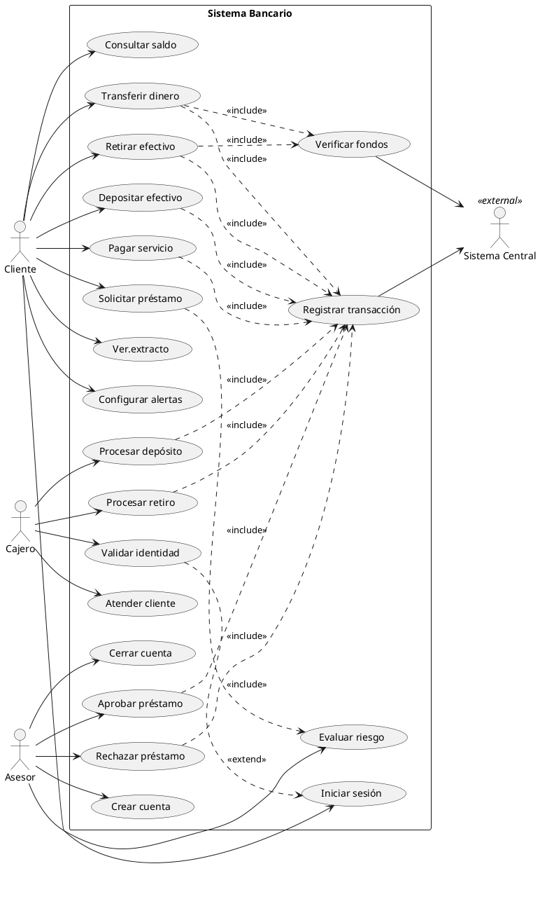

# Ejemplo: Diagrama de Casos de Uso — Sistema Bancario

## Contexto

Sistema bancario donde los clientes realizan operaciones financieras, los cajeros atienden en sucursal, los asesores gestionan productos financieros y un sistema centraliza las transacciones.

## Diagrama

## Desglose por Actor

### Cliente
| Caso de Uso | Descripción |
| --- | --- |
| Iniciar sesión | Se autentica con credenciales o biometría. |
| Consultar saldo | Ve el saldo disponible en sus cuentas. |
| Transferir dinero | Envía dinero a otra cuenta (propia o de terceros). |
| Depositar efectivo | Ingresa dinero en efectivo a su cuenta. |
| Retirar efectivo | Saca dinero de su cuenta. |
| Pagar servicio | Paga boletas de servicios básicos (agua, luz, etc.). |
| Solicitar préstamo | Solicita un crédito con monto y plazo. |
| Ver extracto | Consulta el historial de transacciones del mes. |
| Configurar alertas | Define notificaciones por email/SMS para movimientos. |

### Cajero (Sucursal)
| Caso de Uso | Descripción |
| --- | --- |
| Atender cliente | Inicia la atención presencial en ventanilla. |
| Procesar depósito | Registra un depósito en efectivo o cheque. |
| Procesar retiro | Procesa un retiro con validación de identidad. |
| Validar identidad | *(extiende* Iniciar sesión*)* Verifica identidad con documento físico. |

### Asesor Financiero
| Caso de Uso | Descripción |
| --- | --- |
| Evaluar riesgo | Analiza el perfil crediticio del cliente para un préstamo. |
| Aprobar préstamo | Aprueba la solicitud y genera el contrato. |
| Rechazar préstamo | Rechaza la solicitud con motivo registrado. |
| Crear cuenta | Apertura una nueva cuenta bancaria para un cliente. |
| Cerrar cuenta | Cierra una cuenta existente (previa liquidación). |

### Actor Externo
| Caso de Uso | Descripción |
| --- | --- |
| Registrar transacción | El sistema central registra cada movimiento en la base de datos. |
| Verificar fondos | Consulta si hay fondos suficientes antes de una operación. |

## Relaciones Clave

- **`<<include>>`** — Transferir, retirar y pagar siempre incluyen Verificar fondos y Registrar transacción. Solicitar préstamo incluye Evaluar riesgo.
- **`<<extend>>`** — Validar identidad se activa **opcionalmente** en el Iniciar sesión cuando el monto supera un umbral.
- **Actor externo** — El Sistema Central es el backbone que valida y persiste todas las transacciones.
