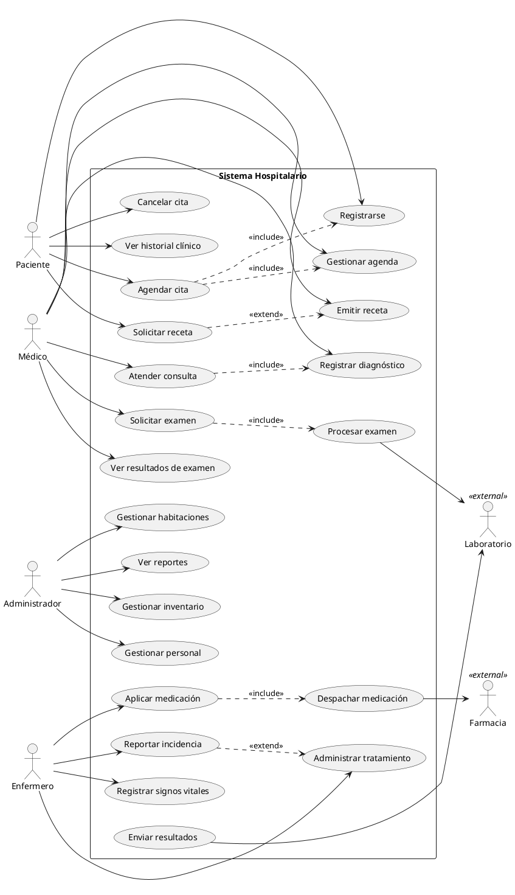

# Ejemplo: Diagrama de Casos de Uso — Sistema Hospitalario

## Contexto

Sistema de gestión hospitalaria donde los pacientes agendan citas, los médicos atienden consultas y emiten recetas, los enfermeros administran tratamientos y los administradores gestionan recursos del hospital.

## Diagrama

## Desglose por Actor

### Paciente
| Caso de Uso | Descripción |
| --- | --- |
| Registrarse | Crea su cuenta con datos personales y seguro médico. |
| Agendar cita | Solicita una cita con un médico en un horario disponible. |
| Cancelar hora | Anula una cita programada con aviso previo. |
| Ver historial clínico | Consulta diagnósticos, tratamientos y exámenes anteriores. |
| Solicitar receta | *(extiende* Emitir receta*)* Solicita renovación de medicamentos recetados. |

### Médico
| Caso de Uso | Descripción |
| --- | --- |
| Atender consulta | Realiza la evaluación clínica del paciente. |
| Emitir receta | Genera una prescripción médica con medicamentos y dosis. |
| Solicitar examen | Pide análisis de laboratorio o imágenes médicas. |
| Ver resultados de examen | Consulta los resultados de exámenes solicitados. |
| Registrar diagnóstico | Documenta el diagnóstico según códigos médicos (CIE-10). |
| Gestionar agenda | Configura sus horarios disponibles para citas. |

### Enfermero
| Caso de Uso | Descripción |
| --- | --- |
| Administrar tratamiento | Supervisa la aplicación de tratamientos hospitalizados. |
| Registrar signos vitales | Registra temperatura, presión, frecuencia cardíaca, etc. |
| Aplicar medicación | Administra medicamentos prescritos al paciente. |
| Reportar incidencia | *(extiende* Administrar tratamiento*)* Documenta eventos adversos o reacciones. |

### Administrador
| Caso de Uso | Descripción |
| --- | --- |
| Gestionar personal | Alta, baja y asignación de médicos, enfermeros y administrative. |
| Gestionar habitaciones | Control de disponibilidad, asignación y mantenimiento. |
| Ver reportes | Estadísticas de pacientes atendidos, ocupación, tiempos de espera. |
| Gestionar inventario | Control de stock de medicamentos, insumos y equipamiento. |

### Actores Externos
| Caso de Uso | Descripción |
| --- | --- |
| Procesar examen | El laboratorio procesa las muestras y genera resultados. |
| Enviar resultados | El laboratorio envía resultados al sistema para consulta del médico. |
| Despachar medicación | La farmacia prepara y entrega los medicamentos prescritos. |

## Relaciones Clave

- **`<<include>>`** — Agendar cita incluye Registrarse y Gestionar agenda. Atender consulta incluye Registrar diagnóstico. Aplicar medicación incluye Despachar medicación. Solicitar examen incluye Procesar examen.
- **`<<extend>>`** — Solicitar receta se activa **opcionalmente** desde Emitir receta (renovación). Reportar incidencia se activa **opcionalmente** desde Administrar tratamiento (cuando hay un evento adverso).
- **Actores externos** — Laboratorio y Farmacia son sistemas/instituciones externas que se integran al sistema hospitalario.
