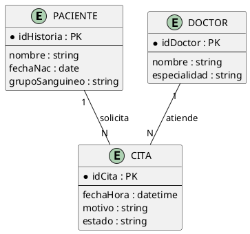
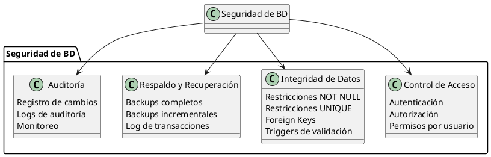
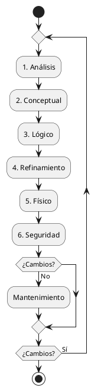

# Etapas del Diseño de una Base de Datos

## ¿Qué es el diseño de una base de datos?

El diseño de una base de datos es el proceso de definir la **estructura**, **organización** y **reglas** que governarán cómo se almacenan, recuperan y manipulan los datos de un sistema de información. No es un evento único, sino un **ciclo iterativo** con etapas bien definidas.

> Un buen diseño de base de datos evita redundancias, garantiza integridad y permite crecer el sistema sin romper lo ya construido.

---

## Las 6 Etapas del Diseño

### Etapa 1: Análisis de Requerimientos

**¿Qué se hace?** Se entiende **qué necesita el negocio**. Se recopilan requisitos funcionales y no funcionales relacionados con los datos.

**Actividades principales:**
- Entrevistas con stakeholders (usuarios, gerentes, clientes)
- Análisis de documentación existente (formularios, reportes, sistemas actuales)
- Identificación de reglas de negocio
- Definición de requisitos de datos: ¿qué información se necesita almacenar?

**Salida esperada:**
- Lista de entidades identificadas
- Requisitos de información documentados
- Restricciones de negocio identificadas

**Ejemplo (Sistema Hospitalario):**

| Requerimiento | Fuente | Entidad Identificada |
| --- | --- | --- |
| "Necesitamos registrar a cada paciente" | Director médico | `Paciente` |
| "Cada doctor tiene una especialidad" | Recursos humanos | `Doctor` |
| "Las citas deben tener fecha y hora" | Recepción | `Cita` |
| "Un paciente puede tener alergias múltiples" | Historial clínico | `Alergia` (multi-valor) |

> **Consejo práctico:** No empieces a diseñar tablas todavía. En esta etapa solo importa **entender qué datos necesita el negocio**.

---

### Etapa 2: Diseño Conceptual

**¿Qué se hace?** Se crea el **Modelo Entidad-Relación (MER)** de alto nivel. Se identifican entidades, atributos, relaciones y cardinalidades **sin pensar en tecnología**.

**Actividades principales:**
- Definir entidades principales del dominio
- Asignar atributos a cada entidad
- Identificar relaciones entre entidades
- Definir cardinalidades (1:1, 1:N, N:M)
- Identificar participaciones (total/parcial)
- Definir claves candidatas

**Herramienta:** Diagrama Entidad-Relación (notación Chen o similar)

**Ejemplo (Sistema Hospitalario):**



> **Nota:** En esta etapa **NO** se piensa en tablas SQL, índices ni SGBD. El modelo es **independiente de la tecnología**.

---

### Etapa 3: Diseño Lógico

**¿Qué se hace?** Se traduce el modelo conceptual a un **modelo lógico** estructurado, definiendo esquemas de tablas, claves primarias, foráneas y restricciones.

**Actividades principales:**
- Convertir entidades en **tablas**
- Definir **columnas** con tipos de datos
- Asignar **claves primarias (PK)** a cada tabla
- Crear **claves foráneas (FK)** para representar relaciones
- Resolver relaciones N:M con **tablas intermedias**
- Aplicar **normalización** (1FN, 2FN, 3FN)
- Definir restricciones (NOT NULL, UNIQUE, CHECK)

**Resultado:** Esquema relacional (tablas, columnas, tipos)

**Ejemplo (Sistema Hospitalario):**

```sql
-- Tabla PACIENTE
CREATE TABLE paciente (
    id_historia    INT PRIMARY KEY,
    nombre         VARCHAR(100) NOT NULL,
    fecha_nac      DATE,
    grupo_sanguineo VARCHAR(5)
);

-- Tabla DOCTOR
CREATE TABLE doctor (
    id_doctor      INT PRIMARY KEY,
    nombre         VARCHAR(100) NOT NULL,
    especialidad   VARCHAR(50)
);

-- Tabla CITA (resuelve relación N:1)
CREATE TABLE cita (
    id_cita        INT PRIMARY KEY,
    id_paciente    INT NOT NULL,
    id_doctor      INT NOT NULL,
    fecha_hora     DATETIME NOT NULL,
    motivo         VARCHAR(200),
    estado         VARCHAR(20),
    FOREIGN KEY (id_paciente) REFERENCES paciente(id_historia),
    FOREIGN KEY (id_doctor) REFERENCES doctor(id_doctor)
);
```

**Diferencia con la etapa conceptual:**

| Aspecto | Conceptual | Lógico |
| --- | --- | --- |
| **Pregunta** | ¿Qué datos necesita el negocio? | ¿Cómo se organizan en tablas? |
| **Herramienta** | Diagrama E-R | Esquema relacional |
| **Detalle** | Alto nivel | Tipos de datos, restricciones |
| **Tecnología** | Independiente | Semi-independiente |

---

### Etapa 4: Refinamiento (Normalización)

**¿Qué se hace?** Se **optimiza** el diseño lógico para eliminar redundancias y anomalías de actualización, inserción y eliminación.

**¿Por qué?** Si los datos están duplicados, cuando actualizas un dato en un lugar pero no en otro, obtienes **inconsistencias**.

**Herramienta:** Formas Normales (FN)

| Forma Normal | Regla | Problema que Resuelve |
| --- | --- | --- |
| **1FN** | Todos los atributos deben ser **atómicos** (sin listas ni valores repetidos) | Datos multivaluados en una celda |
| **2FN** | 1FN + Todos los atributos no-clave dependen de **toda** la clave primaria (no de una parte) | Dependencias parciales en claves compuestas |
| **3FN** | 2FN + No existen **dependencias transitivas** (atributo no-clave depende de otro no-clave) | Redundancia por dependencias indirectas |
| **BCNF** | Todo determinante es una clave candidata | Excepciones de 3FN |

**Ejemplo de Normalización:**

**Tabla sin normalizar (0FN):**

| id_cita | paciente | doctor | especialidad | fecha | ciudad_hospital |
| --- | --- | --- | --- | --- | --- |
| 1 | Ana | Dr. Ruiz | Cardiología | 2026-09-01 | Santiago |
| 2 | Pedro | Dra. López | Neurología | 2026-09-02 | Valparaíso |
| 3 | Ana | Dr. Ruiz | Cardiología | 2026-09-15 | Santiago |

**Problemas:**
- La especialidad del doctor se repite (redundancia)
- La ciudad del hospital se repite
- Si el doctor cambia de especialidad, hay que actualizar muchas filas

**Después de 3FN:**

```sql
-- Tabla DOCTOR (ya no depende transitivamente)
CREATE TABLE doctor (
    id_doctor INT PRIMARY KEY,
    nombre VARCHAR(100),
    especialidad VARCHAR(50)
);

-- Tabla HOSPITAL
CREATE TABLE hospital (
    id_hospital INT PRIMARY KEY,
    ciudad VARCHAR(50)
);

-- Tabla DOCTOR_HOSPITAL (asignación)
CREATE TABLE doctor_hospital (
    id_doctor INT,
    id_hospital INT,
    PRIMARY KEY (id_doctor, id_hospital)
);
```

> **Regla práctica:** Las primeras tres formas normales (1FN, 2FN, 3FN) son el **mínimo recomendado** para cualquier diseño de base de datos.

---

### Etapa 5: Diseño Físico

**¿ qué se hace?** Se implementa el diseño lógico en un **Sistema de Gestión de Bases de Datos (SGBD)** específico, optimizando para rendimiento.

**Actividades principales:**
- Crear tablas con tipos de datos del SGBD específico
- Definir **índices** para búsquedas frecuentes
- Crear **vistas** para simplificar consultas
- Configurar **particiones** para tablas grandes
- Definir **triggers** y **procedimientos almacenados**
- Optimizar **consultas** (EXPLAIN, análisis de plan de ejecución)

**Ejemplo (MySQL):**

```sql
-- Índice para búsquedas frecuentes por fecha
CREATE INDEX idx_cita_fecha ON cita(fecha_hora);

-- Índice compuesto para consultas de doctor en fecha específica
CREATE INDEX idx_cita_doctor_fecha ON cita(id_doctor, fecha_hora);

-- Vista para reporte de citas del día
CREATE VIEW vista_citas_hoy AS
SELECT 
    c.id_cita,
    p.nombre AS paciente,
    d.nombre AS doctor,
    d.especialidad,
    c.fecha_hora,
    c.motivo
FROM cita c
JOIN paciente p ON c.id_paciente = p.id_historia
JOIN doctor d ON c.id_doctor = d.id_doctor
WHERE DATE(c.fecha_hora) = CURDATE();
```

**Decisiones de diseño físico:**

| Decisión | Opciones | Cuándo elegir cada una |
| --- | --- | --- |
| **Motor de almacenamiento** | InnoDB, MyISAM | InnoDB para transacciones, MyISAM para lectura masiva |
| **Tipos de datos** | INT, VARCHAR, TEXT, DATE | El tipo más pequeño que satisfaga la necesidad |
| **Índices** | B-Tree, Hash, Full-text | B-Tree para rangos, Hash para igualdad exacta |
| **Normalización vs Denormalización** | 3FN vs tablas denormalizadas | Denormalizar solo cuando el rendimiento lo exige |

---

### Etapa 6: Seguridad y Control de Acceso

**¿Qué se hace?** Se definen las **políticas de seguridad** que protegen los datos contra accesos no autorizados, pérdidas y inconsistencias.

**Componentes de la seguridad:**



**Ejemplo de control de acceso:**

```sql
-- Crear roles
CREATE ROLE 'medico', 'enfermero', 'recepcion', 'admin';

-- Permisos para médicos (pueden ver y modificar citas)
GRANT SELECT, UPDATE ON cita TO 'medico';
GRANT SELECT ON paciente TO 'medico';
GRANT SELECT ON doctor TO 'medico';

-- Permisos para recepción (pueden crear citas pero no modificar historial)
GRANT SELECT, INSERT ON cita TO 'recepcion';
GRANT SELECT ON paciente TO 'recepcion';
GRANT SELECT ON doctor TO 'recepcion';

-- Permisos para enfermeros (solo lectura)
GRANT SELECT ON cita TO 'enfermero';
GRANT SELECT ON paciente TO 'enfermero';

-- Administrador tiene acceso total
GRANT ALL PRIVILEGES ON *.* TO 'admin';
```

**Principios de seguridad:**

| Principio | Descripción |
| --- | --- |
| **Mínimo privilegio** | Cada usuario solo tiene los permisos mínimos necesarios |
| **Separación de职责** | Quien diseña no es quien produce datos |
| **Cifrado** | Datos sensibles deben estar cifrados en reposo y tránsito |
| **Auditoría** | Todo acceso a datos sensibles debe quedar registrado |
| **Respaldo regular** | Backups automatizados con prueba de restauración |

---

## Resumen: El Ciclo Completo



| Etapa | Pregunta Clave | Herramienta Principal |
| --- | --- | --- |
| **1. Análisis** | ¿Qué datos necesita el negocio? | Entrevistas, documentación |
| **2. Conceptual** | ¿Qué entidades existen y cómo se relacionan? | Diagrama E-R |
| **3. Lógico** | ¿Cómo se estructuran en tablas? | Esquema relacional |
| **4. Refinamiento** | ¿Cómo elimino redundancias? | Normalización (1FN, 2FN, 3FN) |
| **5. Físico** | ¿Cómo lo implemento en un SGBD? | DDL SQL, índices, vistas |
| **6. Seguridad** | ¿Cómo protejo los datos? | Roles, permisos, auditoría |

---

## Referencias

- [[02_Entidad_Atributos_e_Instancias]] — Conceptos fundamentales del MER
- [[04_Relaciones_y_Cardinalidades]] — Cómo modelar conexiones entre entidades
- [[08_Caso_de_Estudio_Completo]] — Ejemplo aplicado de todo el proceso
