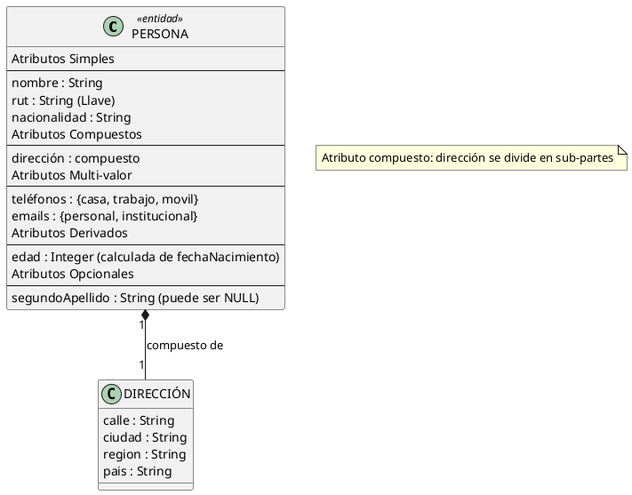
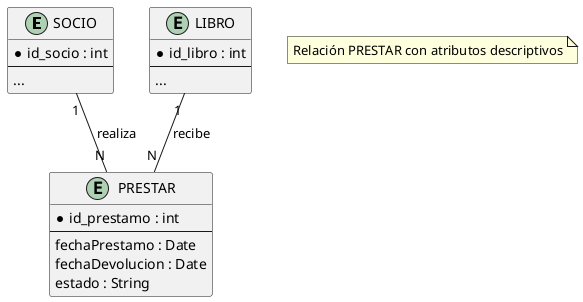
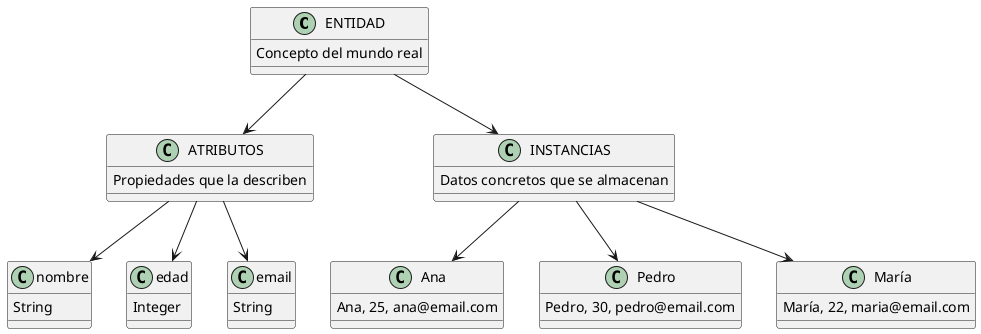

# Entidad, Atributos e Instancias

## ¿Qué es una Entidad?

Una **entidad** es un objeto o concepto del mundo real que tiene **existencia independiente** y es **distinguible** de otros objetos. En el contexto de bases de datos, es todo aquello de lo que necesitamos **guardar información**.

> **Regla práctica para identificar entidades:** Pregúntate: *"¿Puedo buscar, crear, modificar o eliminar instancias de esto?"*
> - Si la respuesta es **SÍ** → Probablemente es una entidad
> - Si es solo un dato descriptivo → Es un **atributo**

### Ejemplo

En un sistema de biblioteca:
- **Libro** → Sí es entidad (puedo crear libros, buscar libros, eliminar libros)
- **Título** → No es entidad, es un atributo de Libro
- **Préstamo** → Sí es entidad (puedo registrar un préstamo, devolverlo, consultarlo)
- **Fecha** → No es entidad, es un atributo de Préstamo

---

## Tipos de Entidades

| Tipo | Descripción | Ejemplo | Característica clave |
| --- | --- | --- | --- |
| **Concreta** | Existe físicamente, tiene representación material | Persona, Libro, Auto, Producto | Tangible |
| **Abstracta** | No existe físicamente pero es relevante para el sistema | Curso, Empresa, Evento, Descuento | Conceptual |
| **Colectiva** | Conjunto de objetos del mismo tipo que se manejan como unidad | Alumnos de un curso, Productos de una categoría | Grupo |
| **Eventual** | Suceso que ocurre en un momento determinado | Venta, Préstamo, Examen, Reserva | Dependiente del tiempo |

### Ejemplo: Sistema de Gestión de un Club Deportivo

| Entidad | Tipo | Justificación |
| --- | --- | --- |
| `Socio` | Concreta | Personas reales que son miembros |
| `Cuota` | Eventual | Pago que ocurre en un momento dado |
| `Disciplina` | Abstracta | Concepto (fútbol, natación, etc.) |
| `Equipo` | Colectiva | Grupo de socios que practican juntos |
| `Campeonato` | Eventual | Evento con fecha de inicio y fin |

---

## Atributos

Un **atributo** es una **característica o propiedad** que describe a una entidad, dándole significado y detalle.

### Tipos de Atributos

| Tipo | Descripción | Ejemplo | Representación en MER |
| --- | --- | --- | --- |
| **Simple** | No se puede dividir en partes | Nombre, RUT, Edad | Óvalo simple |
| **Compuesto** | Se divide en sub-partes | Dirección (calle, ciudad, país) | Óvalo con ramas |
| **Mono-valor** | Un solo valor por instancia | Edad, DNI, ISBN | Óvalo simple |
| **Multi-valor** | Varios valores simultáneamente | Teléfonos, Emails, Especialidades | Óvalo doble |
| **Derivado** | Se calcula a partir de otros atributos | Edad (de fecha de nacimiento) | Óvalo punteado |
| **Llave (Key)** | Identifica unívocamente a la instancia | ISBN, ID, RUT | Óvalo subrayado |
| **Nulo** | Puede no tener valor | Teléfono (opcional), Segundo apellido | Sin restricción |

### Ejemplo Completo: Entidad PERSONA

### Atributos Descriptivos en Relaciones

Los atributos también pueden pertenecer a **relaciones**, no solo a entidades. Esto ocurre cuando la relación misma tiene propiedades.

**Ejemplo:**
- Relación `PRESTAR` entre `SOCIO` y `LIBRO`
- Atributos de la relación: `fechaPrestamo`, `fechaDevolucion`, `estado`

---

## Instancia

Una **instancia** es una **ocurrencia específica y concreta** de una entidad. Es el "dato real" que se almacena en la base de datos.

> **Analogía:**
> - **Entidad** = Clase (molde de galletas)
> - **Instancia** = Objeto (cada galleta individual)

### Ejemplo: Entidad vs Instancia

**Entidad LIBRO** (el concepto):

| Atributo | Tipo |
| --- | --- |
| isbn | String (PK) |
| titulo | String |
| autor | String |
| anio | Integer |
| stock | Integer |

**Instancias de LIBRO** (los datos reales):

| isbn | titulo | autor | anio | stock |
| --- | --- | --- | --- | --- |
| 978-3-16-148410-0 | Cien años de soledad | Gabriel García Márquez | 1967 | 5 |
| 978-0-06-112008-4 | El principito | Antoine de Saint-Exupéry | 1943 | 12 |
| 978-0-452-28423-4 | 1984 | George Orwell | 1949 | 8 |

Cada **fila** de la tabla es una **instancia** de la entidad `LIBRO`.

---

## Relación entre Entidad, Atributo e Instancia

---

## Ejemplo Didáctico: Sistema de una Universidad

### Entidades Identificadas

| Entidad | Tipo | Descripción |
| --- | --- | --- |
| `Estudiante` | Concreta | Persona matriculada en la universidad |
| `Profesor` | Concreta | Persona que dicta clases |
| `Asignatura` | Abstracta | Materia que se imparte |
| `Matrícula` | Eventual | Inscripción de un estudiante a una asignatura |
| `Departamento` | Abstracta | Unidad académica |

### Atributos de cada Entidad

**Estudiante:**
- `id_estudiante` (PK, simple, llave)
- `nombre` (simple)
- `apellido` (simple)
- `email` (simple)
- `fecha_nacimiento` (simple)
- `carrera` (simple)
- `semestre` (simple)
- `edad` (derivado, calculado de fecha_nacimiento)

**Profesor:**
- `id_profesor` (PK, simple)
- `nombre` (simple)
- `especialidad` (multi-valor: puede tener varias)
- `titulo_academico` (simple)
- `departamento_id` (FK)

**Asignatura:**
- `codigo` (PK, simple)
- `nombre` (simple)
- `creditos` (simple)
- `prerequisitos` (multi-valor: varias asignaturas previas)

**Matrícula:**
- `id_matricula` (PK, simple)
- `estudiante_id` (FK)
- `asignatura_codigo` (FK)
- `semestre` (simple)
- `nota_final` (simple)
- `estado` (simple: cursando, aprobado, reprobado)

### Instancias de Ejemplo

**Estudiantes:**

| id_estudiante | nombre | apellido | email | carrera | semestre |
| --- | --- | --- | --- | --- | --- |
| E001 | Ana | García | ana@uni.cl | Ing. Informática | 5 |
| E002 | Pedro | López | pedro@uni.cl | Ing. Civil | 3 |
| E003 | María | Soto | maria@uni.cl | Ing. Informática | 7 |

**Asignaturas:**

| codigo | nombre | creditos |
| --- | --- | --- |
| INF-101 | Programación I | 4 |
| INF-201 | Bases de Datos | 5 |
| CIV-101 | Mecánica de Materiales | 6 |

**Matrículas:**

| id_matricula | estudiante_id | asignatura_codigo | semestre | nota_final | estado |
| --- | --- | --- | --- | --- | --- |
| M001 | E001 | INF-201 | 2026-2 | 6.5 | Aprobado |
| M002 | E002 | CIV-101 | 2026-2 | 5.8 | Aprobado |
| M003 | E001 | INF-101 | 2026-1 | 7.0 | Aprobado |

---

## Errores Comunes

| Error | Ejemplo Incorrecto | Corrección |
| --- | --- | --- |
| **Confundir atributo con entidad** | "Estado civil" como entidad | `EstadoCivil` es atributo de `Persona` |
| **Crear entidades que son atributos** | "Color del producto" como entidad | `Color` es atributo de `Producto` |
| **Olvidar atributos derivados** | No indicar que "edad" se calcula | Marcar `edad` como derivado de `fechaNacimiento` |
| **No identificar multi-valor** | Guardar teléfonos en un campo separado por comas | Crear atributo multi-valor o tabla separada |

---

## Resumen

| Concepto | Definición | Ejemplo |
| --- | --- | --- |
| **Entidad** | Objeto del mundo real con existencia independiente | `Paciente`, `Libro`, `Venta` |
| **Atributo** | Característica que describe a una entidad | `nombre`, `precio`, `fecha` |
| **Instancia** | Ocurrencia concreta de una entidad | Ana García (instancia de `Paciente`) |
| **Entidad Concreta** | Existe físicamente | `Auto`, `Persona` |
| **Entidad Abstracta** | No existe físicamente pero es relevante | `Curso`, `Empresa` |
| **Entidad Eventual** | Suceso en tiempo determinado | `Venta`, `Préstamo` |

---

## Referencias

- [[01_Etapas_del_Diseño_de_BD]] — Proceso completo de diseño
- [[03_Claves_Candidatas_y_Primaria]] — Cómo identificar entidades
- [[04_Relaciones_y_Cardinalidades]] — Conexiones entre entidades
- [[06_Entidades_Debiles_vs_Regulares]] — Tipos de entidades según dependencia
