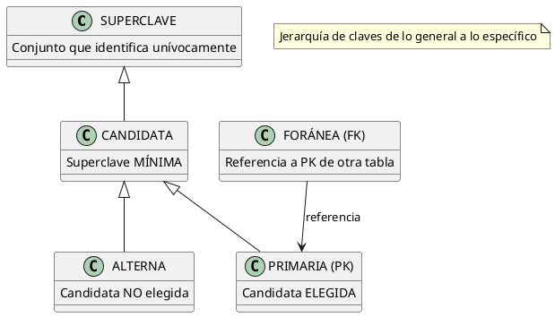

# Claves Candidatas y Clave Primaria

## ¿Qué es una Clave?

Una **clave** es un atributo (o conjunto de atributos) que **identifica unívocamente** cada instancia de una entidad. Sin una clave adecuada, no podríamos distinguir un registro de otro.

> **Analogía:** El RUT de una persona es como una clave. No hay dos personas con el mismo RUT, y con él puedes encontrar a cualquier persona de forma única.

---

## Jerarquía de Claves

La jerarquía de claves va de lo más general a lo más específico:



---

## Tipos de Claves

### 1. Superclave

Una **superclave** es un conjunto de atributos que identifica unívocamente cada instancia. Puede tener **atributos redundantes** (de más).

**Ejemplo:**

| Atributos en la superclave | ¿Identifica único? | ¿Es mínima? |
| --- | --- | --- |
| `{RUT}` | Sí | Sí |
| `{RUT, nombre}` | Sí | **No** (nombre es redundante) |
| `{RUT, nombre, telefono}` | Sí | **No** (hay dos de más) |
| `{email}` | Sí | Sí |

> Una misma entidad puede tener **múltiples superclaves**.

### 2. Clave Candidata

Una **clave candidata** es una superclave **mínima**: si eliminas cualquier atributo de ella, ya no identifica unívocamente.

**Criterios de una clave candidata:**

| Criterio | Descripción | Ejemplo |
| --- | --- | --- |
| **Unicidad** | No puede haber dos instancias con el mismo valor | No pueden existir dos personas con el mismo RUT |
| **Minimalidad** | No puede tener atributos redundantes | `{RUT}` es candidata, `{RUT, nombre}` no |
| **Irreducibilidad** | Ningún subconjunto propio es candidata | `{RUT, email}` no es candidata si `{RUT}` ya funciona |

**Ejemplo: Entidad PERSONA**

| Conjunto de atributos | ¿Es superclave? | ¿Es candidata? | Justificación |
| --- | --- | --- | --- |
| `{RUT}` | Sí | **Sí** | Identifica único y es mínima |
| `{email}` | Sí | **Sí** | Identifica único y es mínima |
| `{RUT, nombre}` | Sí | No | Tiene atributo redundante (nombre) |
| `{nombre, apellido}` | No | No | Dos personas pueden tener el mismo nombre |

### 3. Clave Primaria (PK)

La **clave primaria** es la clave candidata **elegida** como identificador principal de la entidad. Es la que se usa en el diseño de la base de datos.

**Características:**
- **Nunca puede ser NULL** (integridad de entidad)
- **Debe ser única** en toda la tabla
- **Es estable** (idealmente no cambia con el tiempo)
- **Es simple** cuando es posible (mejor un solo atributo que varios)

### 4. Clave Alterna

Es una clave candidata que **no fue elegida** como primaria. Puede tener una restricción `UNIQUE` para mantener unicidad.

**Ejemplo:**
- PK: `id_estudiante` (autonumérico, estable)
- Alterna: `rut` (único, pero puede cambiar si hay correcciones)
- Alterna: `email` (único, pero puede cambiar)

### 5. Clave Foránea (FK)

Es un atributo en una tabla que **referencia** la clave primaria de otra tabla. Establece la **relación** entre tablas.

**Características:**
- **Puede ser NULL** (si la participación es parcial)
- **Debe referenciar** una PK existente o ser NULL
- **Puede no ser única** (muchas filas pueden apuntar a la misma PK)

### 6. Clave Compuesta

Es una clave formada por **dos o más atributos**. Se usa cuando un solo atributo no es suficiente para identificar únicamente.

**Ejemplo:**

```sql
-- Tabla MATRICULA: un estudiante puede matricularse a la misma 
-- asignatura en diferentes semestres
CREATE TABLE matricula (
    id_estudiante   INT,
    codigo_asig     VARCHAR(10),
    semestre        VARCHAR(10),
    nota_final      DECIMAL(3,1),
    PRIMARY KEY (id_estudiante, codigo_asig, semestre)
);
-- La PK compuesta garantiza que un estudiante no se matricule 
-- dos veces a la misma asignatura en el mismo semestre
```

---

## Criterios de Unicidad y Minimalidad

### Criterio de Unicidad

Para que un conjunto de atributos sea clave, debe cumplir:

> **Para cualquier par de instancias distintas, al menos un atributo de la clave debe tener valores diferentes.**

**Ejemplo:**

| Estudiante | RUT | Email | Nombre |
| --- | --- | --- | --- |
| Ana | 12.345.678-9 | ana@uni.cl | Ana García |
| Pedro | 12.345.678-9 | pedro@uni.cl | Pedro López |

- `{RUT}` **NO** es clave: Ana y Pedro tienen el mismo RUT
- `{Email}` **SÍ** es clave: cada uno tiene un email diferente
- `{RUT, Email}` **SÍ** es clave (pero no es mínima)

### Criterio de Minimalidad

Para que un conjunto sea **mínimo**, debe cumplir:

> **Ningún subconjunto propio del conjunto es también una superclave.**

**Ejemplo:**

| Conjunto | ¿Es superclave? | ¿Es mínima? | Razón |
| --- | --- | --- | --- |
| `{RUT, email, telefono}` | Sí | No | `{RUT}` ya es superclave |
| `{RUT, email}` | Sí | No | `{RUT}` ya es superclave |
| `{RUT}` | Sí | **Sí** | No se puede quitar nada |
| `{email}` | Sí | **Sí** | No se puede quitar nada |

---

## Ejemplo Completo: Sistema de Biblioteca

### Entidad SOCIO

| Atributo | Descripción | ¿Clave? |
| --- | --- | --- |
| `id_socio` | ID autonumérico | **PK** (elegida) |
| `rut` | RUT del socio | **Alterna** (única) |
| `email` | Correo electrónico | **Alterna** (única) |
| `nombre` | Nombre completo | No |
| `direccion` | Dirección | No |
| `telefono` | Teléfono | No |

**Claves candidatas identificadas:**
1. `{id_socio}` → Elegida como PK (es autonumérica, estable, simple)
2. `{rut}` → Alterna (única pero puede cambiar)
3. `{email}` → Alterna (única pero puede cambiar)

### Entidad LIBRO

| Atributo | Descripción | ¿Clave? |
| --- | --- | --- |
| `isbn` | ISBN del libro | **PK** (elegida) |
| `titulo` | Título del libro | No (pueden haber libros con el mismo título) |
| `autor` | Autor | No |
| `editorial` | Editorial | No |

**Claves candidatas identificadas:**
1. `{isbn}` → Elegida como PK (estándar internacional, único)

### Entidad PRESTAMO (Entidad Débil)

| Atributo | Descripción | ¿Clave? |
| --- | --- | --- |
| `id_prestamo` | ID autonumérico | **PK** |
| `isbn` | FK a LIBRO | Parte de PK compuesta |
| `id_socio` | FK a SOCIO | Parte de PK compuesta |
| `fecha_prestamo` | Fecha del préstamo | Parte de PK compuesta |

**Clave compuesta:** `{isbn, id_socio, fecha_prestamo}` (un socio no puede pedir prestado el mismo libro dos veces en el mismo día)

---

## Reglas de las Claves

| Regla | Descripción | Importancia |
| --- | --- | --- |
| **La PK nunca puede ser NULL** | Toda instancia debe tener un identificador | Integridad de entidad |
| **La PK debe ser única** | No pueden existir dos filas con la misma PK | Unicidad |
| **La FK puede ser NULL** | Si la participación es parcial | Flexibilidad |
| **La FK debe referenciar una PK existente** | O ser NULL | Integridad referencial |
| **La PK debe ser estable** | Idealmente no cambia con el tiempo | Consistencia |
| **Prefiere PK simple** | Un solo atributo sobre compuesta | Simplicidad |

---

## Mapeo a SQL

### De Entidad a Tabla

```sql
-- Entidad: SOCIO
-- PK: id_socio
-- Alterna: rut (UNIQUE)
-- Alterna: email (UNIQUE)

CREATE TABLE socio (
    id_socio    INT PRIMARY KEY AUTO_INCREMENT,
    rut         VARCHAR(12) NOT NULL UNIQUE,
    email       VARCHAR(100) NOT NULL UNIQUE,
    nombre      VARCHAR(100) NOT NULL,
    direccion   VARCHAR(200),
    telefono    VARCHAR(15)
);
```

### De Relación 1:N a FK

```sql
-- Relación: SOCIO (1) → PRESTAMO (N)
-- FK: id_socio en tabla prestamo

CREATE TABLE prestamo (
    id_prestamo     INT PRIMARY KEY AUTO_INCREMENT,
    isbn            VARCHAR(20) NOT NULL,
    id_socio        INT NOT NULL,
    fecha_prestamo  DATE NOT NULL,
    fecha_devolucion DATE,
    estado          VARCHAR(20) DEFAULT 'ACTIVO',
    FOREIGN KEY (isbn) REFERENCES libro(isbn),
    FOREIGN KEY (id_socio) REFERENCES socio(id_socio)
);
```

### De Relación N:M a Tabla Intermedia

```sql
-- Relación N:M: ESTUDIANTE ↔ ASIGNATURA
-- PK compuesta: (id_estudiante, codigo_asig, semestre)

CREATE TABLE matricula (
    id_estudiante   INT,
    codigo_asig     VARCHAR(10),
    semestre        VARCHAR(10),
    nota_final      DECIMAL(3,1),
    estado          VARCHAR(20),
    PRIMARY KEY (id_estudiante, codigo_asig, semestre),
    FOREIGN KEY (id_estudiante) REFERENCES estudiante(id),
    FOREIGN KEY (codigo_asig) REFERENCES asignatura(codigo)
);
```

---

## Resumen

| Tipo de Clave | Definición | Ejemplo | ¿Puede ser NULL? |
| --- | --- | --- | --- |
| **Superclave** | Conjunto que identifica único (puede tener de más) | `{RUT, nombre, email}` | No (si incluye PK) |
| **Candidata** | Superclave mínima | `{RUT}`, `{email}` | No |
| **Primaria (PK)** | Candidata elegida | `{id_socio}` | **Nunca** |
| **Alterna** | Candidata no elegida | `{rut}`, `{email}` | Depende (UNIQUE) |
| **Foránea (FK)** | Referencia a PK otra tabla | `{id_socio}` en Prestamo | Sí (si es parcial) |
| **Compuesta** | PK formada por 2+ atributos | `{isbn, id_socio, fecha}` | No |

---

## Referencias

- [[02_Entidad_Atributos_e_Instancias]] — Conceptos de entidad y atributo
- [[04_Relaciones_y_Cardinalidades]] — Cómo se conectan las entidades
- [[06_Entidades_Debiles_vs_Regulares]] — Claves en entidades débiles
- [[01_Etapas_del_Diseño_de_BD]] — Normalización y diseño
