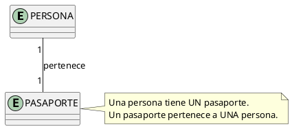
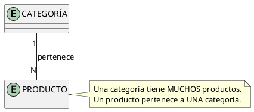
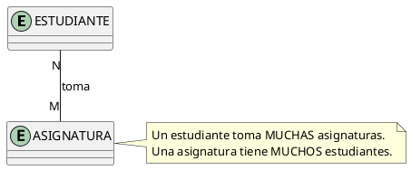
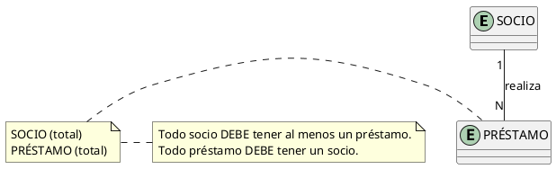
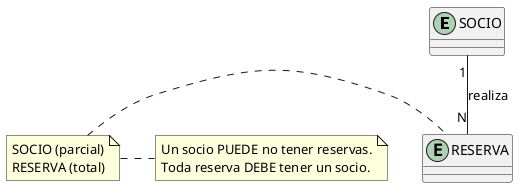
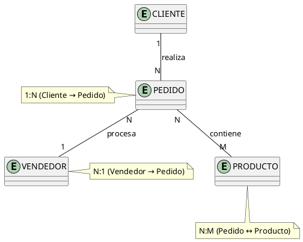
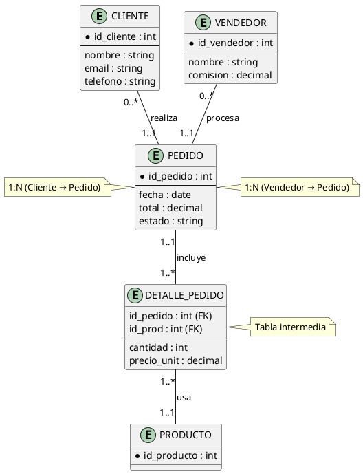

# Relaciones y Cardinalidades

## ¿Qué es una Relación?

Una **relación** es una **asociación** entre dos o más entidades que describe **cómo se conectan** y **qué hacen juntas**. En el diagrama E-R, se representa con un **rombo**.

> **Pregúntate:** ¿Qué verbo conecta estas dos entidades?
> - Socio **realiza** Préstamo
> - Producto **pertenece a** Categoría
> - Doctor **atiende** Paciente

### Componentes de una Relación

| Componente | Descripción | Ejemplo |
| --- | --- | --- |
| **Nombre** | Verbo que describe la conexión | "realizar", "pertenecer a", "atender" |
| **Entidades** | Entidades involucradas | Socio ↔ Préstamo |
| **Cardinalidad** | Número de instancias que participan | 1:N, N:M, 1:1 |
| **Participación** | Obligatoriedad de la relación | Total (obligatoria) o Parcial (opcional) |
| **Atributos propios** | Propiedades de la relación misma | Fecha, hora, cantidad |

---

## Cardinalidad

La **cardinalidad** define el **número máximo** de instancias de una entidad que pueden asociarse con instancias de otra entidad en una relación.

### Los Tres Tipos de Cardinalidad

#### 1. Uno a Uno (1:1)

**Una** instancia de A se asocia con **una** instancia de B, y viceversa.



**Ejemplos:**

| Entidad A | Entidad B | Justificación |
| --- | --- | --- |
| Persona | Pasaporte | Cada persona tiene un pasaporte único |
| País | Capital | Cada país tiene una capital |
| Auto | Patente | Cada auto tiene una patente única |

**Implementación SQL:**

```sql
-- Opción 1: FK en una de las tablas
CREATE TABLE pasaporte (
    numero      VARCHAR(20) PRIMARY KEY,
    id_persona  INT UNIQUE NOT NULL,  -- UNIQUE garantiza 1:1
    fecha_exp   DATE,
    FOREIGN KEY (id_persona) REFERENCES persona(id)
);
```

#### 2. Uno a Varios (1:N)

**Una** instancia de A se asocia con **muchas** instancias de B, pero cada instancia de B se asocia con **una sola** instancia de A.



**Ejemplos:**

| Entidad A (1) | Entidad B (N) | Justificación |
| --- | --- | --- |
| Departamento | Empleado | Un depto tiene muchos empleados |
| Cliente | Pedido | Un cliente hace muchos pedidos |
| Autor | Libro | Un autor escribe muchos libros |
| Madre | Hijo | Una madre tiene muchos hijos |

**Implementación SQL:**

```sql
-- FK en el lado "N"
CREATE TABLE producto (
    id_producto     INT PRIMARY KEY,
    nombre          VARCHAR(100),
    id_categoria    INT NOT NULL,
    FOREIGN KEY (id_categoria) REFERENCES categoria(id)
);
```

#### 3. Varios a Varios (N:M)

**Muchas** instancias de A se asocian con **muchas** instancias de B, y viceversa.



**Ejemplos:**

| Entidad A | Entidad B | Justificación |
| --- | --- | --- |
| Estudiante | Curso | Un estudiante toma muchos cursos |
| Actor | Película | Un actor actúa en muchas películas |
| Producto | Pedido | Un producto aparece en muchos pedidos |
| Paciente | Doctor | Un paciente ve a muchos doctores |

**Implementación SQL (requiere tabla intermedia):**

```sql
-- Tabla intermedia
CREATE TABLE matricula (
    id_estudiante   INT,
    codigo_asig     VARCHAR(10),
    fecha_inscrip   DATE,
    nota_final      DECIMAL(3,1),
    PRIMARY KEY (id_estudiante, codigo_asig),
    FOREIGN KEY (id_estudiante) REFERENCES estudiante(id),
    FOREIGN KEY (codigo_asig) REFERENCES asignatura(codigo)
);
```

> **Regla de oro:** Siempre que tengas una relación **N:M**, necesitas una **tabla intermedia** para implementarla en una base de datos relacional.

---

## Participación

La **participación** define si la relación es **obligatoria** o **opcional** para cada entidad.

| Tipo | Descripción | Notación | Ejemplo |
| --- | --- | --- | --- |
| **Total** | Toda instancia **DEBE** participar en la relación | Línea doble | Todo préstamo **DEBE** tener un socio |
| **Parcial** | La participación es **OPCIONAL** | Línea simple | Un socio **PUEDE** no tener préstamos |

### Ejemplo: Sistema de Biblioteca





### Participación Total vs Parcial

| Situación | Participación Socio | Participación Préstamo |
| --- | --- | --- |
| "Todo socio debe tener al menos un préstamo" | **Total** | — |
| "Un préstamo siempre tiene un socio" | — | **Total** |
| "Un socio puede no tener préstamos" | **Parcial** | — |
| "Un préstamo siempre tiene un socio" | — | **Total** |

---

## Cardinalidad Mínima y Máxima

La cardinalidad se expresa con dos valores: **mínima** y **máxima**.

| Notación | Mínima | Máxima | Significado |
| --- | --- | --- | --- |
| `1..1` | 1 | 1 | Exactamente uno (obligatorio) |
| `0..1` | 0 | 1 | Cero o uno (opcional) |
| `1..*` | 1 | N | Uno o más (obligatorio) |
| `0..*` | 0 | N | Cero o más (opcional) |

### Ejemplo: Sistema Hospitalario

| Relación | Cardinalidad | Lectura |
| --- | --- | --- |
| Paciente → Cita | `0..*` | Un paciente puede tener **cero o más** citas |
| Cita → Paciente | `1..1` | Toda cita tiene **exactamente un** paciente |
| Doctor → Cita | `1..*` | Un doctor tiene **una o más** citas |
| Cita → Doctor | `1..1` | Toda cita tiene **exactamente un** doctor |

---

## Mapeo de Cardinalidades a SQL

### 1:1

```sql
-- FK con UNIQUE
CREATE TABLE pasaporte (
    numero      VARCHAR(20) PRIMARY KEY,
    id_persona  INT UNIQUE,
    FOREIGN KEY (id_persona) REFERENCES persona(id)
);
```

### 1:N

```sql
-- FK en el lado "N"
CREATE TABLE empleado (
    id_empleado INT PRIMARY KEY,
    nombre      VARCHAR(100),
    id_depto    INT NOT NULL,
    FOREIGN KEY (id_depto) REFERENCES departamento(id)
);
```

### N:M

```sql
-- Tabla intermedia
CREATE TABLE inscripcion (
    id_estudiante INT,
    id_curso      INT,
    fecha         DATE,
    nota          DECIMAL(3,1),
    PRIMARY KEY (id_estudiante, id_curso),
    FOREIGN KEY (id_estudiante) REFERENCES estudiante(id),
    FOREIGN KEY (id_curso) REFERENCES curso(id)
);
```

---

## Ejemplo Didáctico: Sistema de Ventas

### Entidades y Relaciones



### Detalle de Relaciones

| Relación | Cardinalidad | Participación | Descripción |
| --- | --- | --- | --- |
| Cliente → Pedido | 1:N | Cliente: Parcial, Pedido: Total | Un cliente hace muchos pedidos; todo pedido tiene un cliente |
| Pedido → Producto | N:M | Ambas: Total | Un pedido tiene muchos productos; todo producto aparece en pedidos |
| Vendedor → Pedido | 1:N | Vendedor: Parcial, Pedido: Total | Un vendedor procesa muchos pedidos; todo pedido tiene un vendedor |

### Diagrama E-R Detallado



### Implementación SQL Completa

```sql
-- Tabla CLIENTE
CREATE TABLE cliente (
    id_cliente  INT PRIMARY KEY AUTO_INCREMENT,
    nombre      VARCHAR(100) NOT NULL,
    email       VARCHAR(100) UNIQUE,
    telefono    VARCHAR(15)
);

-- Tabla VENDEDOR
CREATE TABLE vendedor (
    id_vendedor INT PRIMARY KEY AUTO_INCREMENT,
    nombre      VARCHAR(100) NOT NULL,
    comision    DECIMAL(5,2)
);

-- Tabla PEDIDO (FK a Cliente y Vendedor)
CREATE TABLE pedido (
    id_pedido   INT PRIMARY KEY AUTO_INCREMENT,
    id_cliente  INT NOT NULL,
    id_vendedor INT NOT NULL,
    fecha       DATE NOT NULL,
    total       DECIMAL(10,2),
    estado      VARCHAR(20) DEFAULT 'PENDIENTE',
    FOREIGN KEY (id_cliente) REFERENCES cliente(id_cliente),
    FOREIGN KEY (id_vendedor) REFERENCES vendedor(id_vendedor)
);

-- Tabla PRODUCTO
CREATE TABLE producto (
    id_producto INT PRIMARY KEY AUTO_INCREMENT,
    nombre      VARCHAR(100) NOT NULL,
    precio      DECIMAL(10,2),
    stock       INT DEFAULT 0
);

-- Tabla intermedia DETALLE_PEDIDO (resuelve N:M)
CREATE TABLE detalle_pedido (
    id_pedido       INT,
    id_producto     INT,
    cantidad        INT NOT NULL,
    precio_unitario DECIMAL(10,2),
    PRIMARY KEY (id_pedido, id_producto),
    FOREIGN KEY (id_pedido) REFERENCES pedido(id_pedido),
    FOREIGN KEY (id_producto) REFERENCES producto(id_producto)
);
```

---

## Resumen

| Cardinalidad | Significado | Ejemplo | Implementación SQL |
| --- | --- | --- | --- |
| **1:1** | Uno a Uno | Persona ↔ Pasaporte | FK con UNIQUE |
| **1:N** | Uno a Varios | Categoría → Producto | FK en el lado N |
| **N:M** | Varios a Varios | Estudiante ↔ Asignatura | Tabla intermedia |

| Participación | Significado | Ejemplo |
| --- | --- | --- |
| **Total** | Obligatoria (DEBE participar) | Todo préstamo DEBE tener un socio |
| **Parcial** | Opcional (PUEDE no participar) | Un socio PUEDE no tener préstamos |

---

## Referencias

- [[03_Claves_Candidatas_y_Primaria]] — Claves primarias y foráneas
- [[05_Relaciones_Especiales]] — N-arias, unarias y atributos descriptivos
- [[06_Entidades_Debiles_vs_Regulares]] — Entidades débiles y sus claves
- [[08_Caso_de_Estudio_Completo]] — Ejemplo integrado
