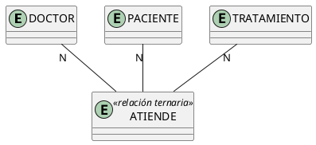
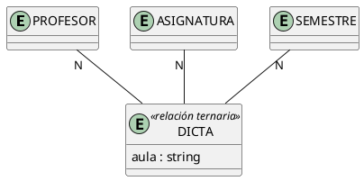
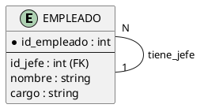
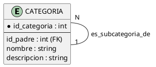
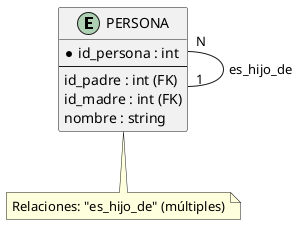
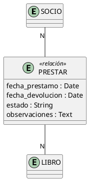
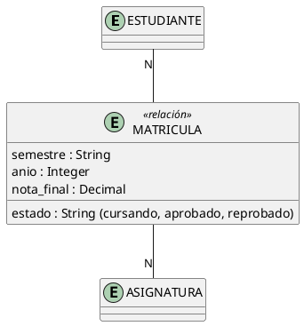
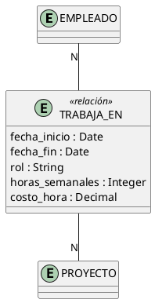

# Relaciones Especiales

## ¿Qué son las Relaciones Especiales?

Las relaciones especiales son aquellas que **van más allá** de la relación binaria básica (dos entidades conectadas). Incluyen:

- **Relaciones N-arias**: involucran **tres o más** entidades simultáneamente
- **Relaciones Unarias (Autorreferenciadas)**: una entidad se relaciona **consigo misma**
- **Atributos descriptivos en relaciones**: propiedades que pertenecen a la **relación misma**, no a las entidades

---

## 1. Relaciones N-arias (Ternarias, Cuaternarias)

### ¿Qué es una Relación N-aria?

Una **relación N-aria** es una asociación que involucra **tres o más entidades** al mismo tiempo. La más común es la **ternaria** (3 entidades).

> **Cuándo usarla:** Cuando el significado de la relación **no se puede descomponer** en relaciones binarias sin perder información.

### Relación Ternaria (3 entidades)



**Significado:** Un doctor atiende a un paciente con un tratamiento específico.

**¿Por qué no se puede descomponer?**
- Si separas "Doctor atiende Paciente" y "Paciente recibe Tratamiento", pierdes **qué doctor recetó qué tratamiento** a qué paciente.

### Ejemplo: Sistema de Profesores y Asignaturas



**Relación ternaria:** `DICTA(profesor, asignatura, semestre)

**Significado:** Un profesor dicta una asignatura en un semestre específico.

**Tabla resultante:**

| id_profesor | codigo_asig | semestre | aula |
| --- | --- | --- | --- |
| P001 | INF-201 | 2026-2 | A-301 |
| P001 | INF-101 | 2026-1 | B-202 |
| P002 | MAT-101 | 2026-2 | C-101 |

### Implementación SQL

```sql
-- Relación ternaria: PROFESOR dicta ASIGNATURA en SEMESTRE
CREATE TABLE dicta (
    id_profesor     INT,
    codigo_asig     VARCHAR(10),
    semestre        VARCHAR(10),
    aula            VARCHAR(10),
    PRIMARY KEY (id_profesor, codigo_asig, semestre),
    FOREIGN KEY (id_profesor) REFERENCES profesor(id),
    FOREIGN KEY (codigo_asig) REFERENCES asignatura(codigo)
);
```

### ¿Cuándo usar Ternaria vs Binarias?

| Situación | ¿Ternaria? | ¿Binarias? |
| --- | --- | --- |
| "Un doctor atiende a un paciente con un tratamiento" | **Sí** | No (pierde la asociación doctor-tratamiento) |
| "Un estudiante toma un curso" | No | **Sí** (binaria N:M) |
| "Un vendedor vende un producto en una tienda" | **Sí** | No (necesita las 3 entidades juntas) |

> **Regla práctica:** Intenta descomponer en binarias. Si al hacerlo **pierdes información**, usa ternaria.

---

## 2. Relaciones Unarias (Autorreferenciadas)

### ¿Qué es una Relación Unaria?

Una **relación unaria** (o autorreferenciada) es una relación donde **una entidad se relaciona consigo misma**. Es decir, una instancia de la entidad se asocia con otra instancia de la **misma** entidad.

> **Analogía:** Piensa en un organigrama: cada empleado puede tener un "jefe", que también es un empleado.

### Ejemplo: Empleado y su Jefe



**Significado:** Cada empleado puede tener un jefe, que es otro empleado de la misma tabla.

### Ejemplo: Categoría y Subcategoría



**Ejemplo de datos:**

| id_categoria | nombre | id_padre |
| --- | --- | --- |
| 1 | Electrónica | NULL |
| 2 | Computadoras | 1 |
| 3 | Laptops | 2 |
| 4 | Celulares | 1 |
| 5 | Smartphones | 4 |

**Interpretación:**
- "Electrónica" es categoría raíz (no tiene padre)
- "Computadoras" es subcategoría de "Electrónica"
- "Laptops" es subcategoría de "Computadoras"

### Ejemplo: Árbol Genealógico



### Implementación SQL

```sql
-- Empleado con jefe (autorreferencia)
CREATE TABLE empleado (
    id_empleado INT PRIMARY KEY AUTO_INCREMENT,
    nombre      VARCHAR(100) NOT NULL,
    cargo       VARCHAR(50),
    id_jefe     INT,  -- FK a sí misma
    FOREIGN KEY (id_jefe) REFERENCES empleado(id_empleado)
);

-- Categoría con padre (autorreferencia)
CREATE TABLE categoria (
    id_categoria INT PRIMARY KEY AUTO_INCREMENT,
    nombre       VARCHAR(100) NOT NULL,
    id_padre     INT,  -- FK a sí misma
    descripcion  TEXT,
    FOREIGN KEY (id_padre) REFERENCES categoria(id_categoria)
);
```

### Ejemplo de Datos: Organigrama

| id_empleado | nombre | cargo | id_jefe |
| --- | --- | --- | --- |
| 1 | Carlos García | Gerente General | NULL |
| 2 | Ana López | Jefe de Ventas | 1 |
| 3 | Pedro Soto | Jefe de TI | 1 |
| 4 | María Ruiz | Vendedora | 2 |
| 5 | Juan Torres | Desarrollador | 3 |

**Lectura:**
- Carlos García es el jefe de Ana y Pedro
- Ana López es la jefa de María
- Pedro Soto es el jefe de Juan

---

## 3. Atributos Descriptivos en Relaciones

### ¿Qué son?

Son **propiedades** que pertenecen a la **relación misma**, no a las entidades involucradas. Se usan cuando la relación tiene información propia que describir.

### Ejemplo: Relación PRESTAR



**Significado:** La relación PRESTAR tiene atributos propios:
- `fecha_prestamo`: ¿cuándo se prestó?
- `fecha_devolucion`: ¿cuándo se devolvió?
- `estado`: ¿está activo, devuelto, atrasado?

### Ejemplo: Relación MATRICULA



### Ejemplo: Relación TRABAJA_EN



### Implementación SQL

```sql
-- Los atributos de la relación van en la tabla intermedia
CREATE TABLE prestamo (
    id_prestamo         INT PRIMARY KEY AUTO_INCREMENT,
    id_socio            INT NOT NULL,
    isbn                VARCHAR(20) NOT NULL,
    fecha_prestamo      DATE NOT NULL,      -- Atributo de la relación
    fecha_devolucion    DATE,                -- Atributo de la relación
    estado              VARCHAR(20),         -- Atributo de la relación
    observaciones       TEXT,                -- Atributo de la relación
    FOREIGN KEY (id_socio) REFERENCES socio(id_socio),
    FOREIGN KEY (isbn) REFERENCES libro(isbn)
);
```

### Ejemplo de Datos

| id_prestamo | id_socio | isbn | fecha_prestamo | fecha_devolucion | estado |
| --- | --- | --- | --- | --- | --- |
| 1 | S001 | 978-3-16-148410-0 | 2026-09-01 | 2026-09-15 | DEVUELTO |
| 2 | S002 | 978-0-06-112008-4 | 2026-09-05 | NULL | ACTIVO |
| 3 | S001 | 978-0-452-28423-4 | 2026-08-20 | NULL | ATRASADO |

---

## Resumen

| Tipo | Descripción | Ejemplo | Cuándo usar |
| --- | --- | --- | --- |
| **N-aria (Ternaria)** | 3+ entidades simultáneamente | Doctor atiende Paciente con Tratamiento | Cuando no se puede descomponer en binarias |
| **Unaria (Autorreferencia)** | Entidad se relaciona consigo misma | Empleado tiene Jefe (otro Empleado) | Jerarquías, árboles, listas enlazadas |
| **Atributos descriptivos** | Propiedades de la relación | Fecha de préstamo, nota en matrícula | Cuando la relación tiene información propia |

---

## Referencias

- [[04_Relaciones_y_Cardinalidades]] — Relaciones binarias básicas
- [[06_Entidades_Debiles_vs_Regulares]] — Entidades débiles
- [[07_Criterios_de_Diseño]] — Cuándo modelar como atributo vs entidad
- [[08_Caso_de_Estudio_Completo]] — Ejemplo integrado
