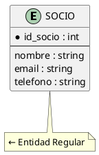
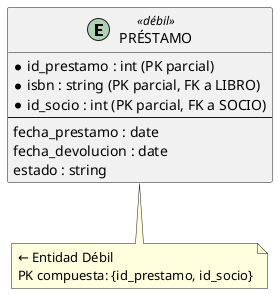
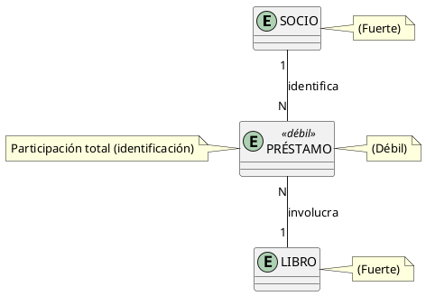
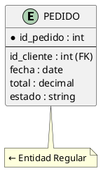
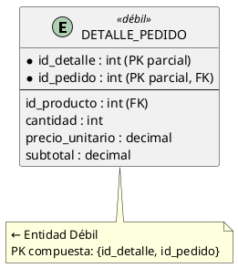
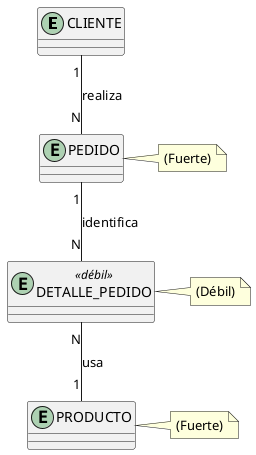
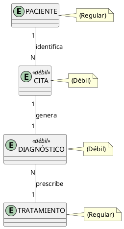

# Entidades Débiles vs Entidades Regulares

## ¿Qué es una Entidad Regular (Fuerte)?

Una **entidad regular** (o fuerte) es aquella que tiene **existencia independiente** y **su propia clave primaria**. No necesita de otra entidad para existir ni para ser identificada.

> **Características:**
> - Tiene su propia **clave primaria** (PK propia)
> - Puede existir **sin** otras entidades
> - Se representa con un **rectángulo simple** en el diagrama E-R

### Ejemplos de Entidades Regulares

| Entidad | PK Propia | ¿Depende de otra? |
| --- | --- | --- |
| `Paciente` | `id_historia_clinica` | No |
| `Doctor` | `id_doctor` | No |
| `Producto` | `id_producto` | No |
| `Cliente` | `id_cliente` | No |
| `Asignatura` | `codigo` | No |

---

## ¿Qué es una Entidad Débil?

Una **entidad débil** es aquella que **NO tiene su propia clave primaria** completa y **depende de otra entidad** (llamada **entidad fuerte** o **identificadora**) para existir y ser identificada.

> **Características:**
> - **NO tiene** su propia PK completa
> - Su PK se forma **combinando** parte de la PK de la entidad fuerte + un **atributo discriminador**
> - **NO puede existir** sin la entidad fuerte
> - Se representa con un **rectángulo con doble borde** en el diagrama E-R
> - La relación con la entidad fuerte es de **identificación** (rombo relleno)

### Ejemplos de Entidades Débiles

| Entidad Débil | Entidad Fuerte | ¿Por qué es débil? |
| --- | --- | --- |
| `Préstamo` | `Socio` | Un préstamo no existe sin un socio |
| `DetallePedido` | `Pedido` | Un detalle no existe sin un pedido |
| `Departamento` | `Empresa` | Un departamento no existe sin la empresa |
| `Hijo` | `Padre` | Un hijo no existe biológicamente sin padres |
| `Factura_Línea` | `Factura` | Una línea no existe sin la factura |

---

## Diferencias Clave

| Aspecto | Entidad Regular (Fuerte) | Entidad Débil |
| --- | --- | --- |
| **Existencia** | Independiente | Depende de otra entidad |
| **Clave Primaria** | Tiene su propia PK | PK compuesta (parte de la PK de la fuerte) |
| **Representación** | Rectángulo simple | Rectángulo con doble borde |
| **Relación** | Asociación normal | Relación de identificación (rombo relleno) |
| **Eliminación** | Se puede eliminar sin afectar otras | Si se elimina la fuerte, se eliminan las débiles |
| **Ejemplo** | `Paciente`, `Producto` | `Préstamo`, `DetallePedido` |

---

## Ejemplo Detallado: Sistema de Biblioteca

### Entidad Fuerte: SOCIO



### Entidad Débil: PRÉSTAMO



### Diagrama E-R



**Significado:**
- Un **SOCIO** puede tener muchos **PRÉSTAMOS** (1:N)
- Un **PRÉSTAMO** siempre tiene un **SOCIO** (identificación)
- Un **PRÉSTAMO** involucra un **LIBRO** (N:1)
- **PRÉSTAMO** no puede existir sin SOCIO ni LIBRO

---

## Ejemplo Detallado: Sistema de Ventas

### Entidad Fuerte: PEDIDO



### Entidad Débil: DETALLE_PEDIDO



### Diagrama E-R



---

## Implementación SQL

### Entidad Débil: PRÉSTAMO

```sql
-- Entidad fuerte: SOCIO
CREATE TABLE socio (
    id_socio    INT PRIMARY KEY AUTO_INCREMENT,
    nombre      VARCHAR(100) NOT NULL,
    email       VARCHAR(100) UNIQUE
);

-- Entidad débil: PRÉSTAMO
-- PK compuesta: (id_prestamo, id_socio)
CREATE TABLE prestamo (
    id_prestamo     INT,
    id_socio        INT,
    isbn            VARCHAR(20) NOT NULL,
    fecha_prestamo  DATE NOT NULL,
    fecha_devolucion DATE,
    estado          VARCHAR(20) DEFAULT 'ACTIVO',
    PRIMARY KEY (id_prestamo, id_socio),
    FOREIGN KEY (id_socio) REFERENCES socio(id_socio),
    FOREIGN KEY (isbn) REFERENCES libro(isbn)
);
```

### Entidad Débil: DETALLE_PEDIDO

```sql
-- Entidad fuerte: PEDIDO
CREATE TABLE pedido (
    id_pedido   INT PRIMARY KEY AUTO_INCREMENT,
    id_cliente  INT NOT NULL,
    fecha       DATE NOT NULL,
    total       DECIMAL(10,2),
    FOREIGN KEY (id_cliente) REFERENCES cliente(id_cliente)
);

-- Entidad débil: DETALLE_PEDIDO
-- PK compuesta: (id_detalle, id_pedido)
CREATE TABLE detalle_pedido (
    id_detalle      INT,
    id_pedido       INT,
    id_producto     INT NOT NULL,
    cantidad        INT NOT NULL,
    precio_unitario DECIMAL(10,2),
    PRIMARY KEY (id_detalle, id_pedido),
    FOREIGN KEY (id_pedido) REFERENCES pedido(id_pedido),
    FOREIGN KEY (id_producto) REFERENCES producto(id_producto)
);
```

---

## Consecuencias de la Eliminación

### Entidad Regular: Se puede eliminar independientemente

```sql
-- Eliminar un socio NO afecta otras entidades
-- (a menos que haya FK con ON DELETE CASCADE)
DELETE FROM socio WHERE id_socio = 1;
```

### Entidad Débil: Si se elimina la fuerte, se eliminan las débiles

```sql
-- Si se elimina un pedido, sus detalles TAMBIÉN se eliminan
-- (usando ON DELETE CASCADE)
CREATE TABLE detalle_pedido (
    id_detalle  INT,
    id_pedido   INT,
    ...
    PRIMARY KEY (id_detalle, id_pedido),
    FOREIGN KEY (id_pedido) REFERENCES pedido(id_pedido) 
        ON DELETE CASCADE  -- Elimina en cascada
);
```

---

## Regla para Identificar Entidades Débiles

Pregúntate:

1. **¿La entidad tiene su propia PK?**
   - Si **SÍ** → Entidad regular
   - Si **NO** → Posiblemente débil

2. **¿Puede existir sin otra entidad?**
   - Si **SÍ** → Entidad regular
   - Si **NO** → Entidad débil

3. **¿Su PK depende de la PK de otra entidad?**
   - Si **SÍ** → Entidad débil
   - Si **NO** → Entidad regular

---

## Ejemplo: Sistema de Hospital

| Entidad | Tipo | PK | Justificación |
| --- | --- | --- | --- |
| `Paciente` | Regular | `id_historia` | Existe independientemente |
| `Doctor` | Regular | `id_doctor` | Existe independientemente |
| `Cita` | **Débil** | `{id_cita, id_paciente}` | Una cita no existe sin un paciente |
| `Diagnóstico` | **Débil** | `{id_diag, id_cita}` | Un diagnóstico no existe sin una cita |
| `Tratamiento` | Regular | `id_tratamiento` | Puede existir independientemente |

### Diagrama



---

## Resumen

| Concepto | Entidad Regular | Entidad Débil |
| --- | --- | --- |
| **Definición** | Tiene existencia independiente | Depende de otra entidad |
| **Clave Primaria** | PK propia | PK compuesta (con PK de la fuerte) |
| **Representación** | Rectángulo simple | Rectángulo con doble borde |
| **Relación** | Asociación normal | Relación de identificación |
| **Eliminación** | Independiente | En cascada con la fuerte |
| **Ejemplos** | Paciente, Producto, Socio | Préstamo, DetallePedido, Cita |

---

## Referencias

- [[03_Claves_Candidatas_y_Primaria]] — Claves en entidades débiles
- [[04_Relaciones_y_Cardinalidades]] — Relaciones de identificación
- [[07_Criterios_de_Diseño]] — Cuándo modelar como entidad débil
- [[08_Caso_de_Estudio_Completo]] — Ejemplo integrado
