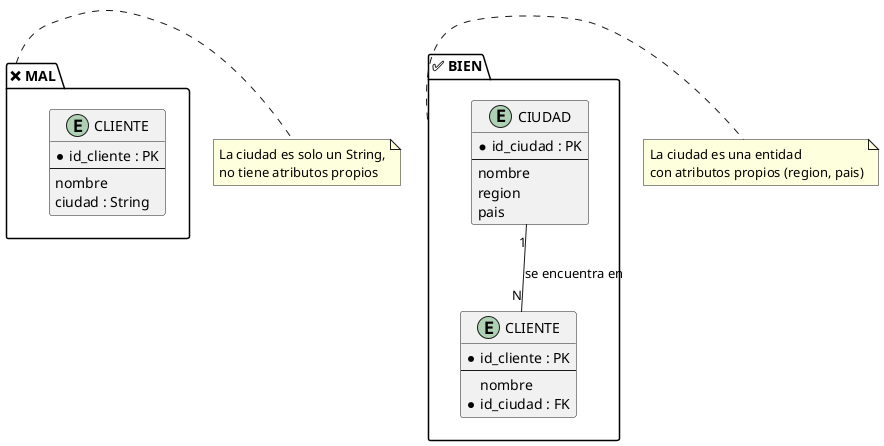
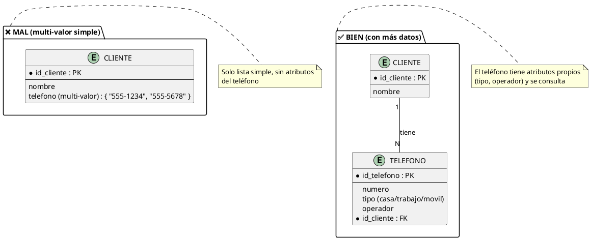
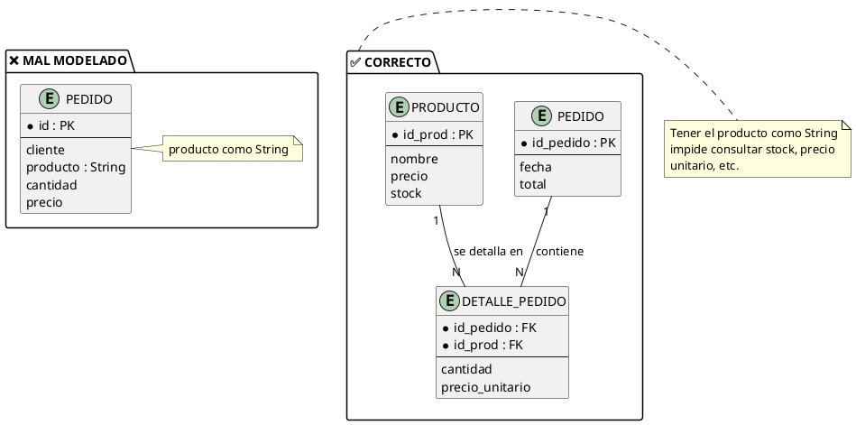
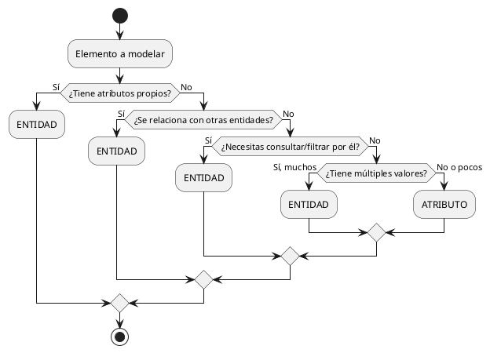

# Criterios de Diseño: ¿Atributo o Entidad?

## El Problema

Una de las decisiones más difíciles en el modelado es decidir si un elemento debe ser:

- Un **ATRIBUTO** (propiedad que describe a una entidad)
- Una **ENTIDAD** (con existencia independiente)

Esta decisión afecta directamente la calidad del modelo y la implementación posterior en SQL.

> **Pregunta clave:** ¿Este elemento es una **propiedad descriptiva** de algo, o es un **objeto con existencia propia** que necesita ser identificado, buscado y relacionado?

---

## Tabla de Decisión Rápida

| Pregunta | Si SÍ → | Si NO → |
| --- | --- | --- |
| ¿El elemento tiene atributos propios? | **Entidad** | Atributo |
| ¿El elemento se relaciona con otras entidades? | **Entidad** | Atributo |
| ¿Existen múltiples instancias del elemento? | **Entidad** | Atributo |
| ¿Necesitas buscar/consultar por ese elemento? | **Entidad** | Atributo |
| ¿El elemento tiene su propia identidad? | **Entidad** | Atributo |
| ¿Es solo un dato que describe? | Atributo | **Entidad** |
| ¿Es un valor fijo de una lista corta? | Atributo | **Entidad** |
| ¿Se usa solo en cálculos? (edad, total) | Atributo | **Entidad** |

---

## Criterio 1: ¿Tiene Atributos Propios?

> Si el elemento necesita ser descrito por **más propiedades**, es una entidad.

**Ejemplo: ¿Ciudad es atributo o entidad?**

| Opción | Análisis |
| --- | --- |
| **Como atributo** | `Cliente(Ciudad)` — solo el nombre de la ciudad |
| **Como entidad** | `Ciudad(id, nombre, region, pais, poblacion)` — no está en desarrollo |

**¿Cuál elegir?**

La ciudad tiene atributos propios (región, país, población), se relaciona con otros conceptos (región → país) y se consulta. → **Entidad**



---

## Criterio 2: ¿Se Relaciona con Otras Entidades?

> Si el elemento participa en **relaciones** con otras entidades, es una entidad.

**Ejemplo: ¿Teléfono es atributo o entidad?**

- **Como atributo**: `Cliente(teléfono)` — un solo teléfono
- **Como entidad**: `Telefono(id, tipo, numero, cliente_id)` — múltiples teléfonos

**Análisis:**
- ¿Un cliente puede tener varios teléfonos? Sí (multi-valor)
- ¿El teléfono tiene atributos propios? Sí (tipo: casa, trabajo, móvil)
- ¿Se necesita consultar por tipo de teléfono? A veces

**Conclusión:** Si solo necesitas una lista, puede ser atributo multi-valor. Si necesitas atributos del teléfono (tipo, operador), es **entidad**.



---

## Criterio 3: ¿Necesitas Buscar o Consultar Por Ese Elemento?

> Si necesitas hacer consultas como "¿cuántos clientes hay en Santiago?", es una entidad.

**Ejemplo: ¿Dirección es atributo o entidad?**

**Análisis:**
- ¿Necesitas consultar "cuántos clientes viven en la Calle Los Aromos 123"? Sí
- ¿La dirección tiene estructura interna? Sí (calle, número, ciudad, región)
- ¿La dirección se comparte entre clientes? A veces (empresa en el mismo edificio)

**Conclusión:** Una dirección simple como atributo compuesto está bien. Pero si es compleja o se consulta, mejor entidad.

```plantuml
@startuml
package "❌ MAL (atributo compuesto)" as mal {
  entity "CLIENTE" as c1 {
    * id_cliente : PK
    --
    dirección (compuesto) : {
      calle
      numero
      ciudad
      pais
    }
  }
}

package "✅ BIEN (como entidad)" as bien {
  entity "DIRECCION" as d {
    * id_direccion : PK
    --
    calle
    numero
    codigo_postal
    * id_ciudad : FK
  }

  entity "CLIENTE" as c2 {
    * id_cliente : PK
    --
    nombre
    * id_direccion : FK
  }

  d "1" -- "N" c2 : "tiene"
}

note right of mal
  Dirección simple como
  atributo compuesto
end note

note right of bien
  Dirección compleja o consultada,
  mejor como entidad
end note
@enduml
```

---

## Criterio 4: ¿Tiene su Propia Identidad y Ciclo de Vida?

> Si el elemento se **crea, modifica y elimina** de forma independiente, es una entidad.

**Ejemplo: ¿Producto es atributo de Pedido?**

- **Como atributo**: `Pedido(producto, cantidad, precio)` — el producto no existe fuera del pedido
- **Como entidad**: `Producto(id, nombre, precio, stock)` y `DetallePedido(id_pedido, id_producto, cantidad)`

**Análisis:**
- ¿El producto existe sin un pedido? Sí (se registra en inventario antes de vender)
- ¿El producto tiene atributos propios? Sí (precio, stock, categoría)
- ¿El "mismo" producto aparece en muchos pedidos? Sí

**Conclusión:** El producto es **entidad**, y la relación con el pedido se resuelve con una tabla intermedia.



---

## Criterio 5: ¿Cuántos Valores Puede Tener?

| Número de valores posibles | Recomendación | Ejemplo |
| --- | --- | --- |
| **Fijo y pequeño** (1-5) | Atributo | `estado: {ACTIVO, INACTIVO}` |
| **Mediano** (5-30) | Atributo con CHECK o ENUM | `tipo: {CASA, DEPTO, TERRENO}` |
| **Grande o variable** (30+) | Entidad | `Categoría`, `Ciudad`, `Especialidad` |
| **Creciente (se agregan nuevos)** | Entidad | `Producto`, `Servicio` |

**Ejemplo: Estado del pedido**

```sql
-- ✅ Como atributo (lista corta fija)
CREATE TABLE pedido (
    ...
    estado VARCHAR(20) CHECK (estado IN ('PENDIENTE', 'PAGADO', 'ENVIADO', 'ENTREGADO', 'CANCELADO'))
);
```

**Ejemplo: Categoría de producto**

```sql
-- ✅ Como entidad (lista creciente, tiene atributos)
CREATE TABLE categoria (
    id_categoria INT PRIMARY KEY AUTO_INCREMENT,
    nombre       VARCHAR(50) NOT NULL,
    descripcion  TEXT,
    id_padre     INT,  -- subcategorías
    FOREIGN KEY (id_padre) REFERENCES categoria(id_categoria)
);

CREATE TABLE producto (
    id_producto   INT PRIMARY KEY AUTO_INCREMENT,
    nombre        VARCHAR(100),
    precio        DECIMAL(10,2),
    id_categoria  INT NOT NULL,
    FOREIGN KEY (id_categoria) REFERENCES categoria(id_categoria)
);
```

---

## Árbol de Decisión



---

## Casos Frecuentes

| Elemento | ¿Atributo o Entidad? | Justificación |
| --- | --- | --- |
| `nombre` de Cliente | **Atributo** | No tiene atributos propios |
| `teléfono` (varios) | **Atributo multi-valor** | Solo lista simple |
| `ciudad` de Cliente | **Entidad** | Tiene atributos (región, país) y se consulta |
| `estado` de Pedido | **Atributo** | Lista corta fija |
| `categoría` de Producto | **Entidad** | Lista creciente, tiene atributos |
| `color` de Auto | **Atributo** | Valor simple fijo |
| `proveedor` de Producto | **Entidad** | Tiene atributos, se relaciona |
| `fecha` de Pedido | **Atributo** | Dato descriptivo simple |
| `factura` de Venta | **Entidad** | Tiene líneas, total, IVA, etc. |
| `email` de Usuario | **Atributo** | Dato simple |

---

## Criterio de Entidad Débil

A veces el elemento es una **entidad débil**: depende de otra para existir.

**Ejemplo:**

| Elemento | Tipo | Entidad Fuerte | ¿Por qué? |
| --- | --- | --- | --- |
| `Línea de Factura` | Entidad débil | Factura | No existe sin la factura |
| `Detalle de Pedido` | Entidad débil | Pedido | No existe sin el pedido |
| `Artículo de Reserva` | Entidad débil | Reserva | No existe sin la reserva |

> **Regla:** Si el elemento tiene sus propios atributos Y depende de otra entidad → **Entidad débil** (no atributo).

---

## Resumen

| Criterio | Entidad | Atributo |
| --- | --- | --- |
| Atributos propios | ✅ Sí | ❌ No |
| Relaciones con otras | ✅ Sí | ❌ No |
| Búsqueda/consulta | ✅ Sí | ❌ No |
| Identidad independiente | ✅ Sí | ❌ No |
| Valores posibles | Muchos/crecientes | Pocos/fijos |
| Naturaleza | Sustantivo ("la cosa") | Adjetivo ("cómo es la cosa") |

> **Regla lingüística:** Si en la oración funciona como **sustantivo** (nombre de una cosa), probablemente es **entidad**. Si funciona como **adjetivo** (describe cómo es), probablemente es **atributo**.

---

## Referencias

- [[02_Entidad_Atributos_e_Instancias]] — Conceptos de entidad y atributo
- [[05_Relaciones_Especiales]] — Atributos descriptivos en relaciones
- [[06_Entidades_Debiles_vs_Regulares]] — Entidades débiles
- [[08_Caso_de_Estudio_Completo]] — Ejemplo integrado
- [[19_Antipatrones_MER]] — El error de confundir atributo con entidad