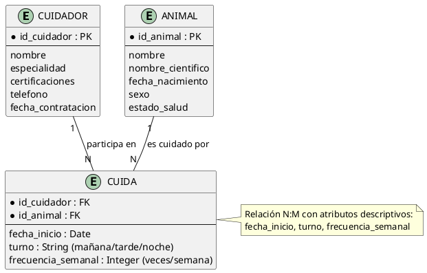
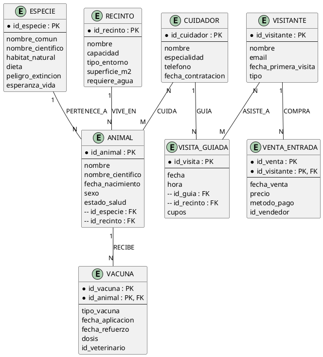

# Caso de Estudio Completo: Sistema de Gestión de Zoológico

## Enunciado

Se necesita diseñar la base de datos de un **zoológico** que requiere gestionar:

- **Animales** de diferentes especies, cada uno con un identificador único, nombre, especie, fecha de nacimiento, sexo y estado de salud.
- **Especies** con nombre científico, hábitat natural, dieta (carnívora, herbívora, omnívora) y nivel de peligro de extinción.
- **Recintos** donde viven los animales, con número de recinto, capacidad, tipo de entorno (selva, desierto, acuario) y responsable.
- **Cuidadores** que se encargan de los animales, con identificador, nombre, especialidad y certificaciones.
- **Vacunas** que se aplican a los animales, con tipo de vacuna, fecha de aplicación y fecha de próximo refuerzo.
- **Visitas guiadas** donde los visitantes recorren el zoológico, con fecha, hora y guía asignado.
- **Vendedores** de entradas que registran cada visita de un visitante.

---

## Paso 1: Análisis de Requerimientos

Identificamos los requerimientos del negocio a partir del enunciado:

| Requerimiento | Fuente | Entidad |
| --- | --- | --- |
| "Registrar a cada animal con su especie" | Biólogo jefe | `Animal` |
| "Conocer el hábitat natural de cada especie" | Biólogo jefe | `Especie` |
| "Asignar animales a recintos por capacidad" | Administración | `Recinto` |
| "Registrar qué cuidador atiende a cada animal" | Personal | `Cuidador` |
| "Llevar control de vacunas de cada animal" | Veterinaria | `Vacuna` |
| "Registrar visitas guiadas" | Operaciones | `VisitaGuiada` |
| "Vender entradas y registrarlas" | Taquilla | `VentaEntrada` |

---

## Paso 2: Lista de Entidades con Atributos e Identificadores

### Entidad: ANIMAL (Regular)

| Atributo | Tipo | Clave | Descripción |
| --- | --- | --- | --- |
| `id_animal` | Integer | **PK** | Identificador único del animal |
| `nombre` | String | — | Nombre propio del animal (ej. "Tito") |
| `nombre_cientifico` | String | — | Nombre científico (ej. *Panthera leo*) |
| `fecha_nacimiento` | Date | — | Fecha de nacimiento |
| `sexo` | Char | — | M / F |
| `estado_salud` | String | — | Bueno, Regular, Crítico |
| `id_especie` | Integer | FK | Especie a la que pertenece |
| `id_recinto` | Integer | FK | Recinto donde vive |

**Claves candidatas:** `{id_animal}`, `{nombre, nombre_cientifico}`
**Clave primaria elegida:** `{id_animal}` (autonumérica, estable)

### Entidad: ESPECIE (Regular)

| Atributo | Tipo | Clave | Descripción |
| --- | --- | --- | --- |
| `id_especie` | Integer | **PK** | Identificador de la especie |
| `nombre_comun` | String | — | Nombre común (ej. "León") |
| `nombre_cientifico` | String | — | Nombre científico (*Panthera leo*) |
| `habitat_natural` | String | — | Sabana, selva, desierto... |
| `dieta` | String | — | Carnívora, Herbívora, Omnívora |
| `peligro_extincion` | Boolean | — | ¿Está en peligro de extinción? |
| `esperanza_vida` | Integer | — | Años esperados de vida |

**Clave primaria:** `{id_especie}`

### Entidad: RECINTO (Regular)

| Atributo | Tipo | Clave | Descripción |
| --- | --- | --- | --- |
| `id_recinto` | Integer | **PK** | Número del recinto |
| `nombre` | String | — | Nombre (ej. "Sabana Africana") |
| `capacidad` | Integer | — | Máximo de animales que puede albergar |
| `tipo_entorno` | String | — | Selva, desierto, acuario, pradera |
| `superficie_m2` | Decimal | — | Superficie en metros cuadrados |
| `requiere_agua` | Boolean | — | ¿Tiene laguna artificial? |

**Clave primaria:** `{id_recinto}`

### Entidad: CUIDADOR (Regular)

| Atributo | Tipo | Clave | Descripción |
| --- | --- | --- | --- |
| `id_cuidador` | Integer | **PK** | Identificador del cuidador |
| `nombre` | String | — | Nombre completo |
| `especialidad` | String | — | Felinos, reptiles, aves... |
| `certificaciones` | String (multi-valor) | — | Primero auxilios, manejo de felinos... |
| `telefono` | String | — | Teléfono de contacto |
| `fecha_contratacion` | Date | — | Fecha de ingreso |

**Clave primaria:** `{id_cuidador}`

### Entidad: VACUNA (Débil — depende de ANIMAL)

| Atributo | Tipo | Clave | Descripción |
| --- | --- | --- | --- |
| `id_vacuna` | Integer | **PK parcial** | Número consecutivo por animal |
| `id_animal` | Integer | **PK parcial, FK** | Animal al que se aplica |
| `tipo_vacuna` | String | — | Antirrábica, distemper, leptospirosis |
| `fecha_aplicacion` | Date | — | Fecha de la vacuna |
| `fecha_refuerzo` | Date | — | Fecha del próximo refuerzo |
| `dosis` | Decimal | — | Dosis aplicada en ml |
| `id_veterinario` | Integer | FK | Veterinario que aplicó |

**PK compuesta:** `{id_vacuna, id_animal}` (un animal puede tener varias vacunas, cada una numerada)

### Entidad: VISITANTE (Regular)

| Atributo | Tipo | Clave | Descripción |
| --- | --- | --- | --- |
| `id_visitante` | Integer | **PK** | Identificador del visitante |
| `nombre` | String | — | Nombre completo |
| `email` | String | — | Correo (único) |
| `fecha_primera_visita` | Date | — | Primera vez que visitó el zoológico |
| `tipo` | String | — | Adulto, niño, tercera edad |

**Clave primaria:** `{id_visitante}`

### Entidad: VISITA_GUIADA (Regular)

| Atributo | Tipo | Clave | Descripción |
| --- | --- | --- | --- |
| `id_visita` | Integer | **PK** | Identificador de la visita |
| `fecha` | Date | — | Fecha de la visita |
| `hora` | Time | — | Hora de inicio |
| `id_guia` | Integer | FK | Cuidador que guía |
| `id_recinto` | Integer | FK | Recinto que se recorre |
| `cupos` | Integer | — | Capacidad de la visita |

**Clave primaria:** `{id_visita}`

### Entidad: VENTA_ENTRADA (Débil — depende de VISITANTE)

| Atributo | Tipo | Clave | Descripción |
| --- | --- | --- | --- |
| `id_venta` | Integer | **PK parcial** | Número de la venta |
| `id_visitante` | Integer | **PK parcial, FK** | Visitante que compra |
| `fecha_venta` | Date | — | Fecha de compra |
| `precio` | Decimal | — | Precio pagado |
| `metodo_pago` | String | — | Efectivo, tarjeta, transferencia |
| `id_vendedor` | Integer | FK | Responsable de la venta |

**PK compuesta:** `{id_venta, id_visitante}`

---

## Paso 3: Lista de Relaciones y sus Atributos Descriptivos

| Relación | Entidades | Atributos descriptivos | Tipo |
| --- | --- | --- | --- |
| `PERTENECE_A` | Animal → Especie | — | 1:N |
| `VIVE_EN` | Animal → Recinto | — | 1:N |
| `CUIDA` | Cuidador ↔ Animal | `fecha_inicio`, `turno`, `frecuencia_semanal` | N:M (con atributos) |
| `RECIBE` | Animal → Vacuna | — | 1:N (identificadora) |
| `REALIZA_VISITA` | Visitante ↔ VisitaGuiada | `id_visitante`, `id_visita` | N:M |
| `COMPRA` | Visitante → VentaEntrada | — | 1:N (identificadora) |
| `GUIA` | Cuidador ↔ VisitaGuiada | — | 1:N |

### Relación con Atributos Descriptivos: CUIDA



---

## Paso 4: Cardinalidades Explícitas (Mínima y Máxima)

| Relación | Entidad A | Entidad B | Cardinalidad A→B | Cardinalidad B→A | Participación A | Participación B |
| --- | --- | --- | --- | --- | --- | --- |
| `PERTENECE_A` | Especie | Animal | 1..* | 1..1 | **Total** (toda especie tiene al menos un animal) | **Total** (todo animal pertenece a una especie) |
| `VIVE_EN` | Recinto | Animal | 0..* | 1..1 | **Parcial** (un recinto puede estar vacío) | **Total** (todo animal vive en un recinto) |
| `CUIDA` | Cuidador | Animal | 0..* | 1..* | **Parcial** (un cuidador puede no tener animales aún) | **Total** (todo animal DEBE tener al menos un cuidador) |
| `RECIBE` | Animal | Vacuna | 0..* | 1..1 | **Parcial** (un animal puede no tener vacunas aún) | **Total** (toda vacuna tiene un animal) |
| `REALIZA_VISITA` | Visitante | VisitaGuiada | 0..* | 0..* | **Parcial** (un visitante puede no hacer visita guiada) | **Parcial** (una visita puede no tener visitantes) |
| `COMPRA` | Visitante | VentaEntrada | 0..* | 1..1 | **Parcial** (un visitante puede no comprar entrada — visita con pase) | **Total** (toda venta tiene un visitante) |
| `GUIA` | Cuidador | VisitaGuiada | 0..* | 1..1 | **Parcial** (un cuidador puede no guiar visitas) | **Total** (toda visita tiene un cuidador guía) |

---

## Paso 5: Diagrama E-R Completo



---

## Paso 6: Tablas Intermedias (Resolución N:M)

### CUIDADOR_ANIMAL (Relación N:M con atributos)

```sql
CREATE TABLE cuidador_animal (
    id_cuidador         INT,
    id_animal           INT,
    fecha_inicio        DATE NOT NULL,      -- Atributo descriptivo
    turno               VARCHAR(20),         -- Atributo descriptivo
    frecuencia_semanal  INT,                 -- Atributo descriptivo
    PRIMARY KEY (id_cuidador, id_animal),
    FOREIGN KEY (id_cuidador) REFERENCES cuidador(id_cuidador),
    FOREIGN KEY (id_animal) REFERENCES animal(id_animal)
);
```

### VISITANTE_VISITA (Relación N:M)

```sql
CREATE TABLE visitante_visita (
    id_visitante    INT,
    id_visita       INT,
    lugar_asiento   VARCHAR(10),
    PRIMARY KEY (id_visitante, id_visita),
    FOREIGN KEY (id_visitante) REFERENCES visitante(id_visitante),
    FOREIGN KEY (id_visita) REFERENCES visita_guiada(id_visita)
);
```

---

## Paso 7: Implementación SQL Completa

```sql
-- ============ ENTIDADES REGULARES ============

CREATE TABLE especie (
    id_especie          INT PRIMARY KEY AUTO_INCREMENT,
    nombre_comun        VARCHAR(100) NOT NULL,
    nombre_cientifico   VARCHAR(100) NOT NULL UNIQUE,
    habitat_natural     VARCHAR(100),
    dieta               VARCHAR(20) CHECK (dieta IN ('CARNIVORA','HERBIVORA','OMNIVORA')),
    peligro_extincion   BOOLEAN DEFAULT FALSE,
    esperanza_vida      INT
);

CREATE TABLE recinto (
    id_recinto      INT PRIMARY KEY AUTO_INCREMENT,
    nombre          VARCHAR(100) NOT NULL,
    capacidad       INT NOT NULL CHECK (capacidad > 0),
    tipo_entorno    VARCHAR(50),
    superficie_m2   DECIMAL(10,2),
    requiere_agua   BOOLEAN DEFAULT FALSE
);

CREATE TABLE cuidador (
    id_cuidador         INT PRIMARY KEY AUTO_INCREMENT,
    nombre              VARCHAR(100) NOT NULL,
    especialidad        VARCHAR(100),
    telefono            VARCHAR(15),
    fecha_contratacion  DATE NOT NULL
);

CREATE TABLE animal (
    id_animal           INT PRIMARY KEY AUTO_INCREMENT,
    nombre              VARCHAR(100) NOT NULL,
    nombre_cientifico   VARCHAR(100),
    fecha_nacimiento    DATE,
    sexo                CHAR(1) CHECK (sexo IN ('M','F')),
    estado_salud        VARCHAR(20) DEFAULT 'BUENO',
    id_especie          INT NOT NULL,
    id_recinto          INT NOT NULL,
    FOREIGN KEY (id_especie) REFERENCES especie(id_especie),
    FOREIGN KEY (id_recinto) REFERENCES recinto(id_recinto)
);

CREATE TABLE visitante (
    id_visitante        INT PRIMARY KEY AUTO_INCREMENT,
    nombre              VARCHAR(100) NOT NULL,
    email               VARCHAR(100) UNIQUE NOT NULL,
    fecha_primera_visita DATE,
    tipo                VARCHAR(20) CHECK (tipo IN ('ADULTO','NINO','TERCERA_EDAD'))
);

CREATE TABLE visita_guiada (
    id_visita   INT PRIMARY KEY AUTO_INCREMENT,
    fecha       DATE NOT NULL,
    hora        TIME NOT NULL,
    id_guia     INT NOT NULL,
    cupos       INT DEFAULT 15,
    FOREIGN KEY (id_guia) REFERENCES cuidador(id_cuidador)
);

-- ============ ENTIDADES DÉBILES ============

CREATE TABLE vacuna (
    id_vacuna           INT,
    id_animal           INT,
    tipo_vacuna         VARCHAR(50) NOT NULL,
    fecha_aplicacion    DATE NOT NULL,
    fecha_refuerzo      DATE,
    dosis               DECIMAL(5,2),
    id_veterinario      INT,
    PRIMARY KEY (id_vacuna, id_animal),
    FOREIGN KEY (id_animal) REFERENCES animal(id_animal)
        ON DELETE CASCADE
);

CREATE TABLE venta_entrada (
    id_venta        INT,
    id_visitante    INT,
    fecha_venta     DATE NOT NULL,
    precio          DECIMAL(10,2) NOT NULL,
    metodo_pago     VARCHAR(20),
    id_vendedor     INT,
    PRIMARY KEY (id_venta, id_visitante),
    FOREIGN KEY (id_visitante) REFERENCES visitante(id_visitante)
        ON DELETE CASCADE
);

-- ============ TABLAS INTERMEDIAS (N:M) ============

CREATE TABLE cuidador_animal (
    id_cuidador         INT,
    id_animal           INT,
    fecha_inicio        DATE NOT NULL,
    turno               VARCHAR(20),
    frecuencia_semanal  INT,
    PRIMARY KEY (id_cuidador, id_animal),
    FOREIGN KEY (id_cuidador) REFERENCES cuidador(id_cuidador),
    FOREIGN KEY (id_animal) REFERENCES animal(id_animal)
);

CREATE TABLE visitante_visita (
    id_visitante    INT,
    id_visita       INT,
    lugar           VARCHAR(10),
    PRIMARY KEY (id_visitante, id_visita),
    FOREIGN KEY (id_visitante) REFERENCES visitante(id_visitante),
    FOREIGN KEY (id_visita) REFERENCES visita_guiada(id_visita)
);
```

---

## Paso 8: Ejemplo de Datos

### Especies

| id_especie | nombre_comun | nombre_cientifico | habitat | dieta | peligro |
| --- | --- | --- | --- | --- | --- |
| 1 | León | Panthera leo | Sabana | CARNIVORA | TRUE |
| 2 | Cebra | Equus quagga | Sabana | HERBIVORA | FALSE |
| 3 | Jirafa | Giraffa camelopardalis | Sabana | HERBIVORA | FALSE |
| 4 | Puma | Puma concolor | Selva | CARNIVORA | TRUE |

### Animales

| id | nombre | especie | nacimiento | sexo | salud | recinto |
| --- | --- | --- | --- | --- | --- | --- |
| 1 | Tito | 1 (León) | 2018-05-12 | M | BUENO | 1 (Sabana) |
| 2 | Luna | 1 (León) | 2020-03-01 | F | BUENO | 1 (Sabana) |
| 3 | Rayo | 2 (Cebra) | 2019-07-22 | M | REGULAR | 2 (Pradera) |
| 4 | Tamara | 4 (Puma) | 2021-01-15 | F | CRITICO | 3 (Selva) |

### Cuidadores

| id_cuidador | nombre | especialidad | telefono |
| --- | --- | --- | --- |
| 1 | Ana Torres | Felinos | 555-1001 |
| 2 | Pedro Ríos | Herbívoros | 555-1002 |

### Relación CUIDA (con atributos)

| id_cuidador | id_animal | fecha_inicio | turno | frecuencia |
| --- | --- | --- | --- | --- |
| 1 | 1 | 2022-01-10 | MAÑANA | 7 |
| 1 | 2 | 2023-03-15 | TARDE | 5 |
| 2 | 3 | 2022-06-01 | MAÑANA | 6 |
| 1 | 4 | 2024-02-20 | NOCHE | 7 |

### Vacunas (entidad débil)

| id_vacuna | id_animal | tipo | fecha_aplicacion | fecha_refuerzo |
| --- | --- | --- | --- | --- |
| 1 | 1 | Antirrábica | 2026-01-10 | 2027-01-10 |
| 2 | 1 | Distemper | 2026-03-05 | 2027-03-05 |
| 1 | 2 | Antirrábica | 2026-02-14 | 2027-02-14 |

---

## Paso 9: Aplicación de Criterios de Diseño

| Elemento | Decisión | Justificación con los criterios |
| --- | --- | --- |
| `Especie` | **Entidad** | Tiene atributos propios (dieta, hábitat), se relaciona con Animal, lista creciente |
| `dieta` de Especie | **Atributo** | Lista corta fija (3 valores), no necesita entidad |
| `certificaciones` de Cuidador | **Atributo multi-valor** | Lista simple sin atributos propios |
| `Vacuna` | **Entidad débil** | Depende de Animal, no existe sola, PK compuesta |
| `fecha_aplicacion` | **Atributo de Vacuna** | Dato descriptivo simple |
| `estado_salud` de Animal | **Atributo** | Lista corta fija (Bueno, Regular, Crítico) |
| `Recinto` | **Entidad** | Tiene atributos propios, se consulta por capacidad |
| `turno` en CUIDA | **Atributo de relación** | Describe la relación Cuidador-Animal, no a ninguna entidad |

---

## Resumen del Caso

| Elemento | Cantidad |
| --- | --- |
| Entidades regulares | 7 (Especie, Animal, Recinto, Cuidador, Visitante, VisitaGuiada, Vendedor) |
| Entidades débiles | 2 (Vacuna, VentaEntrada) |
| Relaciones binarias | 7 |
| Relaciones N:M | 2 (Cuida, Visitante-Visita) |
| Relaciones con atributos descriptivos | 1 (Cuida) |
| Tablas intermedias | 2 (cuidador_animal, visitante_visita) |

---

## Referencias

- [[01_Etapas_del_Diseño_de_BD]] — Etapas aplicadas en este caso
- [[02_Entidad_Atributos_e_Instancias]] — Identificación de entidades y atributos
- [[03_Claves_Candidatas_y_Primaria]] — Elección de claves
- [[04_Relaciones_y_Cardinalidades]] — Cardinalidades de cada relación
- [[05_Relaciones_Especiales]] — Relación N:M con atributos (CUIDA)
- [[06_Entidades_Debiles_vs_Regulares]] — Vacuna y Venta como entidades débiles
- [[07_Criterios_de_Diseño]] — Decisiones atributo vs entidad