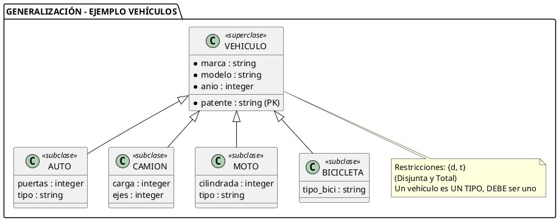
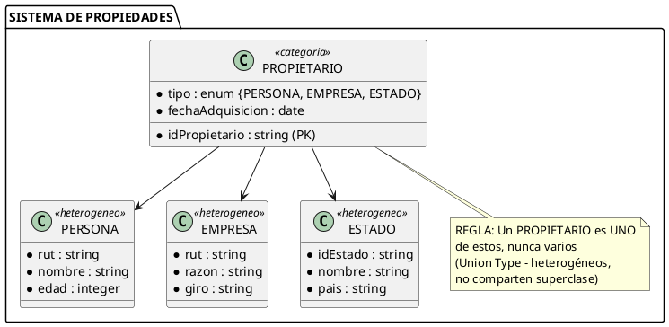
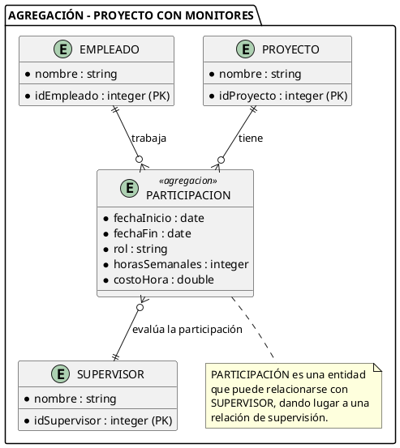
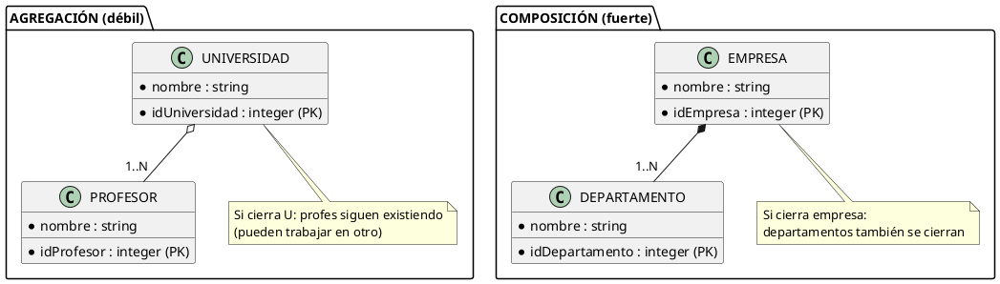
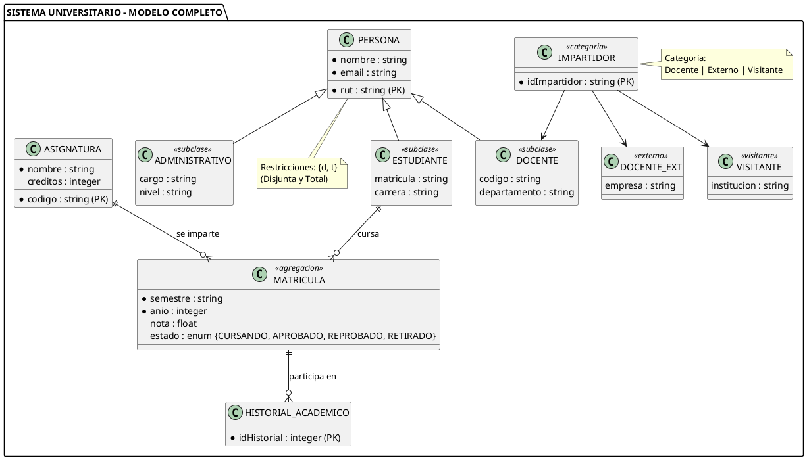

# 9. Modelo Entidad-Relación Extendido (MER Extendido)

> **Definición:** Extensión del modelo E-R original de Peter Chen (1976) que incorpora **generalización, especialización, categorías (unión) y agregación** para modelar dominios más complejos con mayor precisión semántica.

---

## 3.1 ¿Por qué el MER Extendido?

El modelo E-R básico (Chen, 1976) tiene **limitaciones** que el MER Extendido resuelve:

| Limitación del MER Básico | Solución del MER Extendido |
|---------------------------|---------------------------|
| No modela jerarquías de entidades | **Generalización / Especialización** |
| No une entidades heterogéneas | **Categorías (Union Types)** |
| No permite relaciones con atributos propios | **Agregación** |
| No controla la pertenencia a subclases | **Restricciones d, s, t, p** |

---

## 3.2 Generalización (Bottom-Up)

> **Definición:** Proceso **bottom-up** (de abajo hacia arriba) donde se identifican características comunes entre varias entidades y se crea una **entidad padre (superclase)** que las generaliza.

### Características

| Aspecto | Descripción | Ejemplo |
|---------|-------------|---------|
| **Dirección** | Bottom-up (instancias → clase padre) | Observar 3 tipos de vehículos → crear "Vehículo" |
| **Entidad resultante** | Es la **generalización** (superclase) | VEHÍCULO |
| **Entidades originales** | Se vuelven **especializaciones** (subclases) | AUTO, CAMIÓN, MOTO |
| **Herencia** | Los atributos comunes se heredan | patente, marca, modelo, año |

### Ejemplo Completo de Generalización



### Restricciones de Generalización

| Restricción | Letra | Significado | Ejemplo |
|-------------|-------|-------------|---------|
| **Disjunta** | **d** | Una instancia pertenece a **máxima una** subclase | Un coche NO es también moto |
| **Solapada** | **s** | Una instancia puede pertenecer a **varias** subclases | Un técnico puede ser diseñador Y programador |
| **Total** | **t** | Toda instancia de la superclase **debe** pertenecer a alguna subclase | Todo VEHÍCULO se clasifica |
| **Parcial** | **p** | Una instancia de la superclase **puede no** pertenecer a ninguna subclase | Un VEHÍCULO puede ser prototipo sin clasificar |

### Combinaciones Posibles

| Combinación | Lectura | Ejemplo |
|-------------|---------|---------|
| **{d, t}** | Disjunta Total: Una clase, obligatoria | Persona → Estudiante \| Docente \| Administrativo (DEBE ser uno) |
| **{d, p}** | Disjunta Parcial: Una clase, opcional | Vehículo → Auto \| Camión \| Moto (puede no estar clasificado) |
| **{s, t}** | Solapada Total: Varias clases, obligatoria | Empleado → Vendedor \| Programador (DEBE estar en alguna) |
| **{s, p}** | Solapada Parcial: Varias clases, opcional | Trabajador → Tiempo completo \| Tiempo parcial (puede no estar en ninguna) |

---

## 3.3 Especialización (Top-Down)

> **Definición:** Proceso **top-down** (de arriba hacia abajo) donde se define una entidad genérica y se derivan entidades más específicas (subclases) con características adicionales.

### Diferencia Generalización vs Especialización

| Aspecto | Generalización | Especialización |
|---------|----------------|-----------------|
| **Dirección** | Bottom-up (instancias → clase padre) | Top-down (clase padre → subclases) |
| **Punto de partida** | Entidades específicas existentes | Entidad genérica definida primero |
| **Objetivo** | Factorizar lo común | Refinar y detallar |
| **Ejemplo** | Auto, Camión, Moto → Vehículo | Vehículo → Auto, Camión, Moto |
| **Momento** | Después de tener datos | Antes de implementar |

> [!NOTE] **Punto clave**
> Generalización y Especialización son el **mismo proceso** visto desde dos direcciones opuestas. Se representan con el **mismo triángulo** en UML.

### Ejemplo de Especialización con Código

```java
// Clase general (Superclase)
abstract class Persona {
    protected String rut;
    protected String nombre;
    protected String email;
    
    public Persona(String rut, String nombre, String email) {
        this.rut = rut;
        this.nombre = nombre;
        this.email = email;
    }
    
    public String getInfoBasica() {
        return "RUT: " + rut + ", Nombre: " + nombre;
    }
    
    // Método abstracto que se implementará en subclases
    public abstract String getRol();
}

// Especialización: Estudiante
class Estudiante extends Persona {
    private String matricula;
    private String carrera;
    
    public Estudiante(String rut, String nombre, String email,
                      String matricula, String carrera) {
        super(rut, nombre, email);
        this.matricula = matricula;
        this.carrera = carrera;
    }
    
    @Override
    public String getRol() {
        return "Estudiante de " + carrera + " (matrícula: " + matricula + ")";
    }
}

// Especialización: Docente
class Docente extends Persona {
    private String departamento;
    private String titulo;
    
    public Docente(String rut, String nombre, String email,
                   String departamento, String titulo) {
        super(rut, nombre, email);
        this.departamento = departamento;
        this.titulo = titulo;
    }
    
    @Override
    public String getRol() {
        return "Docente de " + departamento + " (" + titulo + ")";
    }
}
```

---

## 3.4 Categorías (Union Types)

> **Definición:** Entidad que representa una **unión** de otras entidades que **no comparten una superclase común**. Una instancia de la categoría pertenece a **exactamente una** de las entidades miembro.

### Diferencia Categoría vs Generalización

| Aspecto | Generalización/Especialización | Categoría |
|---------|------------------------------|----------|
| **Relación entre miembros** | Comparten semántica ("es un") | **NO** comparten semántica |
| **Herencia** | Los miembros heredan atributos | **NO** hay herencia |
| **Verbo** | "es un tipo de" | "es propietario de" / "es parte de" |
| **Homogeneidad** | Sí, los miembros son similares | No, los miembros son heterogéneos |

### Ejemplo: Sistema de Propiedades



### ¿Cuándo usar Categorías?

| Escenario | Tipo a usar |
|-----------|-------------|
| Personas, Empresas, Gobiernos (heterogéneos) son Propietarios | **Categoría** |
| Estudiante, Docente, Administrativo (comparten ser "Persona") | **Generalización** |
| Coche, Camión, Moto (todos son Vehículos) | **Generalización** |
| Pago en efectivo, tarjeta, transferencia (heterogéneos) | **Categoría** |

---

## 3.5 Agregación

> **Definición:** Permite tratar una **relación** como si fuera una **entidad** de nivel superior, para que pueda participar en otras relaciones. Representa "**tiene un**" a nivel de relaciones.

### Cuándo Usar Agregación

| Situación | Ejemplo |
|-----------|---------|
| La relación necesita atributos propios | `TRABAJA_EN` con `fechaInicio`, `rol` |
| La relación participa en otra relación | `TRABAJA_EN` → `EVALUAR` (supervisor) |
| Modelo "relación de relación" | `PARTICIPACIÓN` → `RESULTADO` |

### Ejemplo Completo



### Código Java para Agregación

```java
// Sin Agregación (NO permite atributos ni relaciones nuevas)
class Empleado {
    String nombre;
    // No hay forma de saber cuándo empezó ni su rol
}

class Proyecto {
    String nombre;
}

// CON Agregación (solución completa)
class Participacion {
    private LocalDate fechaInicio;
    private LocalDate fechaFin;
    private String rol;
    private Integer horasSemanales;
    private Double costoHora;
    
    // Composición con Empleado y Proyecto
    private Empleado empleado;
    private Proyecto proyecto;
    
    public Double calcularCostoTotal() {
        long dias = ChronoUnit.DAYS.between(fechaInicio, fechaFin);
        return dias * horasSemanales * costoHora;
    }
    
    public boolean estaActiva() {
        return fechaFin == null || fechaFin.isAfter(LocalDate.now());
    }
}

class Empleado {
    private String nombre;
    private List<Participacion> participaciones;  // Relación a través de Agregación
}

class Proyecto {
    private String nombre;
    private List<Participacion> participaciones;
}
```

### Agregación vs Composición

| Aspecto | Agregación | Composición |
|---------|------------|-------------|
| **Fuerza** | Relación débil | Relación fuerte |
| **Ciclo de vida** | Independiente | Dependiente del contenedor |
| **Destrucción** | Si contenedor muere, las partes pueden seguir | Si contenedor muere, las partes también |
| **Símbolo** | Línea hueca ▷ | Línea rellena ◆ |
| **Ejemplo** | Universidad y Profesores (si cierra la U, profes siguen) | Universidad y Facultades (si cierra la U, facultades también) |



---

## 3.6 Notación Gráfica Completa

| Concepto | Símbolo | Significado | Ejemplo Visual |
|----------|---------|-------------|----------------|
| **Generalización/Especialización** | △ (triángulo) | Conecta superclase con subclases | `PERSONA △→ ESTUDIANTE` |
| **Disjunta (d)** | d en △ | Una sola subclase a la vez | `d △→ (E\|C\|P)` |
| **Solapada (s)** | s en △ | Varias subclases simultáneas | `s △→ (V\|P\|G)` |
| **Total (t)** | t en la línea | Obligatoria pertenencia | `PERSONA ─t─→ (E\|C)` |
| **Parcial (p)** | p en la línea | Opcional pertenencia | `VEHÍCULO ─p─→ (A\|C)` |
| **Categoría** | ○ (círculo) con línea | Unión de entidades heterogéneas | `PROPIETARIO ⦿→ (P\|E)` |
| **Agregación** | Rectángulo punteado | Relación tratada como entidad | `◈ TRABAJA_EN ◈` |

### Mnemotecnia para Recordar

| Letra | Significado | Truco para recordar |
|-------|-------------|---------------------|
| **d** | Disjunta | "**D**iferente" - solo una opción |
| **s** | Solapada | "**S**uperpuesta" - varias opciones |
| **t** | Total | "**T**odas" deben clasificarse |
| **p** | Parcial | "**P**uede, pero no debe" |

---

## 3.7 Ejemplo Integrado: Sistema Universitario



### Patrones Utilizados

| Patrón | Aplicación en el Sistema Universitario |
|--------|---------------------------------------|
| **Generalización** | `PERSONA → Estudiante, Docente, Administrativo` |
| **Especialización** | `EMPLEADO → Tiempo completo, Tiempo parcial` |
| **Categoría** | `IMPARTIDOR → Docente, Externo, Visitante` |
| **Agregación** | `MATRICULA` (con atributos propios) |
| **Tabla intermedia N:M** | `MATRICULA` une `ESTUDIANTE` con `ASIGNATURA` |

---

## 📌 Resumen de la Nota

| Concepto | Descripción Clave | Cuándo usar |
|----------|-------------------|-------------|
| **Generalización** | Bottom-up: crear superclase de entidades similares | Cuando hay entidades con muchos atributos comunes |
| **Especialización** | Top-down: derivar subclases de entidad genérica | Cuando se necesita refinar una entidad abstracta |
| **Categorías** | Unión de entidades heterogéneas | Miembros NO comparten semántica |
| **Agregación** | Tratar relación como entidad | Relación con atributos o que participa en otra |
| **{d, t}** | Disjunta y Total | Una sola clase, obligatoria |
| **{d, p}** | Disjunta y Parcial | Una sola clase, opcional |
| **{s, t}** | Solapada y Total | Varias clases, obligatoria |
| **{s, p}** | Solapada y Parcial | Varias clases, opcional |

---

## 🔗 Notas Relacionadas

- [[04_Relaciones_y_Cardinalidades]] — MER Básico (conceptos previos)
- [[08_Caso_de_Estudio_Completo]] — Caso de estudio con MER Extendido aplicado
- [[11_Ejercicios_Practicos]] — Ejercicios de modelado
- [[13_Abstraccion_y_Tipos]] — Las 4 abstracciones (agregación y generalización en profundidad)
- [[15_Jerarquias_Superclase_Subclase]] — Superclase, subclase y regla Is-A
- [[16_Cobertura_Jerarquias]] — Restricciones d, s, t, p en detalle
- [[17_Caso_SIG_Medio_Ambiente]] — Caso SIG con jerarquías y cobertura

---

> [!TIP] **Consejo para el examen**
> Cuando veas un problema de modelado, pregúntate:
> 1. ¿Hay jerarquías de entidades? → Generalización/Especialización
> 2. ¿Los miembros son heterogéneos? → Categoría
> 3. ¿Una relación tiene atributos o participa en otra? → Agregación
> 4. ¿Hay control sobre la pertenencia? → Restricciones d, s, t, p

---

*Creado para el Semestre 2026-2 — ADOO*
