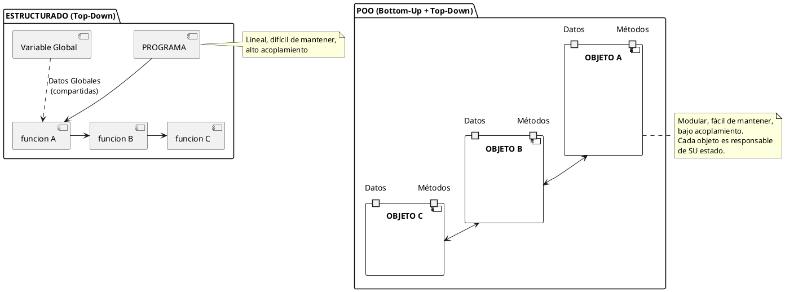
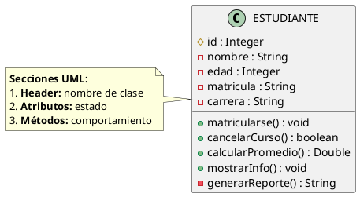
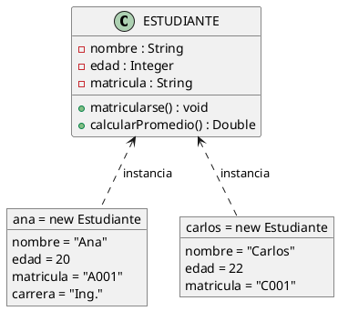
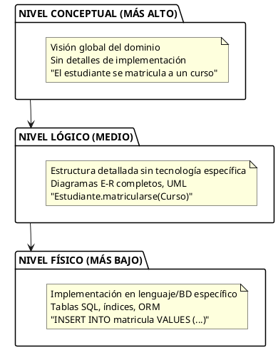
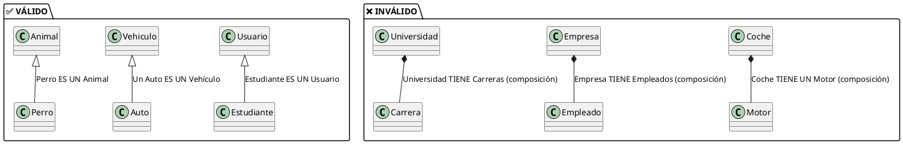
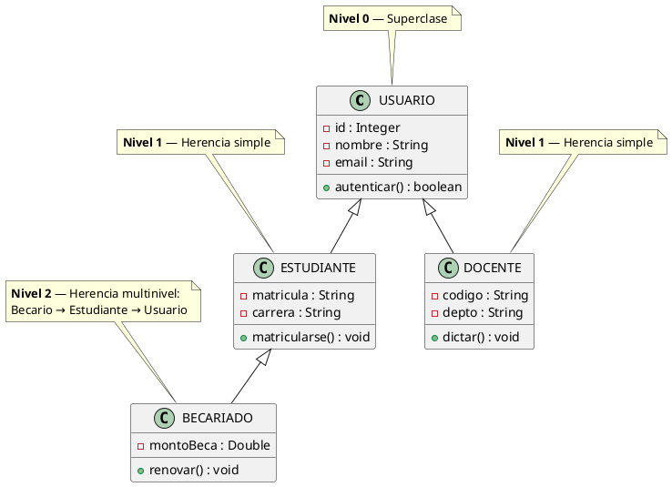
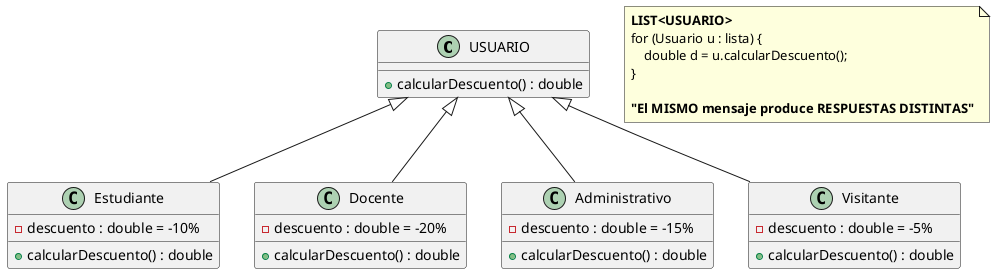
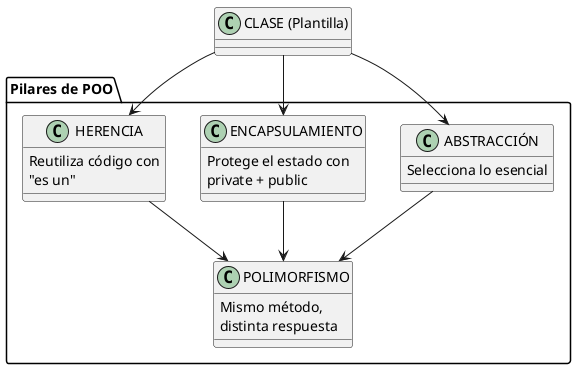

# 10. Conceptos Fundamentales del Paradigma Orientado a Objetos

> **Definición:** El Paradigma Orientado a Objetos (POO) organiza el software en **objetos** que combinan **datos (atributos)** y **comportamiento (métodos)**, modelando entidades del mundo real con cuatro pilares fundamentales: **Abstracción, Encapsulamiento, Herencia y Polimorfismo**.

---

## 4.1 Cambio de Paradigma

### Estructurado vs. Orientado a Objetos

| Aspecto | Paradigma Estructurado | POO |
|---------|------------------------|-----|
| **Pregunta clave** | ¿Qué procesos realiza el sistema? | ¿Qué objetos participan y cuál es su responsabilidad? |
| **Unidad básica** | Función/Procedimiento | Clase/Objeto |
| **Organización** | Variables globales + funciones | Clases con datos y métodos encapsulados |
| **Paso de control** | Variables globales y llamadas a funciones | Mensajes entre objetos |
| **Reutilización** | Limitada (copy-paste, librerías) | Alta (herencia, polimorfismo, composición) |
| **Mantenimiento** | Difícil en sistemas grandes | Más fácil (modular) |
| **Acoplamiento** | Alto (mucha dependencia) | Bajo (bajo acoplamiento) |
| **Ejemplo código** | `print("Hola")` en main | `persona.hablar()` invoca método |

### Diagrama de Cambio de Paradigma



> [!NOTE] **Punto clave de POO**
> En lugar de "¿qué hace el sistema?", pregúntate **"¿qué objetos existen y qué saben hacer?"**

---

## 4.2 Clase y Objeto

### Clase (Plantilla)

> **Definición:** Una clase es una **plantilla o molde** que define la estructura (atributos) y el comportamiento (métodos) de un conjunto de objetos similares.

#### Componentes de una Clase

| Parte | Descripción | Notación UML |
|-------|-------------|--------------|
| **Nombre** | Identificador de la clase (singular) | `Estudiante` |
| **Atributos** | Propiedades/estado del objeto | `- nombre: String` |
| **Métodos** | Acciones/comportamiento | `+ matricularse(): void` |
| **Visibilidad** | Nivel de acceso | `-` privado, `+` público, `#` protegido |

#### Notación UML



#### Visibilidad en UML

| Símbolo | Nombre Java | Acceso | Uso |
|---------|-------------|--------|-----|
| `-` | `private` | Solo dentro de la clase | Atributos internos |
| `+` | `public` | Desde cualquier parte | Interfaz pública |
| `#` | `protected` | Clase y subclases | Para herencia |
| `~` | `package-private` | Mismo paquete | Utilidades internas |

#### Tipos de Clases

| Tipo | Descripción | Notación |
|------|-------------|----------|
| **Concreta** | Puede crear objetos directamente | Normal |
| **Abstracta** | NO puede crear objetos, solo heredar | `<<abstract>>` o nombre en *cursiva* |
| **Interfaz** | Contrato sin implementación | `<<interface>>` |
| **Enum** | Conjunto fijo de constantes | `{VALOR1, VALOR2, ...}` |

### Objeto (Instancia)

> **Definición:** Un objeto es una **ocurrencia específica** de una clase. Representa una entidad única con su propia identidad, estado y comportamiento.

#### Características de un Objeto

| Característica | Descripción | Ejemplo |
|----------------|-------------|---------|
| **Identidad** | Referencia única que distingue al objeto | `id_usuario: 12345` |
| **Estado** | Valores actuales de sus atributos | `nombre: "Ana", edad: 20` |
| **Comportamiento** | Acciones que puede realizar | `matricularse()`, `comprar()` |
| **Ciclo de vida** | Creación, uso, destrucción | `new Estudiante()` → uso → `garbage collection` |

#### Ejemplo: Clase vs Objeto



#### Ejemplo Completo en Java

```java
// Definición de la CLASE
class Estudiante {
    // ATRIBUTOS (estado encapsulado)
    private String nombre;
    private int edad;
    private String matricula;
    private String carrera;
    
    // CONSTRUCTOR
    public Estudiante(String nombre, int edad, String matricula, String carrera) {
        this.nombre = nombre;
        this.edad = edad;
        this.matricula = matricula;
        this.carrera = carrera;
    }
    
    // MÉTODOS (comportamiento)
    public void matricularse() {
        System.out.println(nombre + " se ha matriculado.");
    }
    
    public double calcularPromedio(double[] notas) {
        double suma = 0;
        for (double nota : notas) suma += nota;
        return notas.length > 0 ? suma / notas.length : 0;
    }
    
    // GETTERS
    public String getNombre() { return nombre; }
    public int getEdad() { return edad; }
    public String getMatricula() { return matricula; }
    public String getCarrera() { return carrera; }
}

// Creación de OBJETOS (Instancias)
public class Main {
    public static void main(String[] args) {
        Estudiante ana = new Estudiante("Ana García", 20, "A001", "Ingeniería");
        Estudiante carlos = new Estudiante("Carlos López", 22, "C001", "Arquitectura");
        
        ana.matricularse();
        carlos.matricularse();
        
        // ana.nombre ❌ Error: nombre es privado
        // ana.getNombre() ✅ Correcto: usamos getter
        System.out.println("Nombre: " + ana.getNombre());
    }
}
```

> [!TIP] **Clase vs Objeto - Analogía**
> - **Clase = Molde de galletas** (la receta)
> - **Objeto = Cada galleta** (cada instancia es única)
> - El molde es uno solo, pero puede crear infinitas galletas

---

## 4.3 Abstracción

> **Definición:** Proceso de **filtrar la información relevante** del dominio del problema, omitiendo detalles irrelevantes. Permite gestionar la complejidad al enfocarse en lo esencial.

### Niveles de Abstracción



### Tipos de Abstracción

| Tipo | Descripción | Ejemplo |
|------|-------------|---------|
| **Abstracción de Datos** | Ocultar detalles de implementación | `Lista` (internamente usa ArrayList o LinkedList) |
| **Abstracción de Control** | Ocultar flujo de ejecución | `foreach` (el cómo iterar está oculto) |
| **Abstracción de Filtro** | Mostrar solo lo relevante | `SELECT nombre FROM estudiantes WHERE edad > 18` |
| **Abstracción de Fachada** | Interfaz simplificada para uso externo | `repo.save(estudiante)` en lugar de 5 sentencias SQL |

### Criterios de Abstracción

| Pregunta para decidir | Si SÍ | Si NO |
|----------------------|-------|-------|
| ¿Es relevante para el dominio del problema? | Incluir | Descartar |
| ¿Se usará en operaciones/consultas futuras? | Incluir | Descartar |
| ¿Es un dato sensible o privado? | Encapsular, NO incluir directamente | Incluir normalmente |
| ¿Es un detalle de implementación? | NO incluir | Incluir |

> [!EXAMPLE] **Ejemplo: Abstracción en Java**
> ```java
> // NIVEL ALTO: Interfaz
> interface Lista {
>     void agregar(int elemento);
>     int obtener(int indice);
>     int tamaño();
> }
> 
> // NIVEL MEDIO: Clase concreta
> class ArrayListImpl implements Lista {
>     private Object[] elementos;
>     private int tamanio;
>     
>     public void agregar(int elemento) {
>         // Implementación con array redimensionable
>     }
> }
> 
> // NIVEL BAJO: Detalles de implementación
> // Arrays, manejo de memoria, redimensionamiento
> ```

> [!WARNING] **Peligro: abstracción incompleta**
> Si abstraes demasiado, pierdes información necesaria. Si abstraes de menos, la complejidad se vuelve inmanejable.

---

## 4.4 Encapsulamiento

> **Definición:** Mecanismo que **protege el estado interno** de un objeto exponiendo solo operaciones seguras (métodos públicos), ocultando la implementación interna. Combina **ocultamiento de datos** y **acceso controlado**.

### Principios del Encapsulamiento

| Principio | Descripción | Importancia |
|-----------|-------------|-------------|
| **Ocultamiento** | Atributos declarados como `private` | Evita acceso directo desde fuera |
| **Validación** | Los métodos setter validan datos | Evita estados inválidos |
| **Acceso controlado** | Getters y setters públicos | Controla cómo se leen/modifican |
| **Inmutabilidad parcial** | Algunos atributos solo tienen getter | Evita modificaciones no deseadas |

### Visibilidad (Modificadores de Acceso)

| Símbolo UML | Java | Acceso | Uso típico |
|-------------|------|--------|------------|
| `-` | `private` | Solo dentro de la clase | Saldo de cuenta, contraseña |
| `#` | `protected` | Clase y subclases | Variables heredables |
| `~` | `package-private` | Mismo paquete | Utilidades internas |
| `+` | `public` | Todo el sistema | Interfaz pública, API |

### Ejemplo Completo

```java
class CuentaBancaria {
    // ATTRIBUTOS PRIVADOS (encapsulados)
    private String numeroCuenta;
    private double saldo;
    private String titular;
    
    // CONSTRUCTOR con validación
    public CuentaBancaria(String numeroCuenta, String titular, double saldoInicial) {
        if (numeroCuenta == null || numeroCuenta.isBlank()) {
            throw new IllegalArgumentException("Número de cuenta inválido");
        }
        if (saldoInicial < 0) {
            throw new IllegalArgumentException("Saldo inicial no puede ser negativo");
        }
        this.numeroCuenta = numeroCuenta;
        this.titular = titular;
        this.saldo = saldoInicial;
    }
    
    // GETTERS (acceso controlado)
    public double getSaldo() { return saldo; }
    
    public String getNumeroCuenta() {
        return numeroCuenta.substring(0, 4) + "****";  // Parcialmente oculto
    }
    
    // SETTER con validación
    public void depositar(double monto) {
        if (monto <= 0) {
            throw new IllegalArgumentException("El monto debe ser positivo");
        }
        saldo += monto;
    }
    
    public boolean retirar(double monto) {
        if (monto <= 0) {
            throw new IllegalArgumentException("El monto debe ser positivo");
        }
        if (monto > saldo) {
            return false;  // Fondos insuficientes
        }
        saldo -= monto;
        return true;
    }
}

// USO
public class Main {
    public static void main(String[] args) {
        CuentaBancaria cuenta = new CuentaBancaria("1234567890", "Ana", 1000);
        cuenta.depositar(500);     // ✅ Válido
        cuenta.retirar(200);       // ✅ Válido
        // cuenta.saldo = 999999;  // ❌ ERROR: saldo es privado
        System.out.println(cuenta.getSaldo());  // 1300
    }
}
```

### Beneficios del Encapsulamiento

| Beneficio | Descripción |
|-----------|-------------|
| **Mantenibilidad** | Cambiar la implementación sin romper código externo |
| **Seguridad** | Datos sensibles no se exponen directamente |
| **Validación** | Datos de entrada son controlados |
| **Testabilidad** | Métodos fáciles de testear individualmente |
| **Debugging** | Más fácil encontrar dónde se modifican los datos |

> [!WARNING] **Errores frecuentes**
> 1. Getters/setters sin validación (rompe encapsulamiento)
> 2. Atributos `public` (acceso libre sin control)
> 3. Clases "hacen de todo" (viola responsabilidad única)

---

## 4.5 Herencia

> **Definición:** Mecanismo por el cual una clase (hija/especializada) **hereda** atributos y métodos de otra clase (padre/generalizada), bajo la regla **"es un"**. Permite reutilización de código y establecimiento de jerarquías.

### Regla de Oro: "Es un"



### Tipos de Herencia

| Tipo | Descripción | Ejemplo | Java |
|------|-------------|---------|------|
| **Simple** | Una clase hereda de un solo padre | `Estudiante extends Usuario` | ✅ |
| **Multinivel** | Cadena de herencia | `Becario → Estudiante → Usuario` | ✅ |
| **Jerárquica** | Un padre, muchas hijas | `Animal → Perro, Gato, Pájaro` | ✅ |
| **Múltiple** | Una clase hereda de varios padres | `EstudianteTrabajador` (no Java) | ❌ |

### Jerarquía de Herencia - Ejemplo



### Ejemplo Completo

```java
// CLASE PADRE (General)
abstract class Usuario {
    protected String id;
    protected String nombre;
    protected String email;
    
    public Usuario(String id, String nombre, String email) {
        this.id = id;
        this.nombre = nombre;
        this.email = email;
    }
    
    // Método que será sobrescrito por hijas
    public abstract double calcularDescuento();
    
    public String getInfoResumida() {
        return String.format("Usuario: %s (%s)", nombre, id);
    }
    
    public String getEmail() { return email; }
}

// CLASE HIJA (Especialización)
class Estudiante extends Usuario {
    private String matricula;
    private String carrera;
    private Integer semestre;
    
    public Estudiante(String id, String nombre, String email,
                      String matricula, String carrera, Integer semestre) {
        super(id, nombre, email);  // Llama al constructor del padre
        this.matricula = matricula;
        this.carrera = carrera;
        this.semestre = semestre;
    }
    
    // SOBREESCRITURA: implementación propia
    @Override
    public double calcularDescuento() {
        return 0.10;  // 10% de descuento para estudiantes
    }
    
    public void matricularse() {
        System.out.println("El estudiante se matriculó en cursos");
    }
    
    public String getMatricula() { return matricula; }
}

class Docente extends Usuario {
    private String departamento;
    private String titulo;
    
    public Docente(String id, String nombre, String email,
                   String departamento, String titulo) {
        super(id, nombre, email);
        this.departamento = departamento;
        this.titulo = titulo;
    }
    
    @Override
    public double calcularDescuento() {
        return 0.20;  // 20% para docentes
    }
    
    public void asignarCurso() {
        System.out.println("El docente asignó un curso");
    }
}
```

### Herencia vs Composición

| Scenario | Herencia | Composición |
|----------|----------|-------------|
| "Un **estudiante** es un **usuario**" | ✅ Usar herencia | ❌ No aplicar |
| "Un **coche** tiene un **motor**" | ❌ No | ✅ Usar composición |
| "Un **perro** es un **animal**" | ✅ Usar herencia | ❌ No aplicar |
| "Un **sistema** tiene **login**" | ❌ No | ✅ Usar composición |

| Cuándo usar Herencia | Cuándo usar Composición |
|----------------------|-------------------------|
| La relación es **estática** | La relación es **dinámica** |
| Las características se comparten | La funcionalidad es independiente |
| No hay cambio frecuente | Se espera cambiar comportamientos |
| La jerarquía es simple y lineal | Evita acoplamiento profundo |

---

## 4.6 Polimorfismo

> **Definición:** Capacidad de un **mismo mensaje o interfaz** para producir **comportamientos distintos** según el tipo de objeto que lo invoca. Viene del griego: "poly" (muchos) + "morphos" (formas) = "muchas formas".

### Tipos de Polimorfismo

| Tipo | Descripción | Cuándo se resuelve | Ejemplo |
|------|-------------|-------------------|---------|
| **Sobrecarga (Overloading)** | Mismo nombre, distintos parámetros | Compilación | `sumar(int,int)` vs `sumar(double,double)` |
| **Sobreescritura (Overriding)** | Mismo método en clase hija | Ejecución | `calcularDescuento()` en subclases |
| **Paramétrico** | Tipos genéricos | Compilación | `List<T>` |
| **De inclusión** | Referencia padre apunta a objeto hijo | Ejecución | `Usuario u = new Estudiante()` |

### Diagrama Visual



### Ejemplo Completo

```java
// INTERFAZ (Define el contrato común)
interface Descontable {
    double calcularDescuento();
    String getTipoDescuento();
}

// CLASE 1
class Estudiante implements Descontable {
    private String nombre;
    private double precio;
    private boolean regular;
    
    public Estudiante(String nombre, double precio, boolean regular) {
        this.nombre = nombre;
        this.precio = precio;
        this.regular = regular;
    }
    
    @Override
    public double calcularDescuento() {
        return regular ? precio * 0.10 : precio * 0.05;
    }
    
    @Override
    public String getTipoDescuento() {
        return "Estudiante: " + (regular ? "10%" : "5%");
    }
}

// CLASE 2
class Docente implements Descontable {
    private String nombre;
    private double precio;
    private String departamento;
    
    public Docente(String nombre, double precio, String departamento) {
        this.nombre = nombre;
        this.precio = precio;
        this.departamento = departamento;
    }
    
    @Override
    public double calcularDescuento() {
        return precio * 0.20;
    }
    
    @Override
    public String getTipoDescuento() {
        return "Docente: 20%";
    }
}

// USO POLIMÓRFICO
public class Main {
    public static void main(String[] args) {
        List<Descontable> descuentos = new ArrayList<>();
        descuentos.add(new Estudiante("Ana", 1000, true));
        descuentos.add(new Estudiante("Carlos", 1000, false));
        descuentos.add(new Docente("Prof. García", 1000, "Matemáticas"));
        
        // El MISMO método produce RESPUESTAS DISTINTAS
        for (Descontable d : descuentos) {
            System.out.println(d.getTipoDescuento());
            System.out.println("  Descuento: $" + d.calcularDescuento());
        }
    }
}
```

### Sobrecarga vs Sobreescritura

| Aspecto | Sobrecarga (Overloading) | Sobreescritura (Overriding) |
|---------|--------------------------|----------------------------|
| **Dónde** | Misma clase | Clase padre e hija |
| **Parámetros** | Diferentes | Idénticos |
| **Tiempo** | Compilación | Ejecución |
| **Ejemplo** | `sumar(int, int)` vs `sumar(double, double)` | `@Override calcularDescuento()` |

---

## 📌 Resumen de los 4 Pilares

| Pilar | Idea Clave | Beneficio Principal |
|-------|-----------|---------------------|
| **Abstracción** | Mostrar lo esencial, ocultar lo complejo | Manejar la complejidad |
| **Encapsulamiento** | Proteger el estado interno | Seguridad y mantenibilidad |
| **Herencia** | Reutilizar código mediante "es un" | Reutilización y jerarquías |
| **Polimorfismo** | Mismo mensaje, distintas respuestas | Flexibilidad y extensibilidad |

### Diagrama Integrado



---

## 🔗 Notas Relacionadas

- [[11_Ejercicios_Practicos]] — Ejercicios de POO
- [[12_Herramientas_UML]] — Diagramas de clases UML

---

## 📝 Autoevaluación

1. ¿Cuál es la diferencia entre clase y objeto?
2. ¿Por qué se usa el encapsulamiento?
3. ¿Cuándo usar herencia vs composición?
4. ¿Cómo el polimorfismo mejora la extensibilidad del código?

---

*Creado para el Semestre 2026-2 — ADOO*
