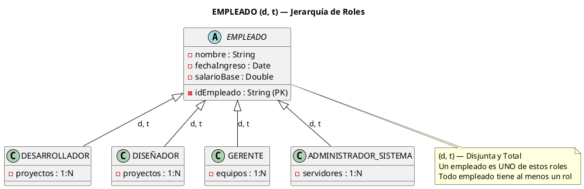
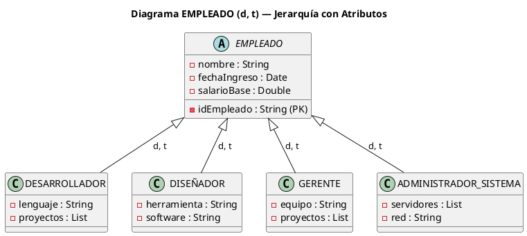
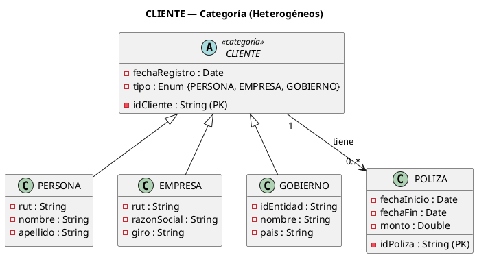
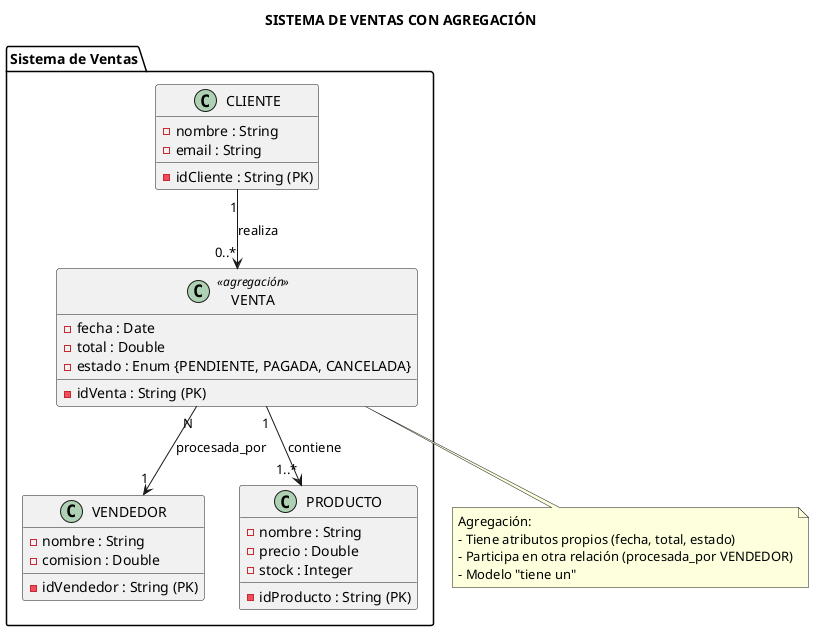
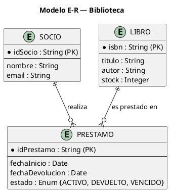
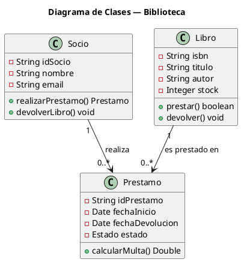
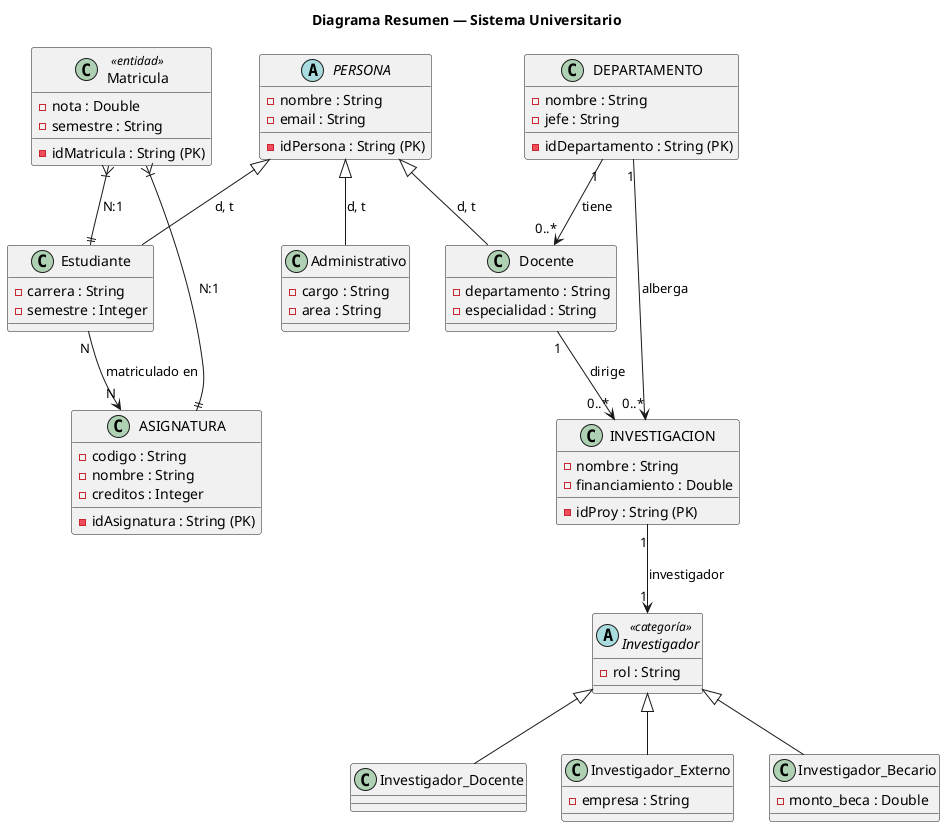
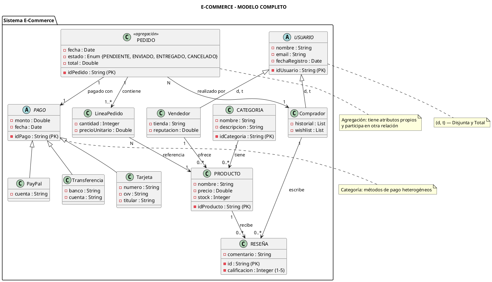

# 11. Ejercicios Prácticos y Autoevaluación

> **Esta nota consolida los conocimientos** mediante ejercicios graduales (de básicos a avanzados) y casos resueltos. Ideal para preparar evaluaciones y profundizar en el modelado.

---

## 6.1 Ejercicios de Identificación (Nivel Básico)

### Ejercicio 1: Identificar Entidades, Atributos y Relaciones

> **Enunciado:** "Una biblioteca tiene libros, cada uno con un ISBN único, título, autor y editorial. Los usuarios pueden pedir préstamos de hasta 3 libros a la vez. Cada préstamo tiene una fecha de inicio y devolución, y si se devuelve tarde se aplica una multa de $100 por día."

#### Solución

| Elemento | Identificación |
|----------|----------------|
| **Entidades** | `Libro`, `Usuario` (Socio), `Préstamo`, `Multa` |
| **Atributos Libro** | `isbn (PK)`, `titulo`, `autor`, `editorial` |
| **Atributos Usuario** | `idUsuario (PK)`, `nombre`, `direccion`, `telefono` |
| **Atributos Préstamo** | `idPrestamo (PK)`, `fechaInicio`, `fechaDevolucion`, `estado` |
| **Atributos Multa** | `idMulta (PK)`, `monto`, `diasRetraso` |
| **Relaciones** | `Usuario realiza Préstamo` (1:N), `Préstamo involucra Libro` (N:M) |
| **Cardinalidad** | Usuario (1) → Préstamo (N) → Libro (N) |
| **Restricciones** | Máximo 3 libros por préstamo (a nivel de instancia) |

---

### Ejercicio 2: Determinar si la Herencia es Válida

> **Enunciado:** Para los siguientes pares, determina si la herencia es válida usando la regla "es un":

| Subclase | Superclase Propuesta | ¿Es válida? | Justificación |
|----------|---------------------|-------------|---------------|
| `Bicicleta` | `Vehículo` | ✅ Sí | Una bicicleta ES UN vehículo |
| `Avión` | `Pájaro` | ❌ No | Un avión NO es un pájaro |
| `Circulo` | `Figura` | ✅ Sí | Un círculo ES UNA figura geométrica |
| `Empresa` | `Persona` | ❌ No | Una empresa NO es una persona |
| `Coche` | `Motor` | ❌ No | Un coche tiene un motor, no "es un" |
| `Estudiante` | `Persona` | ✅ Sí | Un estudiante ES UNA persona |
| `Smartphone` | `Computadora` | 🤔 Depende | Algunos modelos, pero no todos |
| `Mazda 3` | `Vehículo` | ✅ Sí | Un Mazda 3 ES UN vehículo |

---

### Ejercicio 3: Clasificar Cardinalidad

> **Enunciado:** Para cada situación, determina la cardinalidad:

| Situación | Cardinalidad | Explicación |
|-----------|--------------|-------------|
| Un país tiene muchas ciudades | **1:N** | Un país, muchas ciudades |
| Un cliente tiene muchas cuentas bancarias | **1:N** | Un cliente, varias cuentas |
| Un libro tiene muchos autores y un autor tiene muchos libros | **N:M** | Relación many-to-many |
| Una persona tiene un único pasaporte | **1:1** | Una persona, un pasaporte |
| Un empleado pertenece a un departamento | **N:1** | Muchos empleados, un depto |
| Un médico atiende a muchos pacientes y un paciente ve a muchos médicos | **N:M** | Relación many-to-many |

---

## 6.2 Ejercicios de Modelado (Nivel Intermedio)

### Ejercicio 4: Modelar una Empresa de Software

> **Enunciado:** Una empresa de software tiene los siguientes tipos de empleados:
> - Desarrolladores
> - Diseñadores
> - Gerentes
> - Administradores (de sistema, no de personal)

#### Solución con MER Extendido



**Restricciones aplicadas:**

| Restricción | Justificación |
|-------------|---------------|
| **d (Disjunta)** | Un empleado es UNO de estos roles |
| **t (Total)** | Todo empleado tiene al menos un rol |

**Diagrama:**



---

### Ejercicio 5: Sistema Asegurador con Categorías

> **Enunciado:** Una aseguradora tiene clientes que pueden ser personas naturales, empresas o entidades gubernamentales. Todos pueden tener pólizas.

#### Solución



**Justificación de la elección:**

| Pregunta | Respuesta |
|----------|-----------|
| ¿Comparten superclase común? | No, son muy heterogéneos |
| ¿Comparten atributos? | Solo el identificador y nombre |
| ¿Un cliente puede ser Persona y Empresa? | No, es solo uno |
| **Conclusión** | **CATEGORÍA** es la elección correcta |

---

### Ejercicio 6: Sistema de Ventas con Agregación

> **Enunciado:** Un sistema de ventas registra cada VENTA, que conecta un CLIENTE con varios PRODUCTOS. La venta tiene fecha, total y un vendedor asignado.

#### Solución



**¿Por qué Agregación?**

| Razón | Justificación |
|-------|---------------|
| Tiene atributos propios | `fecha`, `total`, `estado` |
| Participa en otra relación | `VENTA → procesada_por → VENDEDOR` |
| Modelo "tiene un" | La VENTA "tiene" un vendedor |

---

## 6.3 Ejercicios de Implementación (Nivel Avanzado)

### Ejercicio 7: Diagrama de Clases en UML

> **Enunciado:** Convierte el siguiente modelo E-R a un diagrama de clases UML:



#### Solución



---

### Ejercicio 8: Identificar Errores de Modelado

> **Enunciado:** Identifica los errores en el siguiente modelo:

```
PROBLEMA:
- HERENCIA: Empleado hereda de Empresa
- ATRIBUTO: Coche tiene como atributo "motor"
- CARDINALIDAD: Cliente (N) → (1) Pedido (1) → (N) Producto
- CARDINALIDAD: Persona (1) → (1) Pasaporte (es 1:1, debería ser 1:1 ok)
- NORMALIZACIÓN: Tabla con campo "teléfonos" multivaluado
```

#### Solución

| Error | Tipo | Corrección |
|-------|------|------------|
| Empleado hereda de Empresa | ❌ Herencia inválida | Un empleado NO es una empresa. Usar composición: `Empresa tiene Empleados` |
| Coche tiene "motor" como atributo | ❌ Confusión entidad/atributo | El motor debería ser una entidad separada: `Coche tiene Motor` (composición) |
| Cliente (N) → (1) Pedido (1) → (N) Producto | ⚠️ Cardinalidad ambigua | Si un pedido tiene muchos productos y un producto puede estar en muchos pedidos, es N:M. Necesita tabla intermedia |
| Persona (1) → (1) Pasaporte | ✅ Correcto | Está bien modelado |
| Campo "teléfonos" multivaluado | ❌ Viola 1FN | Crear tabla `Telefono` con FK a `Persona` |

---

## 6.4 Ejercicios Integrales (Nivel Experto)

### Ejercicio 9: Sistema Universitario Completo

> **Enunciado:** Modela completamente un sistema universitario con:
> - Personas (Estudiantes, Docentes, Administrativos)
> - Asignaturas con créditos
> - Departamentos
> - Matrículas (con notas y semestre)
> - Investigación (proyectos con financiamiento)

#### Elementos a Identificar

| Elemento | Tipo | Restricciones |
|----------|------|---------------|
| `Persona` | Entidad | Generalización con 3 subclases |
| `Estudiante` | Entidad | Con carrera, semestre |
| `Docente` | Entidad | Con departamento, especialidad |
| `Administrativo` | Entidad | Con cargo, área |
| `Asignatura` | Entidad | Con código, créditos |
| `Departamento` | Entidad | Con nombre, jefe |
| `Matrícula` | Entidad/Agregación | Estudiante + Asignatura con nota |
| `Investigación` | Entidad | Proyecto con financiamiento |
| `Investigador` | Categoría | Docente, Externo, Becario |

#### Diagrama Resumen



---

### Ejercicio 10: Sistema de E-commerce

> **Enunciado:** Modela un sistema de e-commerce con:
> - Usuarios (compradores y vendedores)
> - Productos en categorías
> - Pedidos con líneas de pedido
> - Métodos de pago heterogéneos
> - Reseñas y calificaciones

#### Modelo Solución



---

## 6.5 Autoevaluación Rápida (Multiple Choice)

> Responde las siguientes preguntas para verificar tu comprensión:

### Pregunta 1
**¿Cuál es la diferencia entre Generalización y Categoría?**

- A) No hay diferencia
- B) Generalización une entidades heterogéneas, Categoría une similares
- C) Generalización une entidades similares ("es un"), Categoría une heterogéneas (sin relación "es un")
- D) Solo se diferencian en la notación

**Respuesta correcta:** C

---

### Pregunta 2
**¿Cuándo se debe usar Agregación?**

- A) Siempre que hay una relación
- B) Cuando la relación tiene atributos propios o participa en otra relación
- C) Solo en relaciones 1:1
- D) Nunca, siempre se usa herencia

**Respuesta correcta:** B

---

### Pregunta 3
**Una relación 1:N entre Cliente y Pedido se modela con:**

- A) Una tabla intermedia
- B) Un FK en la tabla Pedido apuntando a Cliente
- C) Un FK en la tabla Cliente apuntando a Pedido
- D) Una sola tabla con todo

**Respuesta correcta:** B

---

### Pregunta 4
**¿Cuál de las siguientes NO es una forma normal?**

- A) 1FN
- B) 3FN
- C) 4FN
- D) BCNF

**Respuesta correcta:** D (BCNF es una extensión de 3FN, no una "forma normal" en el sentido clásico)

---

### Pregunta 5
**El polimorfismo permite:**

- A) Crear múltiples clases
- B) Que un mismo método tenga diferentes comportamientos según el objeto
- C) Heredar de múltiples clases
- D) Encapsular datos

**Respuesta correcta:** B

---

## 6.6 Checklist de Verificación de Modelos

Antes de entregar un modelo, verifica:

### Modelo E-R

- [ ] ¿Todas las entidades tienen PK definida?
- [ ] ¿Los nombres son en singular y descriptivos?
- [ ] ¿Las relaciones tienen nombre (verbo)?
- [ ] ¿La cardinalidad está especificada?
- [ ] ¿La participación (total/parcial) está clara?
- [ ] ¿Las relaciones N:M tienen tabla intermedia?
- [ ] ¿No hay redundancia (cumple 3FN)?

### Herencia

- [ ] ¿La relación cumple "es un"?
- [ ] ¿La subclase tiene atributos específicos propios?
- [ ] ¿Las restricciones d, s, t, p están bien aplicadas?
- [ ] ¿Se usó Categoría en lugar de Generalización cuando es apropiado?

### POO

- [ ] ¿Los atributos son privados?
- [ ] ¿Hay getters y setters con validación?
- [ ] ¿Los métodos tienen nombres descriptivos?
- [ ] ¿Se aplica polimorfismo cuando hay comportamientos diferentes?
- [ ] ¿La herencia no es demasiado profunda (máximo 3 niveles)?

---

## 6.7 Proyecto Integrador Sugerido

### Opción 1: Sistema de Gestión de Clínica
- Entidades: Paciente, Doctor, Enfermero, Cita, Tratamiento
- Aplicar: Generalización, Agregación, Categorías

### Opción 2: Sistema de Restaurante
- Entidades: Cliente, Pedido, Plato, Mesero, Mesa, Reserva
- Aplicar: Tablas intermedias, Herencia

### Opción 3: Sistema de Biblioteca
- Entidades: Libro, Socio, Préstamo, Multa, Reserva
- Aplicar: Agregación, Relaciones complejas

### Opción 4: Red Social
- Entidades: Usuario, Publicación, Comentario, Grupo
- Aplicar: Relaciones recursivas, Categorías

### Opción 5: Sistema de Transporte
- Entidades: Vehículo, Conductor, Ruta, Pasajero
- Aplicar: Herencia multinivel, Agregación

---

## 🔗 Notas Relacionadas

- [[01_Etapas_del_Diseño_de_BD]] — Conceptos base del diseño
- [[02_Entidad_Atributos_e_Instancias]] — Vocabulario técnico (entidad, atributo)
- [[09_MER_Extendido]] — MER Extendido
- [[10_POO_Conceptos_Fundamentales]] — POO
- [[08_Caso_de_Estudio_Completo]] — Ejemplos completos
- [[12_Herramientas_UML]] — Herramientas para implementar

---

> [!TIP] **Para preparar el examen**
> 1. Practica identificando entidades en escenarios reales
> 2. Dibuja diagramas E-R de sistemas cotidianos (hospital, banco, tienda)
> 3. Memoriza las restricciones del MER Extendido (d, s, t, p)
> 4. Practica la conversión de E-R a clases UML
> 5. Aprende a usar Mermaid para diagramas rápidos

---

*Creado para el Semestre 2026-2 — ADOO*
