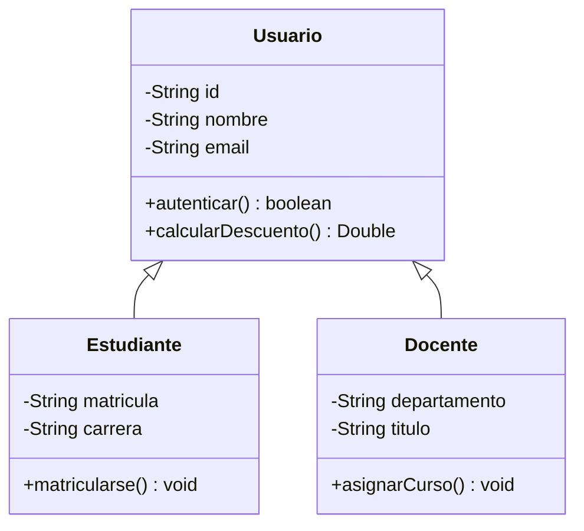
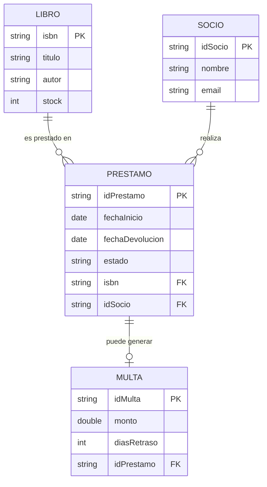
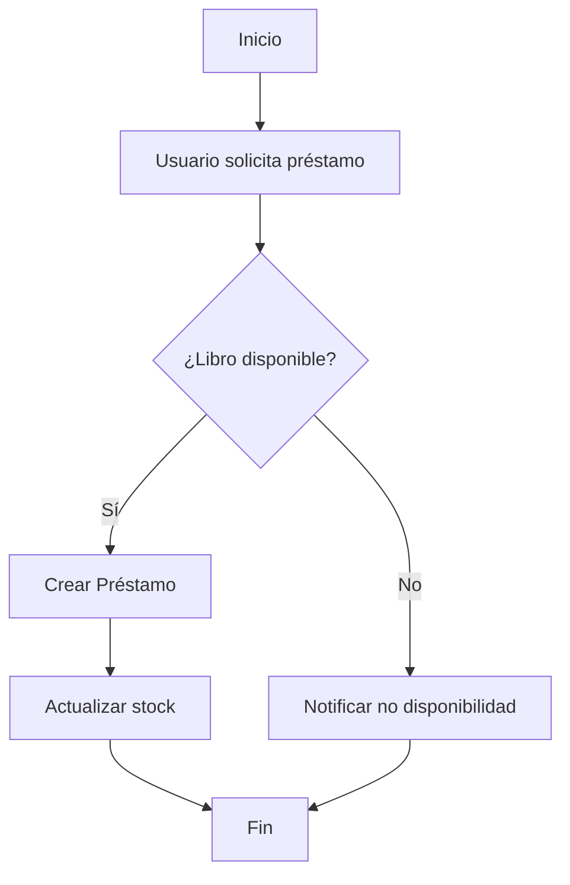
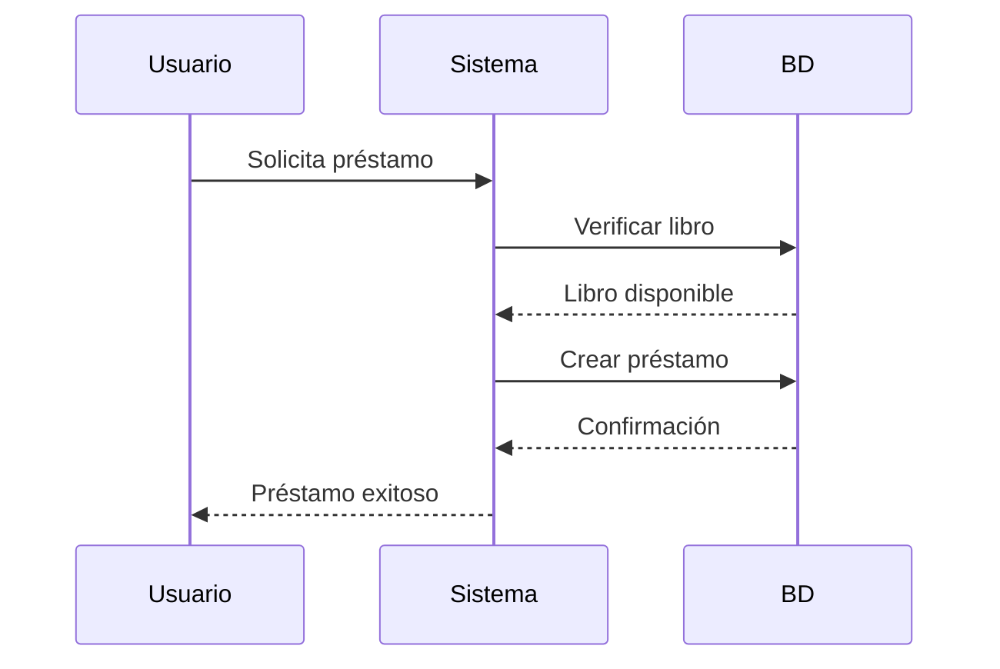
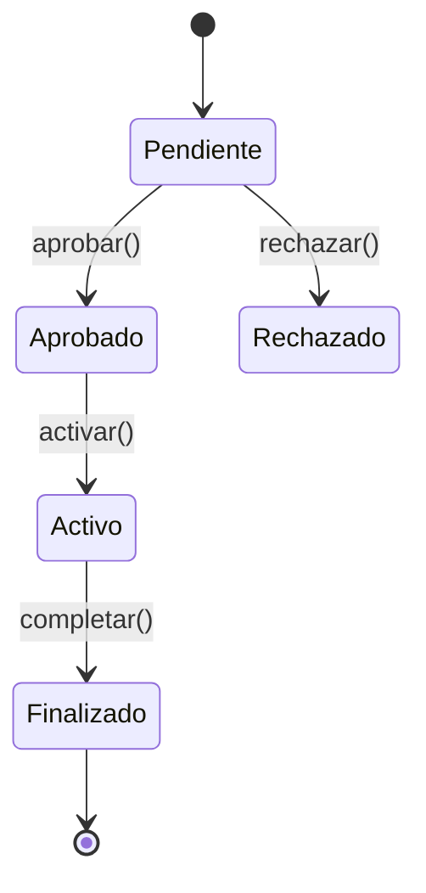
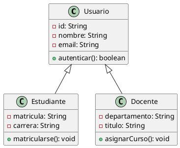
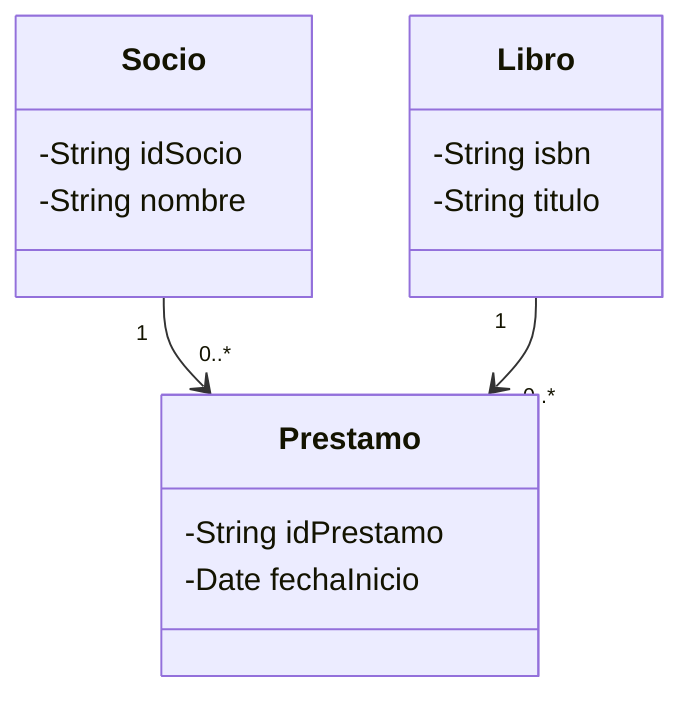
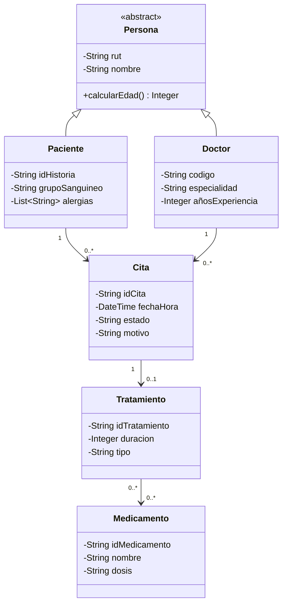
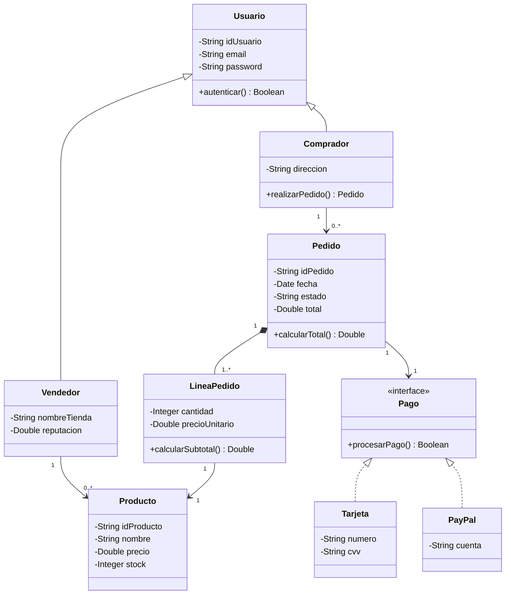
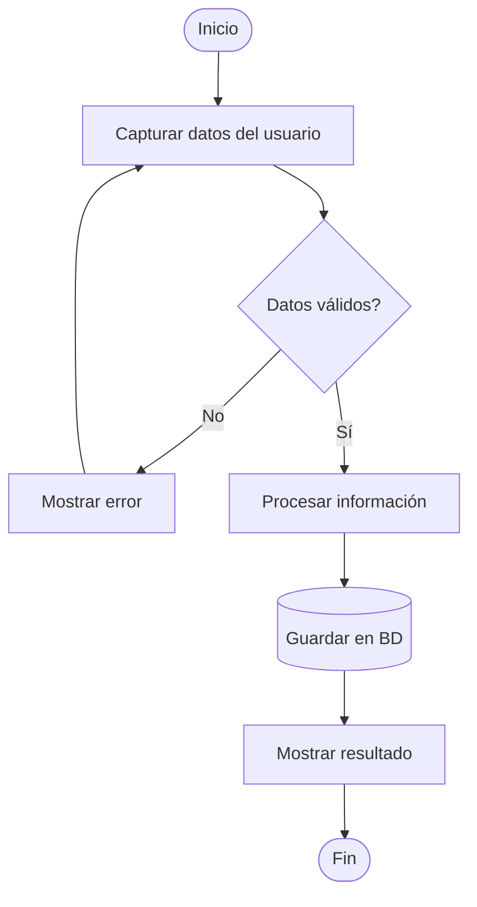

# 12. Herramientas UML y Notación para Modelado

> **Esta nota recopila las herramientas más utilizadas** para implementar los modelos E-R, diagramas UML y de clases. Incluye una guía de Mermaid (ideal para Obsidian) y comparativa de software profesional.

---

## 7.1 UML (Unified Modeling Language) - Introducción

> **Definición:** Lenguaje estándar (ISO/IEC 19505) para **visualizar, especificar, documentar y construir** sistemas de software. Creado por Grady Booch, James Rumbaugh e Ivar Jacobson (Rational Software, 1997).

### Tipos de Diagramas UML

```
┌─────────────────────────────────────────────────────────────────────┐
│                    DIAGRAMAS UML                                     │
├─────────────────────────────────────────────────────────────────────┤
│                                                                      │
│  ESTRUCTURALES (Estructura del sistema)                            │
│  ├── Diagrama de Clases ← Más usado en ADOO                       │
│  ├── Diagrama de Objetos                                            │
│  ├── Diagrama de Componentes                                        │
│  ├── Diagrama de Despliegue                                         │
│  ├── Diagrama de Paquetes                                           │
│  └── Diagrama de Estructura Compuesta                               │
│                                                                      │
│  DE COMPORTAMIENTO (Comportamiento del sistema)                    │
│  ├── Diagrama de Casos de Uso                                       │
│  ├── Diagrama de Actividades                                        │
│  ├── Diagrama de Estados                                            │
│  └── Diagrama de Máquina de Estados                                 │
│                                                                      │
│  DE INTERACCIÓN (Interacción entre objetos)                        │
│  ├── Diagrama de Secuencia                                          │
│  ├── Diagrama de Comunicación                                        │
│  ├── Diagrama de Tiempos                                            │
│  └── Diagrama de Vista de Interacción                                │
│                                                                      │
└─────────────────────────────────────────────────────────────────────┘
```

### Diagrama de Clases (El más importante para ADOO)

#### Notación de Clase

```
┌─────────────────────────────────┐
│         NOMBRE_CLASE            │ ← Header (Nombre)
├─────────────────────────────────┤
│  - atributo1: Tipo             │ ← Sección de Atributos
│  - atributo2: Tipo             │   (privado con -)
│  + atributo3: Tipo             │   (público con +)
├─────────────────────────────────┤
│  + metodo1(): TipoRetorno      │ ← Sección de Métodos
│  + metodo2(param: Tipo): Tipo  │
│  - metodoPrivado(): void        │
└─────────────────────────────────┘
```

#### Visibilidad

| Símbolo | Java | Significado |
|---------|------|-------------|
| `+` | `public` | Accesible desde cualquier parte |
| `-` | `private` | Solo dentro de la clase |
| `#` | `protected` | Clase y subclases |
| `~` | `package` | Mismo paquete |

#### Tipos de Relaciones

| Relación | Símbolo | Significado |
|----------|---------|-------------|
| **Asociación** | ──── | Relación estructural simple |
| **Agregación** | ─◇ | "Tiene un" (débil) |
| **Composición** | ─◆ | "Es parte de" (fuerte) |
| **Herencia** | ──▷ | "Es un" |
| **Implementación** | ──▷ | Implementa interfaz |
| **Dependencia** | ──> | "Usa temporalmente" |

---

## 7.2 Herramientas Recomendadas

### Comparativa General

| Herramienta | Tipo | Costo | Mejor para |
|-------------|------|-------|------------|
| **draw.io** | Online/Desktop | Gratis | Diagramas E-R y UML rápidos |
| **PlantUML** | Texto | Gratis | Diagramas desde código |
| **Mermaid** | Texto (Markdown) | Gratis | Integración con Markdown/Obsidian |
| **Lucidchart** | Online | Freemium | Diagramas colaborativos |
| **MySQL Workbench** | Desktop | Gratis | Diseño de BD profesional |
| **Visual Paradigm** | Desktop | Comercial | UML completo |
| **StarUML** | Desktop | Comercial | UML open source |
| **DbSchema** | Desktop | Freemium | Diseño visual de BD |
| **DBeaver** | Desktop | Gratis | Cliente SQL universal |
| **Microsoft Visio** | Desktop | Comercial | Diagramas empresariales |

---

## 7.3 Mermaid (Recomendado para Obsidian)

> **Mermaid** es un lenguaje de diagramación basado en texto que se renderiza automáticamente en Markdown. **Es el más recomendado para Obsidian** porque:
> - Se escribe en bloques de código
> - Se actualiza en tiempo real
> - No requiere software adicional
> - Es portable

### Activar Mermaid en Obsidian

1. Settings → Core Plugins → Markdown importer (activar)
2. Crear bloque de código con ` ```mermaid `

### Tipos de Diagramas Soportados

| Tipo | Sintaxis | Uso |
|------|----------|-----|
| `flowchart` | Diagramas de flujo | Procesos, algoritmos |
| `classDiagram` | Diagrama de clases | POO, diseño |
| `sequenceDiagram` | Diagrama de secuencia | Interacciones |
| `stateDiagram` | Diagrama de estados | Estados de objeto |
| `erDiagram` | Diagrama E-R | Bases de datos |
| `gantt` | Diagrama de Gantt | Proyectos |
| `pie` | Gráfico circular | Distribuciones |
| `journey` | Customer journey | UX |

---

### Ejemplo 1: Diagrama de Clases con Mermaid



### Ejemplo 2: Diagrama E-R con Mermaid



### Ejemplo 3: Flujo de Proceso



### Ejemplo 4: Diagrama de Secuencia



### Ejemplo 5: Diagrama de Estados



---

## 7.4 PlantUML (Alternativa Profesional)

> **PlantUML** es similar a Mermaid pero más potente y con más tipos de diagramas. Requiere un plugin en Obsidian.

### Ejemplo de Diagrama de Clases



### Plugin para Obsidian

**Obsidian PlantUML Plugin:**
- Settings → Community Plugins → Buscar "PlantUML"
- Activar y configurar

---

## 7.5 draw.io (Alternativa Visual)

> **draw.io** (también conocido como diagrams.net) es una herramienta **gratuita** muy popular para crear diagramas visualmente.

### Características

| Característica | Detalle |
|----------------|---------|
| **Costo** | 100% Gratis |
| **Plataforma** | Online + Desktop |
| **Formatos** | PNG, SVG, PDF, XML |
| **Integración** | Google Drive, OneDrive, GitHub |
| **Biblioteca** | Extensa (UML, E-R, AWS, Azure) |
| **Exportación** | Múltiples formatos |

### Ventajas vs Mermaid

| Aspecto | draw.io | Mermaid |
|---------|---------|---------|
| Interfaz visual | ✅ Sí | ❌ Solo texto |
| Velocidad | ⚠️ Más lento | ✅ Rápido (escribir) |
| Integración con Obsidian | ❌ Requiere plugin | ✅ Nativo |
| Personalización | ✅ Total | ⚠️ Limitada |
| Trabajo colaborativo | ✅ Sí | ❌ No |

---

## 7.6 Notación Estándar UML (Referencia Rápida)

### Diagrama de Clases

```
┌─────────────────────────────────────────────────────────────┐
│                    CLASE                                      │
├─────────────────────────────────────────────────────────────┤
│  Atributos:                                                  │
│    + nombreAtributo: Tipo  (público)                        │
│    - nombreAtributo: Tipo  (privado)                        │
│    # nombreAtributo: Tipo  (protegido)                      │
│                                                              │
│  Métodos:                                                    │
│    + nombreMetodo(param: Tipo): TipoRetorno                 │
│    + metodoEstatico(): void                                 │
│    + metodoAbstracto(): void {abstract}                     │
└─────────────────────────────────────────────────────────────┘
```

### Relaciones

```
ASOCIACIÓN (simple)
  Cliente ──── Pedido
  "Un cliente hace pedidos"

AGREGACIÓN (débil, "tiene un")
  Universidad ◇──── Profesor
  "Universidad TIENE profesores (pero pueden existir sin ella)"

COMPOSICIÓN (fuerte, "es parte de")
  Empresa ◆──── Departamento
  "Departamento ES PARTE de la empresa (muere con ella)"

HERENCIA ("es un")
  Animal ───▷ Perro
  "Perro ES UN animal"

IMPLEMENTACIÓN (interfaz)
  <<interface>> Volador ───▷ Pájaro
  "Pájaro IMPLEMENTA Volador"

DEPENDENCIA ("usa")
  Controlador ───> Servicio
  "Controlador USA Servicio"
```

---

## 7.7 Mapeo de E-R a Clases UML

### Reglas de Conversión

| Elemento E-R | Elemento UML |
|--------------|--------------|
| **Entidad** | Clase |
| **Atributo** | Atributo de clase |
| **Atributo llave (PK)** | Atributo con `<<PK>>` o subrayado |
| **Relación 1:1** | Asociación con cardinalidad 1..1 |
| **Relación 1:N** | FK en el lado "N" |
| **Relación N:M** | Clase intermedia (asociativa) |
| **Generalización** | Herencia (`extends`) |
| **Categoría** | Interfaz o clase abstracta |
| **Agregación** | Asociación con ◇ |
| **Composición** | Asociación con ◆ |

### Ejemplo de Mapeo

#### Modelo E-R

```
Socio (1) ───< (N) Préstamo >── (N) Libro
```

#### Diagrama de Clases Resultante



---

## 7.8 Ejemplos Prácticos con Mermaid

### Ejemplo A: Sistema Hospitalario



### Ejemplo B: Sistema E-commerce



### Ejemplo C: Diagrama de Flujo



---

## 7.9 Atajos y Tips para Mermaid

### Tips Generales

| Tip | Descripción |
|-----|-------------|
| **Sintaxis mínima** | Solo necesitas escribir texto, Mermaid genera el diagrama |
| **Preview en vivo** | En Obsidian, se actualiza al escribir |
| **Comentarios** | Usa `%%` para comentarios |
| **Estilos** | Algunos temas soportan CSS personalizado |
| **Subgraphs** | Agrupa elementos con `subgraph` |

### Ejemplo con Subgraphs

```mermaid
classDiagram
    subgraph "Dominio Biblioteca"
        Libro
        Socio
        Prestamo
    end
    
    subgraph "Servicios"
        ServicioPrestamo
        ServicioPago
    end
    
    class Libro {
        -String isbn
    }
    
    class ServicioPrestamo {
        +crear() Prestamo
        +cancelar() void
    }
    
    ServicioPrestamo --> Prestamo
```

---

## 7.10 Recursos Adicionales

### Tutoriales Recomendados

| Recurso | Enlace | Tipo |
|---------|--------|------|
| **Mermaid Live Editor** | mermaid.live | Editor online |
| **Mermaid Documentation** | mermaid.js.org | Documentación oficial |
| **PlantUML** | plantuml.com | Tutoriales oficiales |
| **draw.io** | diagrams.net | Herramienta online |
| **UML Diagrams** | uml-diagrams.org | Referencia UML |

### Libros Recomendados

| Libro | Autor | Enfoque |
|-------|-------|---------|
| "UML Distilled" | Martin Fowler | Guía concisa de UML |
| "El Lenguaje Unificado de Modelado" | Rumbaugh, Jacobson, Booch | Biblia de UML |
| "UML 2 and the Unified Process" | Jim Arlow | UML + Proceso Unificado |

### Cursos Online

| Plataforma | Curso | Nivel |
|-----------|-------|-------|
| Coursera | "Object-Oriented Design" | Intermedio |
| Udemy | "UML Class Diagrams" | Principiante |
| YouTube | "Mermaid Crash Course" | Principiante |

---

## 📌 Resumen de Herramientas

| Herramienta | Cuándo Usarla |
|-------------|---------------|
| **Mermaid** | Dentro de Obsidian, diagramas rápidos, documentación en Markdown |
| **draw.io** | Diagramas visuales complejos, trabajo colaborativo |
| **PlantUML** | UML detallado, generación desde código |
| **MySQL Workbench** | Diseño específico de bases de datos |
| **StarUML** | UML profesional, diagramas complejos |
| **Lucidchart** | Trabajo en equipo, presentaciones |

---

## 🔗 Notas Relacionadas

- [[01_Etapas_del_Diseño_de_BD]] — Conceptos teóricos
- [[10_POO_Conceptos_Fundamentales]] — POO
- [[08_Caso_de_Estudio_Completo]] — Ejemplos para diagramar
- [[11_Ejercicios_Practicos]] — Practica con estas herramientas

---

> [!TIP] **Recomendación final**
> Para el curso de ADOO, te recomiendo:
> 1. **Mermaid** para diagramas dentro de notas de Obsidian
> 2. **draw.io** para diagramas complejos de mayor tamaño
> 3. **PlantUML** cuando necesites UML más detallado
> 
> Practica con los ejemplos de [[08_Caso_de_Estudio_Completo]] y [[11_Ejercicios_Practicos]].

---

*Creado para el Semestre 2026-2 — ADOO*
