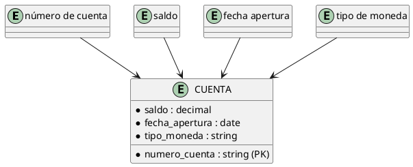
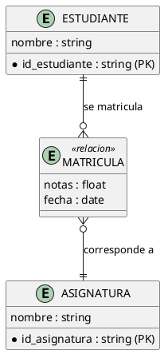
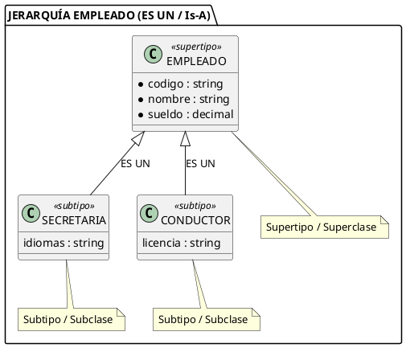
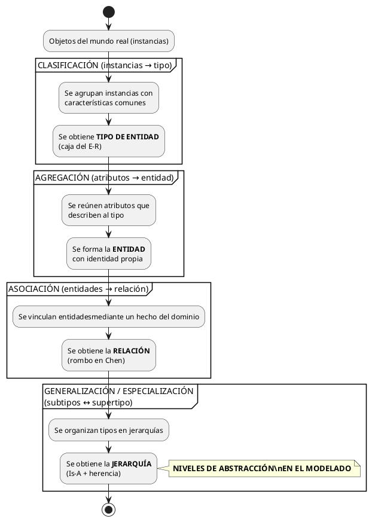

# Los 4 Tipos de Abstracción en el Modelamiento de Datos

> **Definición general:** La **abstracción** es el proceso cognitivo de **ignorar los detalles irrelevantes** de un dominio y concentrarse únicamente en los **aspectos esenciales** que se desean representar. En modelamiento de datos, toda construcción del modelo E-R (entidades, atributos, relaciones, jerarquías) surge de aplicar una de **cuatro operaciones de abstracción** fundamentales.

---

## 1. Explicación Teórica: El Marco de las 4 Abstracciones

Los modelos conceptuales se construyen con **cuatro niveles de abstracción**, cada uno con una dirección propia:

| Abstracción | Transformación | Pregunta clave | Resultado en el MER |
|---|---|---|---|
| **Agregación** | Atributos → Entidad | ¿Qué características describen a este objeto? | Entidad (con sus atributos) |
| **Asociación** | Entidades → Relación | ¿Cómo se vinculan estos objetos? | Relación (rombo) |
| **Clasificación** | Instancias → Tipo | ¿Qué objetos individuales comparten propiedades? | Tipo de entidad |
| **Generalización / Especialización** | Subtipos → Supertipo | ¿Qué tipos son casos particulares de un tipo más general? | Jerarquía (superclase/subclase) |

> [!NOTE] **Orden lógico de construcción**
> 1. **Clasificamos** objetos reales → obtenemos **entidades**.
> 2. **Agregamos** atributos a cada entidad → describimos sus **propiedades**.
> 3. **Asociamos** entidades → obtenemos **relaciones**.
> 4. **Generalizamos/especializamos** tipos → obtenemos **jerarquías** con herencia.

---

### 1.1 Clasificación (Instancias → Tipo de Entidad)

**Definición:** Operación que agrupa un conjunto de **objetos individuales (instancias)** que comparten las mismas características en un **tipo de entidad**. Es la abstracción más básica: convierte lo particular en lo general.

- Dirección: de lo **particular** (cada objeto) a lo **general** (el tipo).
- Resultado: la **entidad** y cada **instancia** que la conforma.
- En la práctica: cada fila de una tabla es una instancia; la tabla es el tipo.

> [!EXAMPLE] **Ejemplo práctico: Sistema universitario**
> María González, Juan Pérez y Pedro Soto son **instancias** individuales. Al reconocer que los tres comparten propiedades (RUN, nombre, fecha de nacimiento, carrera), los clasificamos en la entidad **ESTUDIANTE**. Nadie modela "María" como tabla: modela ESTUDIANTE, y María es una fila más.

---

### 1.2 Agregación (Atributos → Entidad)

**Definición:** Operación que **construye una entidad reuniendo los atributos** que la describen. Los atributos individuales se agregan para formar un **todo con identidad propia**. En el MER clásico también se llama *agregación* a elevar una **relación al nivel de entidad** para que participe en otra relación (ver [[09_MER_Extendido]]).

> [!EXAMPLE] **Ejemplo práctico: Sistema bancario**
> Los datos sueltos `{número de cuenta, saldo, fecha de apertura, tipo de moneda}` no tienen sentido por separado. **Agregamos** esos atributos y obtenemos la entidad **CUENTA**. La agregación responde: *¿qué atributos forman una unidad coherente que debe persistir junta?*

---

### 1.3 Asociación (Entidades → Relación)

**Definición:** Operación que **vincula dos o más tipos de entidad** mediante un hecho del dominio real (un verbo), produciendo una **relación**. Las entidades **existen por sí solas**; la relación solo existe **entre** ellas.

- Dirección: de las entidades al **vínculo** que las conecta.
- Resultado: la **relación** (rombo en notación Chen).
- La asociación responde: *¿qué hecho vincula estas entidades?*

> [!EXAMPLE] **Ejemplo práctico: Universidad**
> **ESTUDIANTE** y **ASIGNATURA** existen independientemente. El hecho "un estudiante se matricula en una asignatura" **asocia** ambas entidades mediante la relación **MATRICULA**. Un estudiante que no está matriculado en nada sigue existiendo; la relación solo describe el vínculo.

---

### 1.4 Generalización / Especialización (Subtipos → Supertipo)

**Definición:** Operación que organiza tipos de entidad en **jerarquías**: 

- **Generalización (bottom-up):** se parte de varios **subtipos** con propiedades comunes y se **fusionan** en un **supertipo** más general.
- **Especialización (top-down):** se parte de un **supertipo** y se **divide** en **subtipos** más específicos.

Ambas expresan la misma jerarquía; solo cambia la dirección del razonamiento. La propiedad central es la **regla "ES UN" (Is-A)**: *toda instancia del subtipo es una instancia del supertipo* (ver [[15_Jerarquias_Superclase_Subclase]]).

> [!EXAMPLE] **Ejemplo práctico: Sistema de transporte**
> Tenemos **SECRETARIA** (con código de empleado, sueldo) y **CONDUCTOR** (con código de empleado, sueldo, licencia). En lugar de repetir atributos, **generalizamos**: ambos "son un" **EMPLEADO**. La entidad EMPLEADO guarda lo común; cada subtipo guarda lo propio.

---

## 2. Las 4 Abstracciones Juntas: Un Mismo Sistema, 4 Miradas

> [!EXAMPLE] **Ejemplo integral: Clínica médica**
> 1. **Clasificación:** todos los pacientes individuales → entidad **PACIENTE**.
> 2. **Agregación:** los atributos `{id_paciente, nombre, rut, fecha_nacimiento, grupo_sanguíneo}` → conforman PACIENTE.
> 3. **Asociación:** **PACIENTE** se vincula con **MÉDICO** mediante **ATIENDE** (N:M).
> 4. **Generalización/Especialización:** **MÉDICO** → subtipos **CIRUJANO** y **PEDIATRA** según su especialidad; y **PERSONAL** → **MÉDICO** / **ENFERMERO** / **ADMINISTRATIVO**.

---

## 3. Diagramación / Esquema Conceptual: Mapa General

---

## 📌 Resumen de la Nota

| Abstracción | Entrada | Salida | Pregunta guía |
|---|---|---|---|
| Agregación | Atributos | Entidad | ¿Qué atributos forman este objeto? |
| Asociación | Entidades | Relación | ¿Qué hecho los vincula? |
| Clasificación | Instancias | Tipo de entidad | ¿Qué objetos comparten propiedades? |
| Generalización/Especialización | Subtipos ↔ Supertipo | Jerarquía | ¿Qué tipos son casos de otro más general? |

> [!TIP] **Regla mnemotécnica: "C-A-G-E"**
> **C**lasificación → **A**gregación → **G**eneralización → cria la **E**structura del modelo. La asociación conecta las piezas en el medio.

---

## 🔗 Notas Relacionadas

- [[02_Entidad_Atributos_e_Instancias]] — Clasificación y agregación en el MER básico
- [[04_Relaciones_y_Cardinalidades]] — La asociación en detalle
- [[09_MER_Extendido]] — Agregación de relaciones y jerarquías (visión panorámica)
- [[15_Jerarquias_Superclase_Subclase]] — La regla Is-A y la herencia en profundidad
- [[16_Cobertura_Jerarquias]] — Restricciones de pertenencia y exclusividad
- [[17_Caso_SIG_Medio_Ambiente]] — Las 4 abstracciones aplicadas al caso SIG