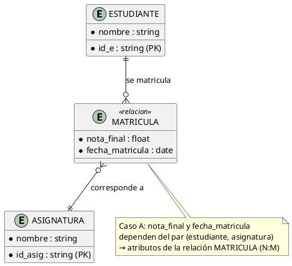
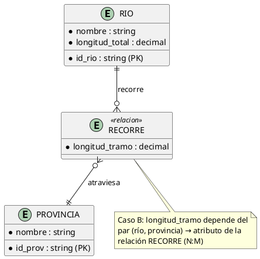
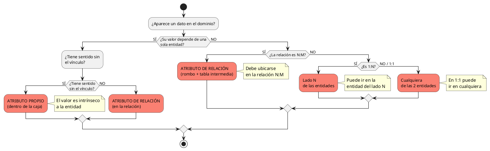

# Atributos Propios vs. Atributos de Relación

> **Problema central del modelado:** cuando un dato aparece en el dominio, el diseñador debe decidir si ese dato **describe a una sola entidad** (atributo propio) o si **describe el vínculo entre entidades** (atributo de relación o atributo descriptivo). Colocarlo en el lugar equivocado genera redundancia, inconsistencias o tablas mal diseñadas.

---

## 1. Explicación Teórica: Los Criterios de Decisión

### Regla de oro

> [!WARNING] **Pregunta decisiva**
> **¿El valor de este dato depende de UNA sola entidad, o depende de la COMBINACIÓN de dos o más entidades?**
> - Si depende de una sola entidad → **atributo propio** (va dentro de la caja).
> - Si depende de la combinación → **atributo de relación** (va en el rombo, o en la tabla intermedia).

### Criterios detallados

| # | Criterio | Atributo propio | Atributo de relación |
|---|---|---|---|
| 1 | **Dependencia semántica** | El valor es intrínseco a la entidad (ej. `fecha_nacimiento` de PERSONA) | El valor cambia según con quién se relacione (ej. `nota_final` depende de qué asignatura cursa) |
| 2 | **Unicidad de contexto** | Un solo valor por instancia, siempre | Un valor distinto por cada par/tupla de entidades vinculadas |
| 3 | **Sentido sin el vínculo** | El dato tiene sentido aunque la entidad no esté relacionada | El dato pierde sentido si se elimina el vínculo |
| 4 | **Cardinalidad (regla práctica)** | — | En **N:M es obligatorio** ubicarlo en la relación; en **1:N** puede ir en la entidad del lado N; en **1:1** puede ir en cualquiera |
| 5 | **Frecuencia de consulta** | Se consulta junto a la entidad | Se consulta siempre junto al par de entidades |

> [!TIP] **Regla de las cardinalidades (la más usada en exámenes)**
> - **1:1** → el atributo puede ubicarse en cualquiera de las dos entidades.
> - **1:N** → se ubica en la entidad del lado **N** (cada hijo tiene un valor propio).
> - **N:M** → se ubica **en la relación** (debe convertirse en tabla intermedia).

---

## 2. Ejemplo Práctico

### Caso A: "Nota final" en un sistema universitario

**Escenario:** Un estudiante se matricula en varias asignaturas y en cada una obtiene una nota distinta.

- La **nota no es de ESTUDIANTE** (no existe "la nota del estudiante" a secas).
- La **nota no es de ASIGNATURA** (no existe "la nota de la asignatura").
- La nota existe **por cada par (estudiante, asignatura)** → es atributo de la relación **MATRICULA (N:M)**.

> [!NOTE] **Consecuencia práctica (SQL)**
> MATRICULA se convierte en la tabla intermedia con clave compuesta `(id_e, id_asig)` y las columnas `nota_final`, `fecha_matricula`. Si la nota fuera atributo de ESTUDIANTE, un estudiante tendría que repetir filas o perder información.

### Caso B: "Tramo de longitud" entre RÍO y PROVINCIA

**Escenario:** Un río atraviesa varias provincias, y en cada tramo tiene **una longitud distinta** medida en kilómetros.

- La `longitud_total` es atributo propio de RÍO (describe al río completo).
- La `longitud_tramo` depende del par (río, provincia): **cada tramo tiene su propia medida** → atributo de la relación **RECORRE (N:M)**.

> [!NOTE] **Con la notación (mín, máx)**
> Cada río recorre **1..n** provincias; cada provincia es recorrida por **0..n** ríos. La longitud del tramo solo tiene sentido dentro de esa combinación.

### Caso C: "Fecha de contrato" en EMPLEADO–DEPARTAMENTO (1:N)

**Escenario:** Un empleado pertenece a un solo departamento. La `fecha_ingreso` describe el vínculo empleado–departamento; como la relación es **1:N**, puede ubicarse como atributo de EMPLEADO (lado N) sin pérdida de información.

---

## 3. Diagramación / Esquema Conceptual: Árbol de Decisión

### Tabla resumen de casos clásicos

| Dato | ¿De quién depende? | Ubicación correcta |
|---|---|---|
| `nota_final` | (estudiante, asignatura) | Relación MATRICULA (N:M) |
| `fecha_préstamo` | (socio, libro) | Relación PRESTAMO (N:M) |
| `longitud_tramo` | (río, provincia) | Relación RECORRE (N:M) |
| `fecha_ingreso` | (empleado, departamento) | EMPLEADO (lado N de 1:N) |
| `rut`, `nombre` | Entidad | Atributo propio siempre |
| `sueldo` | Entidad (EMPLEADO) | Atributo propio |
| `cantidad_comprada` | (cliente, producto) | Relación COMPRA (N:M) |

> [!IMPORTANT] **¿Cuándo la relación se convierte en entidad?**
> Si la relación acumula **varios atributos descriptivos** (nota, fecha, estado, observaciones), conviene **elevarla a entidad** (agregación de relación, ver [[13_Abstraccion_y_Tipos]] y [[09_MER_Extendido]]). Ejemplo: MATRICULA se convierte en la entidad **MATRÍCULA** con su propia clave (id_matricula).

---

## 📌 Resumen de la Nota

1. Pregunta clave: **¿el dato depende de una entidad o de la combinación?**
2. En **N:M** los datos del vínculo van **siempre** en la relación (tabla intermedia).
3. En **1:N** pueden ir en la entidad del lado N; en **1:1** en cualquiera.
4. Si la relación tiene muchos atributos → **elevar la relación a entidad**.
5. Un error típico de examen: poner `nota` dentro de ESTUDIANTE o ASIGNATURA → esto rompe la unicidad y obliga a duplicar filas.

---

## 🔗 Notas Relacionadas

- [[02_Entidad_Atributos_e_Instancias]] — Atributos y tipos de atributos
- [[04_Relaciones_y_Cardinalidades]] — Cardinalidades 1:1, 1:N, N:M
- [[05_Relaciones_Especiales]] — Atributos descriptivos en relaciones (PRESTAR, MATRICULA)
- [[07_Criterios_de_Diseño]] — Decisiones atributo vs. entidad
- [[13_Abstraccion_y_Tipos]] — Agregación: de atributos a entidad
- [[17_Caso_SIG_Medio_Ambiente]] — La longitud de tramo aplicada al caso SIG
- [[19_Antipatrones_MER]] — Anti-patrón: atributo vs. entidad mal resuelto