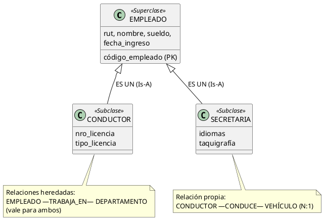
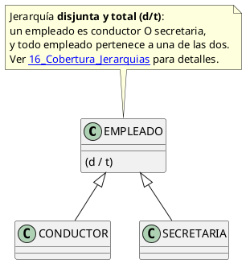

# Jerarquías en MER Extendido: Superclases, Subclases y la Regla "ES UN"

> **Definición:** Una **jerarquía de especialización/generalización** organiza los tipos de entidad en niveles: un tipo general (**superclase o supertipo**) y uno o más tipos específicos (**subclases o subtipos**) que lo refinan. La piedra angular es la **regla semántica "ES UN" (Is-A)**: *toda instancia de una subclase es, a su vez, una instancia de la superclase.*

---

## 1. Explicación Teórica

### 1.1 Superclase (Supertipo)

Es el tipo de entidad **general** que reúne los **atributos y relaciones comunes** a todos los miembros de la jerarquía.

- Contiene las propiedades que son ciertas para **todos** sus subtipos.
- Ejemplos: `EMPLEADO`, `VEHÍCULO`, `CUENTA`, `ELEMENTO_GEOLÓGICO`.

### 1.2 Subclase (Subtipo)

Es el tipo de entidad **específico** que **hereda** todo lo del supertipo y **añade sus propias propiedades** (atributos y relaciones particulares).

- No se vuelven a declarar los atributos heredados.
- Ejemplos: `CONDUCTOR` ⊆ `EMPLEADO`; `AUTO` ⊆ `VEHÍCULO`; `VOLCÁNICO` ⊆ `MONTE`.

> [!NOTE] **Notación de conjunto**
> La subclase es un **subconjunto** de la superclase:
> {CONDUCTOR} ⊆ {EMPLEADO}
> Cada elemento de CONDUCTOR pertenece a EMPLEADO; lo inverso NO es cierto.

### 1.3 Herencia de atributos y relaciones

La subclase **hereda automáticamente**:

1. **Todos los atributos** de la superclase (las columnas se comparten a nivel conceptual).
2. **Todas las relaciones** de la superclase (los vínculos valen para cada subtipo).

La subclase solo declara lo **nuevo**: sus atributos propios y sus relaciones propias.

> [!EXAMPLE] **Ejemplo de herencia de relaciones**
> Si `EMPLEADO —TRABAJA_EN— DEPARTAMENTO` existe en la superclase, entonces **CONDUCTOR** y **SECRETARIA** también "trabajan en" un departamento, sin necesidad de redibujar el vínculo en cada subclase. Consultar "¿en qué departamento trabaja el conductor X?" usa la relación heredada.

### 1.4 La regla semántica "ES UN" (Is-A)

- Lectura correcta: **CONDUCTOR ES UN EMPLEADO** (cada conductor es también empleado).
- Lectura INCORRECTA: "EMPLEADO ES UN CONDUCTOR" (falso: no todo empleado conduce).
- Propiedad de **transitividad**: si `CHOFER_BUS ES UN CONDUCTOR` y `CONDUCTOR ES UN EMPLEADO`, entonces `CHOFER_BUS ES UN EMPLEADO`.
- La relación Is-A es la que permite **reutilizar** la definición del supertipo y aplicar consultas polimórficas: `SELECT` sobre EMPLEADO devuelve también a los conductores y secretarias.

| Lectura | Valor de verdad | Explicación |
|---|---|---|
| CONDUCTOR ES UN EMPLEADO | ✅ Verdadero | Subconjunto ⊆ superconjunto |
| EMPLEADO ES UN CONDUCTOR | ❌ Falso | Hay empleados no conductores |
| CHOFER_BUS ES UN EMPLEADO | ✅ Verdadero | Transitividad de la herencia |

---

## 2. Ejemplo Práctico

### Sistema de una empresa de transporte

**Entidades involucradas:**

- **EMPLEADO** (superclase): `código_empleado (PK)`, `rut`, `nombre`, `fecha_ingreso`, `sueldo`.
- **CONDUCTOR** (subclase): atributos propios → `nro_licencia`, `tipo_licencia` (A2, A3, A4...), `antigüedad_licencia`.
- **SECRETARIA** (subclase): atributos propios → `taquigrafía`, `idiomas`, `nivel_atención_cliente`.
- Relación heredada: `EMPLEADO —TRABAJA_EN— DEPARTAMENTO` (N:1).
- Relación propia de CONDUCTOR: `CONDUCTOR —CONDUCE— VEHÍCULO` (N:1); `CONDUCTOR —REALIZA— VIAJE` (1:N).

**Instancias de ejemplo:**

| código | nombre | sueldo | fecha_ingreso | (rol) | datos propios |
|---|---|---|---|---|---|
| E-01 | Ana Rojas | 850.000 | 2024-03-01 | Conductora | licencia A3, 6 años |
| E-02 | Luis Mora | 720.000 | 2023-11-15 | Secretaria | inglés, francés |
| E-03 | Sara Peña | 900.000 | 2022-08-20 | Conductora | licencia A4, 10 años |

> [!NOTE] **Lo que NO se debe hacer**
> Incorrecto: crear dos tablas CONDUCTOR y SECRETARIA duplicando `rut/nombre/sueldo/fecha_ingreso` en cada una. Correcto: un solo almacenamiento del supertipo + subclases con solo lo propio.

---

## 3. Diagramación / Esquema Conceptual

### Representación con notación abreviada

> Donde `(d/t)` indica que la jerarquía es **disjunta y total** (un empleado es conductor o secretaria, y todo empleado pertenece a una de las dos). Los detalles de esta notación se estudian en [[16_Cobertura_Jerarquias]].

---

## 4. ¿Cómo se Implementa en SQL? (Descripción Conceptual)

| Estrategia | Descripción | Cuándo usarla |
|---|---|---|
| **Tabla única (1 tabla)** | Una sola tabla con todos los atributos + columna discriminante `tipo` | Jerarquías disjuntas con pocos atributos propios |
| **Tabla por subclase (N+1 tablas)** | Una tabla para la superclase + una por subclase con FK a la superclase | Jerarquías con muchos atributos propios (lo más común) |
| **Tabla por nodo** | Una tabla por cada clase de la jerarquía, con duplicación | Consultas muy específicas por subclase |

> [!TIP] **Coherencia de claves**
> En la estrategia "tabla por subclase", la PK de CONDUCTOR es a la vez su FK hacia EMPLEADO: `CONDUCTOR(código_empleado PK/FK → EMPLEADO, nro_licencia, tipo_licencia)`. Así se garantiza que cada conductor existe primero como empleado.

---

## 📌 Resumen de la Nota

1. **Superclase** = propiedades comunes; **subclase** = propiedades comunes heredadas + propiedades propias.
2. La **herencia** cubre atributos **y** relaciones: no se redibuja lo heredado.
3. **Regla Is-A:** subclase ⊆ superclase, con transitividad.
4. Los atributos se colocan en el nivel donde sean válidos para **todos** los descendientes.
5. La implementación típica: tabla superclase + tabla por subclase con PK/FK compartida.

---

## 🔗 Notas Relacionadas

- [[09_MER_Extendido]] — Generalización vs. Especialización y notación gráfica
- [[13_Abstraccion_y_Tipos]] — La generalización como 4ª abstracción
- [[16_Cobertura_Jerarquias]] — Restricciones de pertenencia (total/parcial) y exclusividad (d/s)
- [[17_Caso_SIG_Medio_Ambiente]] — Jerarquías aplicadas: Montes, Elementos Geológicos y Usuarios
- [[10_POO_Conceptos_Fundamentales]] — La herencia en el paradigma orientado a objetos