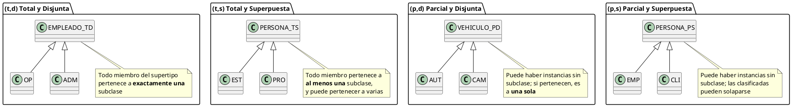

# Dimensiones de Cobertura en Jerarquías

> **Definición:** Toda jerarquía de especialización se define con **dos dimensiones de restricción**:
> 1. **Pertenencia (o cobertura):** ¿toda instancia de la superclase debe pertenecer al menos a una subclase? → **Total (t)** o **Parcial (p)**.
> 2. **Exclusividad:** ¿una instancia puede pertenecer a más de una subclase a la vez? → **Disjunta (d)** o **Superpuesta (s)**.

La combinación de ambas dimensiones produce **cuatro tipos de jerarquía**.

---

## 1. Explicación Teórica

### 1.1 Pertenencia: Cobertura Total vs. Parcial

Responde a: **¿toda instancia del supertipo pertenece obligatoriamente a (al menos) una subclase?**

| Tipo | Regla | Notación |
|---|---|---|
| **Total (t)** | Toda instancia de la superclase es instancia de alguna subclase. No existen instancias de la superclase "sin clasificar". | **Doble línea** entre la superclase y el círculo de jerarquía |
| **Parcial (p)** | Pueden existir instancias de la superclase que **no** pertenezcan a ninguna subclase. | **Línea simple** |

> [!EXAMPLE] **Ejemplo conceptual**
> - **Cuenta bancaria → Corriente / Ahorro (Total):** toda cuenta debe ser corriente o de ahorro. No hay "cuenta genérica sin tipo".
> - **Vehículo → Auto / Camión (Parcial):** pueden existir vehículos que no son ni autos ni camiones (una moto, una bicicleta).

### 1.2 Exclusividad: Jerarquía Disjunta vs. Superpuesta

Responde a: **¿una instancia puede pertenecer a MÁS DE UNA subclase simultáneamente?**

| Tipo | Regla | Notación |
|---|---|---|
| **Disjunta (d)** | Una instancia pertenece a **una sola** subclase. Las subclases son **excluyentes** entre sí. | Círculo con letra **d** |
| **Superpuesta (s)** | Una instancia puede pertenecer a **varias** subclases a la vez (solape). | Círculo con letra **s** |

> [!EXAMPLE] **Ejemplo conceptual**
> - **Empleado → Operario / Administrativo (Disjunta):** nadie es ambas cosas a la vez.
> - **Persona → Estudiante / Profesor (Superpuesta):** una persona puede ser estudiante **y** profesor simultáneamente.

---

## 2. Las 4 Combinaciones de Cobertura

| Combinación | Notación | Regla semántica | Ejemplo clásico |
|---|---|---|---|
| **Total / Disjunta** | (t, d) | Todo miembro del supertipo pertenece a **exactamente una** subclase | EMPLEADO → OPERARIO / ADMINISTRATIVO |
| **Total / Superpuesta** | (t, s) | Todo miembro pertenece a **al menos una** subclase, y puede pertenecer a varias | PERSONA → ESTUDIANTE / PROFESOR (todos en la universidad tienen rol) |
| **Parcial / Disjunta** | (p, d) | Puede haber instancias sin subclase; si pertenecen, es a **una sola** | VEHÍCULO → AUTO / CAMIÓN (la moto queda fuera) |
| **Parcial / Superpuesta** | (p, s) | Puede haber instancias sin subclase; las clasificadas pueden solaparse | PERSONA → EMPLEADO / CLIENTE (hay personas sin relación con la empresa) |

> [!IMPORTANT] **Cómo leer la notación**
> La doble línea solo afecta a la **pertenencia (t)**; la letra del círculo (**d** o **s**) solo afecta a la **exclusividad**. Son independientes: se puede tener t con s, p con d, etc.

---

## 3. Diagramación / Esquema Conceptual

### Notación gráfica estándar (Chen)

```plantuml
@startuml
package "Total (doble línea)" {
  class EMPLEADO_T <<(d,Disjunta)>>
  class OPERARIO
  class ADMINISTRATIVO

  EMPLEADO_T <|-- OPERARIO
  EMPLEADO_T <|-- ADMINISTRATIVO
}

package "Parcial (línea simple)" {
  class VEHICULO_P <<(d,Disjunta)>>
  class AUTO
  class CAMION

  VEHICULO_P <|-- AUTO
  VEHICULO_P <|-- CAMION
}

note top of EMPLEADO_T
  **Total (doble línea):**
  toda instancia del supertipo
  pertenece a exactamente
  una subclase
end note

note top of VEHICULO_P
  **Parcial (línea simple):**
  pueden existir instancias
  que no pertenezcan a
  ninguna subclase
end note
@enduml
```

### Las 4 combinaciones lado a lado



---

## 4. Ejemplo Práctico Completo: Sistema Universitario

| Jerarquía | Superclase | Subclases | Cobertura | Justificación |
|---|---|---|---|---|
| Roles institucionales | PERSONA | ESTUDIANTE, PROFESOR, FUNCIONARIO | (t, d) | Toda persona registrada en la universidad tiene exactamente un rol |
| Tipos de matrícula | ESTUDIANTE | PREGRADO, POSTGRADO | (t, d) | Todo estudiante cursa uno de los dos niveles |
| Becas | ESTUDIANTE | BECADO_ACADÉMICO, BECADO_SOCIOECONÓMICO | (p, s) | Un estudiante puede tener ambas becas; otros no tienen beca |

> [!EXAMPLE] **Caso (p,s) en detalle**
> `ESTUDIANTE` puede ser `BECADO_ACADÉMICO` y a la vez `BECADO_SOCIOECONÓMICO`. El solape se permite porque las becas no son excluyentes; la pertenencia es parcial porque hay estudiantes sin ninguna beca.

---

## 5. Impacto en Consultas y Validación

| Combinación | ¿Existen instancias de superclase sin subclase? | ¿Un registro puede salir en 2 subclases? | Validación típica |
|---|---|---|---|
| (t, d) | No | No | Al insertar un supertipo hay que clasificarlo: CHECK obligatorio |
| (t, s) | No | Sí | Al insertar un supertipo debe tener ≥ 1 subclase |
| (p, d) | Sí | No | CHECK opcional; la subclase exige > 1 atributos propios |
| (p, s) | Sí | Sí | Misma superclase puede relacionarse con 2 subclases |

> [!TIP] **Pregunta de examen frecuente**
> "Un empleado puede ser técnico o profesional, y algunos empleados aún no tienen clasificación" → jerarquía **(Parcial, Disjunta)**: parcial porque hay sin clasificar, disjunta porque nadie es técnico y profesional a la vez.

---

## 📌 Resumen de la Nota

1. **Pertenencia:** Total (doble línea) vs. Parcial (línea simple).
2. **Exclusividad:** Disjunta (d) vs. Superpuesta (s).
3. Las **4 combinaciones**: (t,d), (t,s), (p,d), (p,s) — cada una con su regla semántica.
4. La notación es independiente por dimensión: no confundir "total" con "disjunta".
5. Toda jerarquía del caso SIG debe declarar explícitamente su par (pertenencia, exclusividad).

---

## 🔗 Notas Relacionadas

- [[09_MER_Extendido]] — Introducción a las restricciones d, s, t, p
- [[13_Abstraccion_y_Tipos]] — La generalización como abstracción
- [[15_Jerarquias_Superclase_Subclase]] — Superclase, subclase y regla Is-A
- [[17_Caso_SIG_Medio_Ambiente]] — Jerarquías del SIG con su cobertura explícita