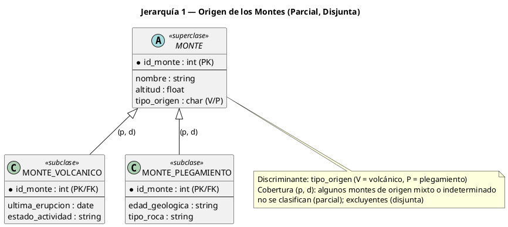
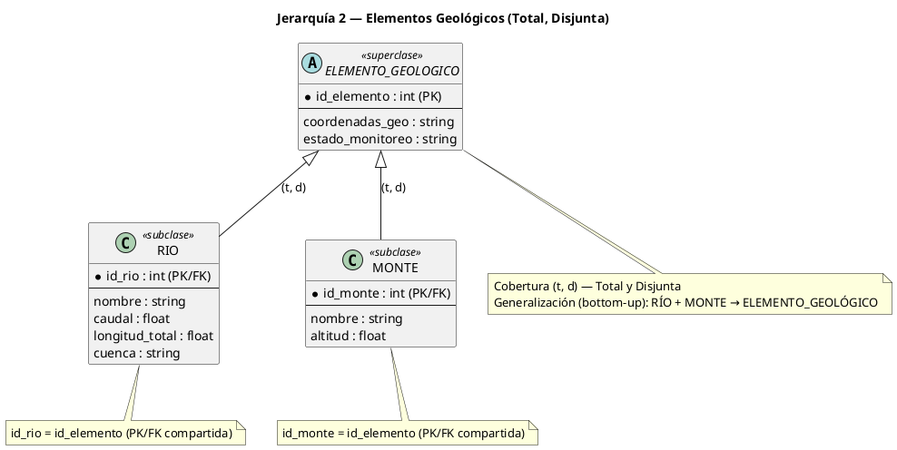
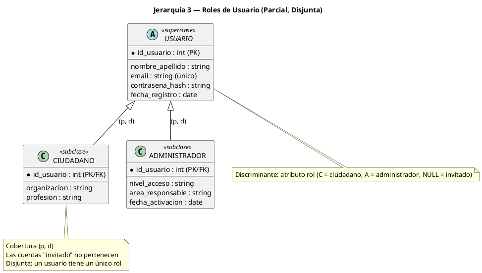
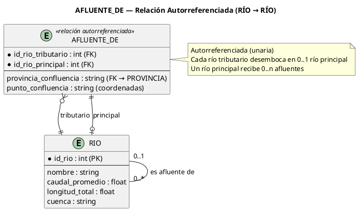
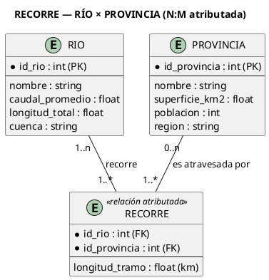
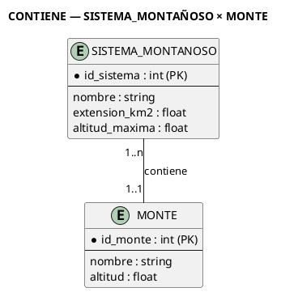
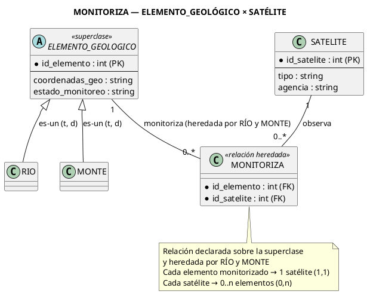
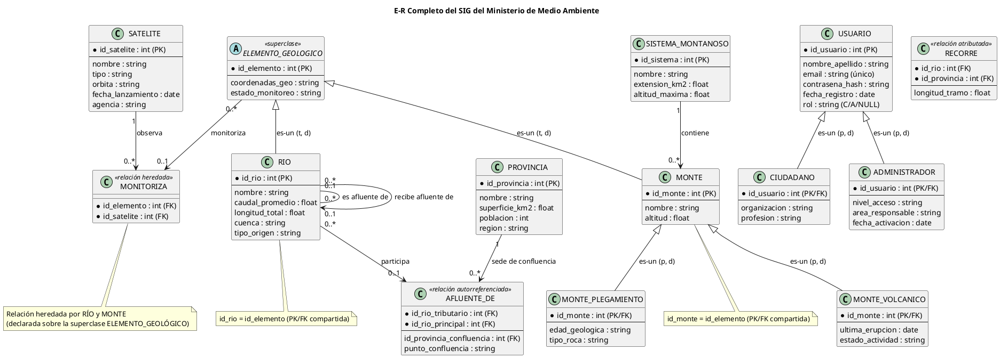

# Caso Práctico Completo: Sistema de Información Geográfica (SIG) del Ministerio de Medio Ambiente

> **Enunciado:** El Ministerio de Medio Ambiente desea construir un **Sistema de Información Geográfica (SIG)** para administrar información territorial: ríos, provincias, sistemas montañosos, montes, los satélites que monitorizan elementos naturales y los usuarios que consultan el sistema. El modelo debe aprovechar las construcciones avanzadas del **MER Extendido**: relaciones autorreferenciadas, relaciones atributadas, jerarquías de especialización y restricciones de cobertura.

**Objetivo didáctico:** aplicar, paso a paso, los conceptos de [[13_Abstraccion_y_Tipos]], [[14_Atributos_Propios_vs_Relacion]], [[15_Jerarquias_Superclase_Subclase]] y [[16_Cobertura_Jerarquias]].

---

## Paso 1: Entidades Principales y sus Atributos

Identificamos las **entidades fuertes** del dominio y sus atributos propios (con sus claves):

| Entidad | Atributos | Clave |
|---|---|---|
| **RÍO** | `nombre`, `caudal_promedio (m³/s)`, `longitud_total (km)`, `cuenca` | `id_rio` |
| **PROVINCIA** | `nombre`, `superficie_km2`, `población`, `región` | `id_provincia` |
| **SISTEMA_MONTAÑOSO** | `nombre`, `extensión_km2`, `altitud_máxima (m)` | `id_sistema` |
| **MONTE** | `nombre`, `altitud (m)` | `id_monte` |
| **SATÉLITE** | `nombre`, `tipo (óptico/radar)`, `órbita`, `fecha_lanzamiento`, `agencia` | `id_satélite` |
| **USUARIO** | `nombre_apellido`, `email (único)`, `contraseña_hash`, `fecha_registro` | `id_usuario` |

> [!NOTE] **Elección de claves**
> - Claves **artificiales** (`id_*`) porque los nombres de ríos, montes y provincias no son únicos a nivel nacional o pueden repetirse.
> - `email` además es **clave candidata** de USUARIO (ver [[03_Claves_Candidatas_y_Primaria]]).

---

## Paso 2: Jerarquías de Especialización (con su Cobertura)

### Jerarquía 1: Origen de los montes → (Parcial, Disjunta)



- **Cobertura (p, d):** se asume que algunos montes tienen **origen mixto o indeterminado**, por lo que no se clasifican (pertenencia **parcial**); y un monte no puede ser volcánico y de plegamiento a la vez (exclusividad **disjunta**).
- **Discriminante:** atributo `tipo_origen` en MONTE (V = volcánico, P = plegamiento).
- **Herencia:** ambas subclases heredan `id_monte, nombre, altitud` y las relaciones de MONTE.

### Jerarquía 2: Elementos Geológicos → (Total, Disjunta)



- **Cobertura (t, d):** el sistema solo cataloga ríos y montes como elementos geológicos (pertenencia **total**); un elemento es río o monte, nunca ambos (exclusividad **disjunta**).
- **Punto didáctico:** es una **generalización (bottom-up)** — partimos de dos entidades existentes (RÍO y MONTE) y las fusionamos en ELEMENTO_GEOLÓGICO. La clave de cada subclase coincide con `id_elemento` (PK/FK compartida).
- La relación de monitorización se declara **una sola vez** sobre la superclase y es **heredada** por ambas subclases (ver Paso 3).

### Jerarquía 3: Roles de Usuario → (Parcial, Disjunta)



- **Cobertura (p, d):** las cuentas "invitado" (sin rol asignado) no pertenecen a ninguna subclase → **parcial**; un usuario tiene un **único** rol → **disjunta**.
- El discriminante puede ser el atributo `rol` en USUARIO (C = ciudadano, A = administrador, NULL = invitado).

---

## Paso 3: Relaciones Complejas

### Relación A: Autorreferenciada — "AFLUENTE_DE" (RÍO → RÍO)

**Explicación:** un río puede ser **afluente** de otro río (el río principal). Es una relación **unaria/recursiva** sobre la misma entidad RÍO (ver [[05_Relaciones_Especiales]]).

- **Cardinalidad (mín, máx):** cada río tributario desemboca en **0..1** río principal; un río principal recibe **0..n** afluentes.
- **Atributo de relación:** `provincia_confluencia` (FK → PROVINCIA) indica **dónde ocurre la unión** de ambos cauces. Es un atributo descriptivo porque depende del par (tributario, principal): la confluencia es un hecho entre dos ríos, no una propiedad de un río solo (ver [[14_Atributos_Propios_vs_Relacion]]).



> [!WARNING] **Decisión de diseño**
> Si la confluencia puede darse en territorio fronterizo entre dos provincias, el atributo `provincia_confluencia` podría devenir en la relación ternaria `CONFLUENCIA(RÍO_TRIBUTARIO, RÍO_PRINCIPAL, PROVINCIA)`. Para este caso se asume que se elige la provincia de mayor cauce (ver supuestos).

### Relación B: Atributada — "RECORRE" (RÍO × PROVINCIA) con longitud de tramo

**Explicación:** un río atraviesa varias provincias, y en cada tramo tiene una **longitud distinta (km)**. La longitud del tramo **depende del par (río, provincia)** → atributo de relación obligatorio (N:M).

- **Cardinalidad:** RÍO participa con **(1, n)** — todo río atraviesa al menos una provincia; PROVINCIA con **(0, n)** — puede haber provincias sin ríos.
- **Atributo descriptivo:** `longitud_tramo (km)` — el caso "nota final / tramo de longitud" estudiado en [[14_Atributos_Propios_vs_Relacion]].



> [!NOTE] **¿Ternaria o binaria atributada?**
> Podría modelarse como ternaria `TRAMO(RÍO, PROVINCIA, LONGITUD)`; sin embargo, como la provincia no aporta atributos propios al tramo más allá de identificarlo, la **binaria atributada** es más simple y equivalente. La ternaria se justificaría si el tramo tuviera atributos adicionales (puntos de muestreo, temperatura, caudales estacionales).

### Relación C: "CONTIENE" — SISTEMA_MONTAÑOSO × MONTE

- **Cardinalidad:** cada SISTEMA_MONTAÑOSO contiene **(1, n)** montes; cada MONTE pertenece a **exactamente 1** sistema `(1, 1)`.
- Es una relación **jerárquica simple** padre–hijo (1:N).



### Relación D: "MONITORIZA" — ELEMENTO_GEOLÓGICO × SATÉLITE con cardinalidad (1,1)–(0,n)

**Explicación:** los satélites observan elementos geológicos (ríos o montes). La relación se declara sobre la **superclase ELEMENTO_GEOLÓGICO** y es **heredada** por RÍO y MONTE:

- **Cardinalidad exigida por el enunciado:** cada elemento monitorizado es observado por **exactamente 1 satélite (1,1)** ✓; cada satélite monitoriza **0..n** elementos (0,n).
- Solo los elementos que participan de la relación son "monitorizados"; los demás quedan fuera (la participación en la relación es la que define el subconjunto monitoreado).



> [!IMPORTANT] **La herencia en acción**
> Como MONITORIZA se declara sobre ELEMENTO_GEOLÓGICO, un río de la subclase RÍO puede participar sin redefinir la relación. Consulta típica heredada: "¿qué satélite monitorea el río X?" — responde la relación MONITORIZA.

### Relación E (extensión sugerida): CONSULTA — USUARIO × ELEMENTO_GEOLÓGICO

Cada consulta del SIG queda registrada: `CONSULTA` es **N:M atributada** con `fecha_consulta` y `tipo_consulta` (mapa, informe, alerta). Incluirla permite auditoría (quién consultó qué) — útil para perfiles de uso.

---

## Paso 4: Diagrama E-R Completo (Mermaid)



> [!NOTE] **Lectura de las flechas "es-un" en Mermaid**
> Las relaciones `|o--o|` con etiqueta "es-un" representan la **jerarquía** (subconjunto ⊆ superconjunto): no son relaciones de negocio sino de especialización. En notación de pizarrón se dibujan como círculo + letras (d/s) + línea doble/simple (t/p).

---

## Paso 5: Implementación SQL Esquemática

```sql
-- Superclases
CREATE TABLE ELEMENTO_GEOLOGICO (
    id_elemento      INT PRIMARY KEY,
    coordenadas_geo  VARCHAR(60),
    estado_monitoreo VARCHAR(20)
);

-- Subclase RÍO (PK/FK compartida con la superclase)
CREATE TABLE RIO (
    id_rio          INT PRIMARY KEY REFERENCES ELEMENTO_GEOLOGICO(id_elemento),
    nombre          VARCHAR(80) NOT NULL,
    caudal_promedio DECIMAL(10,2),
    longitud_total  DECIMAL(10,2),
    cuenca          VARCHAR(60)
);

-- Subclase MONTE
CREATE TABLE MONTE (
    id_monte    INT PRIMARY KEY REFERENCES ELEMENTO_GEOLOGICO(id_elemento),
    id_sistema  INT NOT NULL REFERENCES SISTEMA_MONTANOSO(id_sistema),
    nombre      VARCHAR(80) NOT NULL,
    altitud     DECIMAL(8,2)
);

-- Origen: partición (p,d) con atributos propios
CREATE TABLE MONTE_VOLCANICO (
    id_monte         INT PRIMARY KEY REFERENCES MONTE(id_monte),
    ultima_erupcion  DATE,
    estado_actividad VARCHAR(30)
);
CREATE TABLE MONTE_PLEGAMIENTO (
    id_monte        INT PRIMARY KEY REFERENCES MONTE(id_monte),
    edad_geologica  VARCHAR(30),
    tipo_roca       VARCHAR(40)
);

-- Relación autorreferenciada con la provincia de unión
CREATE TABLE AFLUENTE_DE (
    id_rio_tributario      INT REFERENCES RIO(id_rio),
    id_rio_principal       INT REFERENCES RIO(id_rio),
    id_provincia_confluencia INT REFERENCES PROVINCIA(id_provincia),
    punto_confluencia      VARCHAR(60),
    PRIMARY KEY (id_rio_tributario, id_rio_principal)
);

-- Relación atributada N:M
CREATE TABLE RECORRE (
    id_rio         INT REFERENCES RIO(id_rio),
    id_provincia   INT REFERENCES PROVINCIA(id_provincia),
    longitud_tramo DECIMAL(10,2) NOT NULL,
    PRIMARY KEY (id_rio, id_provincia)
);

-- Relación de monitorización heredada
CREATE TABLE MONITORIZA (
    id_elemento  INT REFERENCES ELEMENTO_GEOLOGICO(id_elemento),
    id_satelite  INT REFERENCES SATELITE(id_satelite),
    PRIMARY KEY (id_elemento, id_satelite)
);
```

> [!TIP] **Integridad de la jerarquía**
> La PK de RIO/MONTE es a la vez FK hacia ELEMENTO_GEOLOGICO: un río no puede existir sin su fila en la superclase (garantiza la pertenencia **total**). El discriminante `tipo_origen` + CHECK controla la **disyunción**.

---

## Paso 6: Supuestos y Restricciones Documentadas

### Supuestos de dominio (decisiones que justifican el modelo)

1. **Afluencia:** cada río desemboca en **a lo sumo un** río principal (0..1). Los ríos que desembocan en el mar/u océano no participan en AFLUENTE_DE (participación opcional).
2. **Provincia de confluencia:** cuando la unión de dos cauces ocurre en el límite entre provincias, se registra la provincia de **mayor cauce** en ese punto. Si esto no fuese aceptable, el atributo pasaría a ser la relación ternaria CONFLUENCIA(RÍO_T, RÍO_P, PROVINCIA).
3. **Origen de los montes:** los montes de **origen mixto o indeterminado** no se clasifican en la jerarquía (justifica la cobertura **parcial**). Se asume que, si se clasifican, el origen es único (justifica **disjunta**).
4. **Catálogo de elementos:** el sistema solo administra ríos y montes como elementos geológicos. Si mañana se agregan glaciares o lagos, la cobertura de la Jerarquía 2 debería cambiar de **total** a **parcial** y añadir la nueva subclase.
5. **Monitorización:** cada elemento monitorizado es observado por **exactamente un satélite (1,1)**. Si el ministerio firmara convenios con más agencias, la cardinalidad mínima subiría a (0,n) y el modelo seguiría siendo válido.
6. **Satélites externos:** los satélites pertenecen a agencias (CONAE, NASA, ESA); el ministerio **no administra** sus órbitas, solo referencia su `id_satélite`, `tipo` y `fecha_lanzamiento`.
7. **Roles:** una cuenta sin rol es "invitado" (no se modela como subclase); el rol se codifica en el discriminante `rol` (C/A/NULL).
8. **Longitud total vs. tramo:** `longitud_total` (atributo de RÍO) es independiente de la suma de los `longitud_tramo` (atributo de relación): puede no coincidir por errores de medición o tramos no demarcados.

### Restricciones de negocio NO modelables en el diagrama E-R

| Restricción | Tipo | Dónde se implementa |
|---|---|---|
| `email` único y formato válido | Integridad de datos | UNIQUE + CHECK en USUARIO |
| Edad mínima (18 años) para ser administrador | Regla de negocio | Trigger/validación de aplicación |
| Contraseñas almacenadas con hash (nunca en claro) | Seguridad | Capa de aplicación |
| Eliminación en cascada: al borrar un río principal se eliminan sus AFLUENTE_DE | Integridad referencial | ON DELETE CASCADE |
| Un monte pertenece al menos a un sistema montañoso | Integridad referencial | CHECK + FK NOT NULL |
| Registro de auditoría de consultas (quién/cuándo/qué) | Regla de negocio | Tabla CONSULTA + triggers |
| Acceso diferenciado por rol (administrador puede editar; ciudadano solo lee) | Autorización | Capa de aplicación, NO en el E-R |
| Concurrencia: dos usuarios editando el mismo monte no deben perderse datos | Control de concurrencia | Versionado/locking en la BD |

> [!WARNING] **¿Qué NO puede expresar el diagrama E-R?**
> El modelo E-R NO modela: reglas temporales ("un ciudadano no puede consultar más de 100 veces al día"), autorizaciones, flujos de aprobación ni derivaciones de cálculo. Estas restricciones se documentan y se implementan fuera del diagrama (triggers, procedimientos, aplicación).

---

## Resumen del Caso

| Construcción MERE | Ejemplo del caso | Nota de referencia |
|---|---|---|
| Agregación (atributos → entidad) | RÍO = {nombre, caudal, longitud, cuenca} | [[13_Abstraccion_y_Tipos]] |
| Asociación (entidades → relación) | RECORRE, CONTIENE, MONITORIZA | [[04_Relaciones_y_Cardinalidades]] |
| Relación autorreferenciada | AFLUENTE_DE con provincia de confluencia | [[05_Relaciones_Especiales]] |
| Relación atributada N:M | RECORRE con longitud_tramo | [[14_Atributos_Propios_vs_Relacion]] |
| Jerarquía con herencia Is-A | ELEMENTO_GEOLÓGICO → RÍO / MONTE | [[15_Jerarquias_Superclase_Subclase]] |
| Cobertura Total/Disjunta | ELEMENTO_GEOLÓGICO (t,d) | [[16_Cobertura_Jerarquias]] |
| Cobertura Parcial/Disjunta | MONTE → VOLCÁNICO/PLEGAMIENTO; USUARIO → CIUDADANO/ADMIN | [[16_Cobertura_Jerarquias]] |
| Cardinalidades (mín, máx) | MONITORIZA (1,1)–(0,n) | [[04_Relaciones_y_Cardinalidades]] |
| Generalización (bottom-up) | RÍO + MONTE → ELEMENTO_GEOLÓGICO | [[09_MER_Extendido]] |

---

## 🔗 Notas Relacionadas

- [[13_Abstraccion_y_Tipos]] — Las 4 abstracciones aplicadas a este caso
- [[14_Atributos_Propios_vs_Relacion]] — Longitud de tramo y provincia de confluencia
- [[15_Jerarquias_Superclase_Subclase]] — Herencia y regla Is-A
- [[16_Cobertura_Jerarquias]] — (t,d), (p,d) usadas en el caso
- [[04_Relaciones_y_Cardinalidades]] — Cardinalidades N:M y (mín, máx)
- [[05_Relaciones_Especiales]] — Relaciones unarias (autorreferenciadas)
- [[09_MER_Extendido]] — Generalización, especialización y agregación