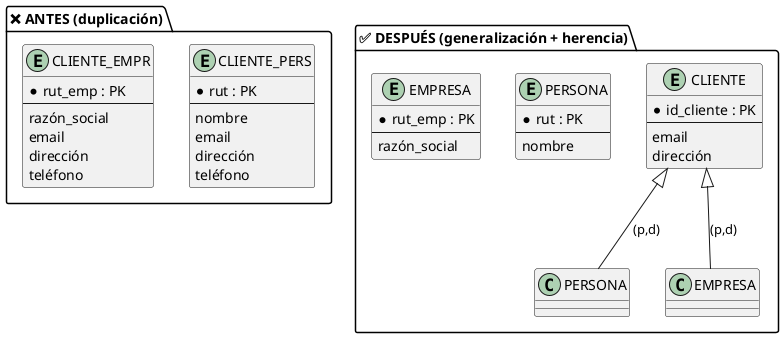
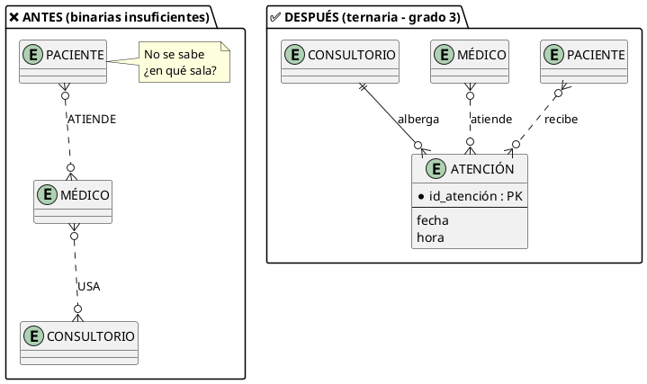

# Detección y Análisis de Errores Frecuentes de Diseño (Anti-patrones MER)

> **Definición:** Un **anti-patrón** es una solución de diseño que **parece razonable** pero que, a mediano plazo, degrada la calidad del esquema: genera redundancia, ambigüedad, anomalías o inflexibilidad. Conocer los anti-patrones permite **detectarlos en revisión** y **corregirlos con el patrón adecuado**.

| Anti-patrón | Síntoma típico | Cualidad que daña ([[18_Cualidades_Esquema_Conceptual]]) |
|---|---|---|
| Confundir atributo ↔ entidad | Casillas "la cosa" que es un dato o datos que son "la cosa" | Completitud, Normalidad |
| Omitir generalización / herencia | Entidades repetidas con atributos idénticos | Minimalidad, Extensibilidad |
| Grado erróneo en relaciones | Relación binaria que no puede responder hechos de 3+ actores | Corrección |
| Olvidar PK o cardinalidades | Diagramas sin claves ni (mín, máx) | Corrección, Autoexplicación |

---

## Anti-patrón 1: Confundir Atributos con Entidades (y viceversa)

### Explicación Teórica

Ocurre en **dos direcciones**:

1. **Tratar como atributo algo que es entidad:** cuando el "dato" tiene **atributos propios**, se relaciona con otras entidades o es **multivaluado** (puede tomar varios valores por instancia) → debe ser entidad (criterios de [[07_Criterios_de_Diseño]] y nota 14).
2. **Tratar como entidad algo que es atributo:** cuando la "entidad" no tiene atributos propios, ni relaciones, ni identidad independiente — es solo un valor enumerado o un descriptor del padre → debe ser atributo.

### Ejemplo Práctico

**Clínica:** cada paciente tiene **varios teléfonos** y cada teléfono podría tener tipo (casa, móvil, trabajo). Modelar `PACIENTE(tel_1, tel_2, tel_3)` es el clásico "atributo multivaluado disfrazado de columnas".

### Violación vs. Solución Optimizada

| ❌ Violación | ✅ Solución |
|---|---|
| `PACIENTE(id_paciente, nombre, tel_1, tel_2, tel_3)` | `PACIENTE (1,1) —TIENE— TELÉFONO (0,n)` con `TELÉFONO(número, tipo)` |
| ¿Y si llega un 4º teléfono? → rediseño | Agregar una fila; extensible (Cualidad 8) |
| **Inverso:** `COLOR` como entidad con una sola relación y cero atributos propios | `COLOR` como atributo enumerado de PRODUCTO |

> [!TIP] **Prueba rápida ("el test del atributo")**
> Si el candidato a entidad **solo existe para describir a otra entidad** y no tiene atributos propios ni es destino de otras relaciones → es un atributo. Si el "atributo" puede tener **2+ valores** o **atributos propios** → es una entidad.

---

## Anti-patrón 2: Omitir Generalizaciones / Especializaciones o su Herencia

### Explicación Teórica

Cuando **varias entidades comparten un conjunto significativo de atributos y relaciones**, se debe aplicar **generalización** ([[13_Abstraccion_y_Tipos]], [[15_Jerarquias_Superclase_Subclase]]) y declarar la **herencia**. Omitirla produce:

- **Duplicación**: los atributos comunes se copian en cada entidad (viola Minimalidad).
- **Anomalías**: un cambio en el dato común exige actualizar todas las copias (viola Normalidad).
- **Rigidez**: agregar un nuevo tipo obliga a duplicar de nuevo (viola Extensibilidad).

El error inverso — **omitir la herencia** — consiste en no aprovechar las relaciones del supertipo: se vuelven a dibujar los vínculos en cada subclase.

### Ejemplo Práctico

**Banco/universidad:** `CLIENTE_PERSONA(rut, nombre, email, dirección)` y `CLIENTE_EMPRESA(rut_empresa, razón_social, email, dirección, gerente)`. El email y la dirección están duplicados; si el email cambia, hay que saber en qué tabla vive.

### Violación vs. Solución Optimizada

| ❌ Violación | ✅ Solución |
|---|---|
| Dos tablas con `email`, `dirección` repetidos | `CLIENTE(id_cliente, email, dirección)` superclase |
| `CLIENTE_PERSONA` y `CLIENTE_EMPRESA` sin relación con la superclase | Subclases que **heredan** email/dirección y agregan lo propio |
| Nueva subclase `CLIENTE_GOBIERNO` → copiar todo otra vez | Nueva subclase → solo sus atributos nuevos (extensible) |

> [!WARNING] **La herencia también se olvida**
> Si la superclase CLIENTE tiene la relación `—REALIZA— PEDIDO`, las subclases PERSONA y EMPRESA **heredan** esa relación. Redibujar PEDIDO en cada subclase es el mismo anti-patrón.

---

## Anti-patrón 3: Definir Grados Erróneos en Relaciones (Binaria vs. Ternaria)

### Explicación Teórica

El **grado** de una relación es el número de entidades participantes (2 = binaria, 3 = ternaria, n = n-aria, ver [[05_Relaciones_Especiales]]). El error típico es **usar una binaria cuando el hecho depende de tres o más actores**, perdiendo información: el modelo ya no puede responder "¿quién participó en este hecho?".

**Regla de decisión:** si el significado del vínculo cambia según una **tercera entidad**, la relación es ternaria (o se resuelve como entidad asociativa). Si se puede responder el hecho entre A y B sin saber quién es C, es binaria.

### Ejemplo Práctico

**Clínica/universidad:** *"Un paciente se atiende con un médico, en un consultorio, en una fecha"*. La atención **depende de los tres a la vez**: el par (paciente, médico) no basta — hay que saber en qué sala y cuándo.

### Violación vs. Solución Optimizada

| ❌ Violación (binaria insuficiente) | ✅ Solución (ternaria / entidad asociativa) |
|---|---|
| `PACIENTE—ATIENDE—MÉDICO` y `MÉDICO—USA—CONSULTORIO` | `ATENCIÓN(PACIENTE, MÉDICO, CONSULTORIO, fecha, hora)` |
| No se puede responder "¿en qué sala se atendió?" | La tupla (paciente, médico, sala, fecha) existe completa |
| La binaria obliga a "inventar" relaciones indirectas | Grado correcto = la información se conserva íntegra |

> [!NOTE] **Elección de implementación**
> La relación ternaria se implementa como tabla con **clave compuesta** de las 3 entidades (más sus atributos). Si además la relación acumula varios atributos (diagnóstico, receta, estado), conviene **elevarla a entidad** `ATENCIÓN(id_atención, ...)`: es la misma semántica, mejor implementación (ver [[14_Atributos_Propios_vs_Relacion]]).

---

## Anti-patrón 4: Olvidar Identificadores (PK) o Especificaciones de Cardinalidad

### Explicación Teórica

Dos omisiones que parecen menores y son graves:

1. **Entidad sin Clave Primaria:** toda entidad debe tener un identificador único (o ser **entidad débil** con clave parcial, ver [[06_Entidades_Debiles_vs_Regulares]] y [[03_Claves_Candidatas_y_Primaria]]). Sin PK, no hay forma de referirse a una instancia concreta: ni FK, ni integridad, ni consulta confiable.
2. **Relaciones sin cardinalidades (mínimo/máximo):** si el diagrama no especifica cuántas veces participa cada entidad, el modelo admite **interpretaciones contradictorias** (¿un pedido tiene 1 o N productos?). La notación **(mín, máx)** elimina la ambigüedad.

### Ejemplo Práctico

**E-commerce:** el diagrama muestra `CLIENTE —REALIZA— PEDIDO` sin números, y la entidad `PRODUCTO` sin clave. Dos diseñadores interpretarán cosas distintas: uno dirá "un pedido es de un solo producto", otro "de varios". El modelo es **no validable**.

### Violación vs. Solución Optimizada

| ❌ Violación | ✅ Solución |
|---|---|
| `PRODUCTO(nombre, precio)` — sin PK | `PRODUCTO(id_producto PK, nombre, precio)` |
| `CLIENTE —REALIZA— PEDIDO` (sin números) | `CLIENTE (0,n) —REALIZA— PEDIDO (1,1)`: un pedido tiene un único cliente; un cliente puede tener 0..n pedidos |
| `PEDIDO —CONTINE— PRODUCTO` | `PEDIDO (0,n) —CONTINE— PRODUCTO (0,n)` con la tabla intermedia y su `cantidad` |

> [!TIP] **Autoevaluación de cardinalidades**
> Para cada relación, lea en voz alta ambos sentidos: *"Un X puede tener entre a y b Ys"* y *"Un Y puede pertenecer a entre c y d Xs"*. Si no puede completar la frase, falta especificar la cardinalidad.

---

## 📌 Tabla Resumen: Antes → Después

| Anti-patrón | Detección | Corrección |
|---|---|---|
| Atributo ↔ Entidad | Test del atributo (multivaluado o con atributos → entidad) | Entidad hija o catálogo |
| Sin generalización | Atributos comunes repetidos en 2+ entidades | Superclase + subclases con herencia |
| Grado erróneo | Un hecho depende de 3+ actores y se modela binario | Relación ternaria o entidad asociativa |
| Sin PK / sin (mín,máx) | Entidades sin identificador; rombos sin números | PK explícitas + cardinalidades en ambos sentidos |

> [!IMPORTANT] **Conexión con las cualidades**
> Cada anti-patrón degrada cualidades medibles de [[18_Cualidades_Esquema_Conceptual]]: la corrección se daña con grados errados y PK ausentes; la minimalidad y extensibilidad con la falta de generalización; la normalidad con atributos mal ubicados. Diagnosticar los 4 anti-patrones cubre buena parte del checklist de calidad.

---

## 🔗 Notas Relacionadas

- [[07_Criterios_de_Diseño]] — Criterios atributo vs. entidad (anti-patrón 1)
- [[14_Atributos_Propios_vs_Relacion]] — Dónde va cada dato (anti-patrón 1 y 4)
- [[15_Jerarquias_Superclase_Subclase]] y [[16_Cobertura_Jerarquias]] — Generalización y cobertura (anti-patrón 2)
- [[05_Relaciones_Especiales]] — Relaciones n-arias (anti-patrón 3)
- [[03_Claves_Candidatas_y_Primaria]] — Identificadores (anti-patrón 4)
- [[18_Cualidades_Esquema_Conceptual]] — Las 8 cualidades que estos errores degradan
- [[20_Taller_Diagnostico_Calidad]] — Taller donde se detectan estos 4 anti-patrones en un caso real