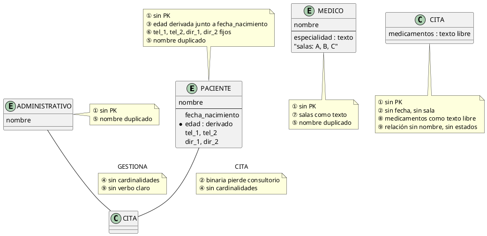
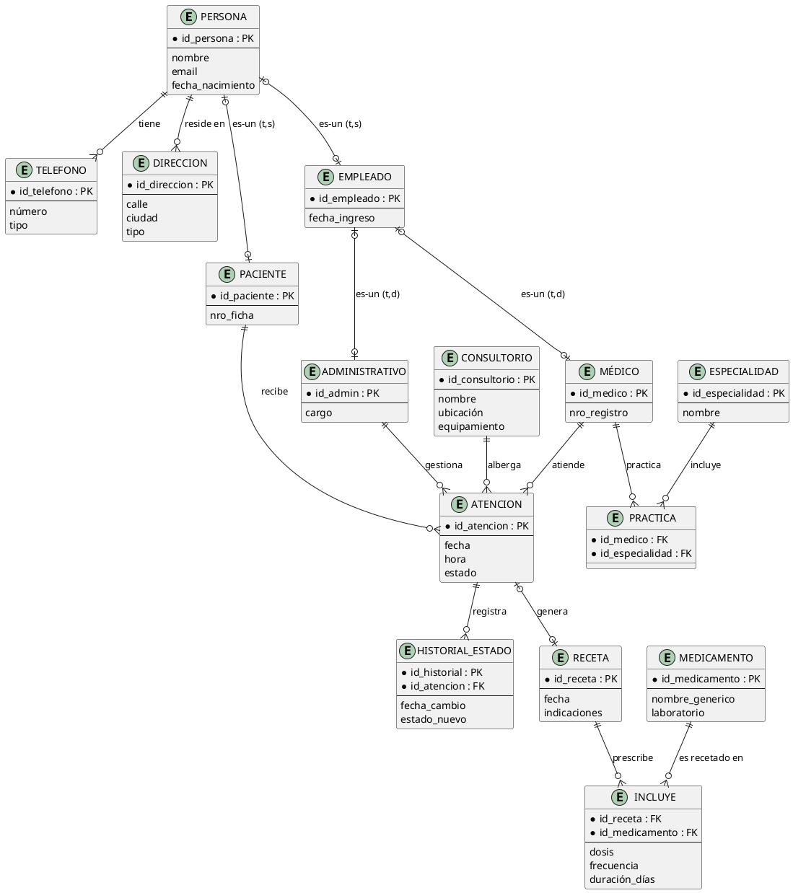
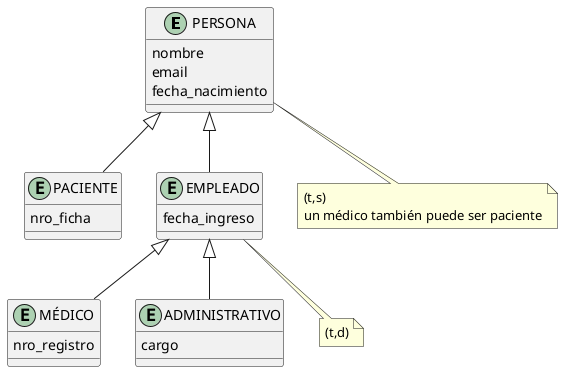

# Taller Práctico de Diagnóstico de Calidad

> **Objetivo:** aplicar el checklist de las **8 cualidades** de [[18_Cualidades_Esquema_Conceptual]] y los **4 anti-patrones** de [[19_Antipatrones_MER]] sobre un diagrama conceptual **deficiente**, identificar cada incumplimiento, proponer la solución corregida y justificar técnicamente el rediseño.

---

## Enunciado del Caso: Centro Médico "VidaSana"

| Requisito | Descripción del negocio |
|---|---|
| R1 | Registrar pacientes con sus datos personales, **varios teléfonos** y **varias direcciones** |
| R2 | Registrar médicos con su especialidad; cada médico **atiende en varios consultorios** y horarios |
| R3 | Gestionar citas: un paciente se atiende con un médico **en un consultorio** y en una **fecha/hora**; la cita tiene un **estado** (agendada, confirmada, cancelada, realizada) |
| R4 | Cada atención genera **una receta médica** con medicamentos y su dosis |
| R5 | El personal **administrativo** gestiona las citas; debe distinguirse de los médicos |
| R6 | Conservar el **historial** de estados de cada cita (una cita cancelada no se borra) |

---

## Paso 1: Diagrama Conceptual Deficiente (propuesta recibida)

Se recibió la siguiente propuesta de un diseñador novato. Las anotaciones ①…⑨ marcan los defectos:

| # | Defecto observable |
|---|---|
| ① | Entidades sin **clave primaria** |
| ② | **CITA binaria**: no existe el consultorio ni la fecha en la relación (el hecho depende de 3 actores) |
| ③ | `edad` almacenada junto a `fecha_nacimiento` (dato **derivable**) |
| ④ | Ninguna relación declara **cardinalidades (mín, máx)** |
| ⑤ | `PACIENTE`, `MEDICO`, `ADMINISTRATIVO` **duplican** nombre/datos → sin generalización |
| ⑥ | `tel_1, tel_2, dir_1, dir_2` fijos → atributos multivaluados mal modelados |
| ⑦ | Las salas como texto dentro de MÉDICO (atributo vs. entidad: CONSULTORIO no existe) |
| ⑧ | "medicamentos" como texto libre en CITA → no se puede consultar por medicamento ni guardar dosis |
| ⑨ | La relación CITA no tiene verbo; faltan estados de cita (R3) e historial (R6) |

---

## Paso 2: Identificación de Incumplimientos de Calidad

### 2.1 Mapeo de defectos → cualidades ([[18_Cualidades_Esquema_Conceptual]])

| Defecto | Cualidad incumplida | Explicación |
|---|---|---|
| ②⑧⑨ | **Completitud** | No se puede responder: "¿en qué consultorio se atiende?", "¿qué medicamentos lleva la receta?", "¿qué citas están confirmadas?" |
| ②④① | **Corrección** | Notación sin cardinalidades, grado binario equivocado (semánticamente falso), entidades sin identificador |
| ③ | **Minimalidad** | `edad` es derivable de `fecha_nacimiento` |
| ⑦⑨ | **Expresividad / Autoexplicación** | "salas: A,B,C" y rombo sin verbo exigen notas externas para entenderse |
| ②④ | **Legibilidad** | Relaciones sin orden ni etiquetas claras → el diagrama no se puede recorrer |
| ⑤⑥⑧ | **Normalidad** | Datos repetidos (nombre en 3 entidades, salas en texto) → anomalías de actualización |
| ⑤⑥⑦ | **Extensibilidad** | Un 3er teléfono, una sala nueva o una especialidad nueva exigen cambios de estructura, no de datos |

### 2.2 Detección de anti-patrones ([[19_Antipatrones_MER]])

| Anti-patrón | Evidencia en el caso |
|---|---|
| **1. Atributo ↔ Entidad** | ⑥ teléfonos/direcciones como columnas; ⑦ consultorios como texto |
| **2. Sin generalización** | ⑤ tres entidades con `nombre` duplicado; sin PERSONA superclase |
| **3. Grado erróneo** | ② CITA binaria cuando el hecho es (paciente, médico, consultorio, fecha) |
| **4. Sin PK / sin cardinalidades** | ① sin claves; ④ rombos sin (mín, máx) |

> [!NOTE] **Conclusión del diagnóstico**
> La propuesta **no es aceptable**: incumple 8/8 cualidades y contiene los **4 anti-patrones**. No es un problema de "detalles": el modelo no puede responder los requisitos R1–R6 del enunciado.

---

## Paso 3: Propuesta de Solución Estructurada y Corregida

### 3.1 Estructura corregida (resumen de decisiones)

| Decisión | Patrón aplicado | Resuelve |
|---|---|---|
| D1 | **PERSONA** (superclase) → subclases **PACIENTE** y **EMPLEADO** (t, s); EMPLEADO → **MÉDICO** / **ADMINISTRATIVO** (t, d) | ⑤ |
| D2 | Entidades **TELÉFONO** y **DIRECCIÓN** (0,n) dependientes de PERSONA | ⑥ |
| D3 | Entidad catálogo **ESPECIALIDAD** + relación `MÉDICO—PRACTICA—ESPECIALIDAD` (0,n)-(1,1) | ⑦, extensibilidad |
| D4 | Entidad **CONSULTORIO** con atributos propios | ⑦ |
| D5 | **ATENCIÓN** como entidad asociativa (elevación de la ternaria): FK a PACIENTE, MÉDICO, CONSULTORIO + `fecha`, `hora`, `estado` | ②, ⑨ |
| D6 | Entidad débil **HISTORIAL_ESTADO** dependiente de ATENCIÓN (fecha, estado_nuevo) → conserva el historial (R6) | ⑨ |
| D7 | **RECETA** (1,1) asociada a ATENCIÓN (0,1) + **MEDICAMENTO** catálogo + `RECETA—INCLUYE—MEDICAMENTO` (N:M con `dosis, frecuencia, duración`) | ⑧ |
| D8 | Claves primarias explícitas y cardinalidades (mín, máx) en **todas** las relaciones | ①, ④ |
| D9 | Eliminar `edad` (atributo derivado); conservar solo `fecha_nacimiento` | ③ |

### 3.2 Diagrama corregido

### 3.3 Jerarquías con su cobertura explícita

> [!NOTE] **Por qué (t,s) en PERSONA**
> Todo individuo registrado en el centro tiene al menos un rol (total); un MÉDICO puede además ser PACIENTE del mismo centro (superpuesta). En EMPLEADO, en cambio, ser médico o administrativo es excluyente (t,d). Ver [[16_Cobertura_Jerarquias]].

---

## Paso 4: Justificación Técnica del Diseño Optimizado

### 4.1 Justificación decisión por decisión

| Decisión | Justificación técnica | Cualidad / Anti-patrón |
|---|---|---|
| D1 | Los atributos `nombre, email, fecha_nacimiento` viven una sola vez en PERSONA; las subclases **heredan** y agregan lo propio (`nro_ficha`, `nro_registro`, `cargo`). El cambio de email se hace en 1 lugar | Minimalidad, Normalidad; anti-patrón 2 |
| D5 | ATENCIÓN con 3 FK (paciente, médico, consultorio) conserva el hecho completo "quién-atendió-a-quién-dónde-y-cuándo"; consultar la sala o la fecha es directo | Completitud, Corrección; anti-patrón 3 |
| D6 | Cada cambio de estado es una fila nueva en HISTORIAL_ESTADO: R6 se cumple sin borrado físico; la entidad depende de ATENCIÓN (entidad débil con su clave parcial `fecha_cambio`) | Completitud; R6 |
| D7 | `INCLUYE (N:M)` con `dosis, frecuencia, duración` permite consultar "¿a cuántos pacientes se recetó paracetamol?" — imposible con texto libre | Completitud, Normalidad; anti-patrón 1 |
| D3–D4 | Catálogos (ESPECIALIDAD, MEDICAMENTO, CONSULTORIO) hacen que **agregar un valor sea insertar una fila**, no modificar el esquema | Extensibilidad |
| D9 | `edad` se calcula con `fecha_nacimiento` al consultar; no hay dos fuentes de verdad que puedan desincronizarse | Minimalidad; anti-patrón de redundancia |
| D8 | PK en toda entidad y (mín, máx) en cada rombo eliminan toda ambigüedad de interpretación | Corrección, Autoexplicación |

### 4.2 Validación final contra el checklist de las 8 cualidades

| Cualidad | ¿Cómo se cumple ahora? | Estado |
|---|---|---|
| Completitud | R1–R6 representados: teléfonos, direcciones, citas, consultorios, recetas, roles, historial | ✅ |
| Corrección | Notación estándar; grados correctos; (mín,máx) en todas las relaciones | ✅ |
| Minimalidad | `edad` eliminada; `nombre` en un solo sitio (PERSONA) | ✅ |
| Expresividad | Nombres del dominio: ATENCIÓN, RECETA, CONSULTORIO, HISTORIAL_ESTADO | ✅ |
| Legibilidad | Entidades fuertes al centro, catálogos y débiles en los bordes | ✅ |
| Autoexplicación | Cada rombo tiene verbo y cardinalidades: "MÉDICO (0,n) ATIENDE (1,1) ATENCIÓN" | ✅ |
| Normalidad | Sin repeticiones; dependencias resueltas en 3FN; RECETA sin datos del paciente | ✅ |
| Extensibilidad | Nuevas especialidades, salas, medicamentos, teléfonos = nuevas filas | ✅ |

> [!TIP] **Conclusión**
> El primer diagrama fallaba por **decisión**, no por falta de requisitos: se modeló lo que "se veía" (cajas y rombos) en lugar de lo que el negocio **necesita responder**. La metodología de diagnóstico es siempre la misma: **enunciado → checklist de cualidades → anti-patrones → rediseño → revalidación**. Con eso, un esquema deficiente se convierte en un modelo aceptable en una sola iteración.

---

## 📌 Resumen del Taller

1. **Diagnóstico:** 9 defectos localizados → 8/8 cualidades incumplidas + los 4 anti-patrones presentes.
2. **Rediseño:** 9 decisiones (D1–D9) aplicando generalización, entidades asociativas, catálogos y entidades débiles.
3. **Revalidación:** el esquema corregido cumple las 8 cualidades y satisface R1–R6.
4. **Lección:** la calidad no se "revisa al final": se diseña con el checklist desde el primer boceto.

---

## 🔗 Notas Relacionadas

- [[18_Cualidades_Esquema_Conceptual]] — El checklist de las 8 cualidades usado en el Paso 2
- [[19_Antipatrones_MER]] — Los 4 anti-patrones detectados en el Paso 2
- [[15_Jerarquias_Superclase_Subclase]] y [[16_Cobertura_Jerarquias]] — D1 (jerarquías y cobertura)
- [[05_Relaciones_Especiales]] — D5 (grado de ATENCIÓN)
- [[06_Entidades_Debiles_vs_Regulares]] — D6 (HISTORIAL_ESTADO como entidad débil)
- [[14_Atributos_Propios_vs_Relacion]] — D7 (dosis como atributo de relación N:M)
- [[07_Criterios_de_Diseño]] — D2, D3, D4 (atributo vs. entidad)
- [[01_Etapas_del_Diseño_de_BD]] — Proceso completo del que el taller es la Etapa 2 aplicada